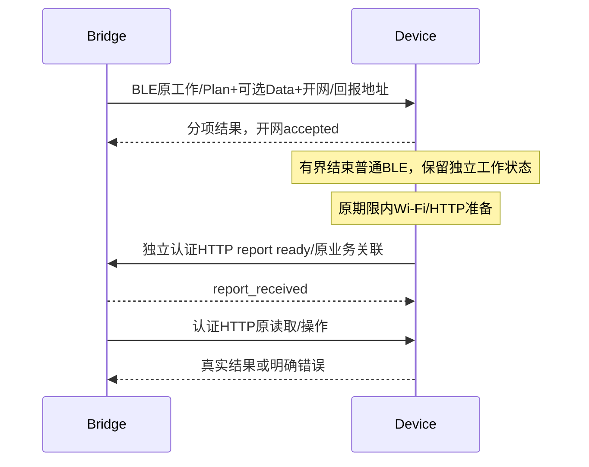

# Bridge—设备下层通信：场景与执行规则

修订：2026-10-11。本文定义**应有行为**，不描述具体报文、函数、UUID 或固定超时值，也不声称这些场景已经完整实现。报文映射见 [协议文档](bridge-device-protocol.md)，当前源码证据与验收边界见 [实现对照](bridge-device-communication-implementation.md)。

本文正文已按最新用户方向统一：BLE接纳后提前结束普通通道，HTTP准备及报告独立完成；旧保留BLE至handoff的顺序只作为实现对照，不是本设计验收条件。

## 1. 三个独立层次

### 2026-10-11 用户确认：BOOT、HTTP 与 BLE 生命周期

最终合同与实施验收见[BOOT/GATT、计划恢复与OTA](../project-workflow/bridge-macos/note4-boot-gatt-followup-20261011.md)。本节覆盖当天早先的“Light 断网也不恢复 BLE”约束。

首次休眠物理BOOT建立300秒Light与120秒临时BLE配置机会，手动GATT常开状态仍为OFF；先通过 BLE 获取 Bridge 对已保存网络的激活选择（不携密码）；无有效选择回退上次成功连接的配置。后续短按从OFF开始交替开启/关闭手动GATT：关闭不延长、不强行中断必要交汇；再次开启从该次物理按键重新计算两个窗口，保持当前 Wi-Fi 激活配置。通信、读取和重复消息不延期。

Wi-Fi 与目标 Bridge HTTP 正常时，设备主动通过 HTTP 联系，不进行普通 BLE 交汇。用户开启的蓝牙窗口仅供 Bridge 主动 GATT，USB 不自动开启蓝牙。关闭 BLE 并释放其功耗锁只证明具备 light sleep 条件，实际低功耗须实测。

关联/DHCP失败与已有 Wi-Fi 但 Bridge HTTP 失败分别记录，两者都进入联网失败流程：通过正常有界 BLE 机会报告本次失败，结束本轮后等下个周期，不能在报告轮重新开网。无人接收沿普通尝试周期，不新增无限汇报重试层。蓝牙开放配置关闭不禁止恢复交汇。

HTTP 联系不改变既有业务方向、owner、原事务与 ACK 规则；业务修订拒绝不能冒充网络失败。当前实现沿用30秒主动联系、连续3次失败及已有BLE周期/窗口；所有尝试受当前有效在线期限约束，低电和物理关机优先。当前Note4部署与其他场景未验边界分别记录。

| 层次 | 回答的问题 | 输出 |
|---|---|---|
| 高层业务合同 | 操作什么、需要何种权限、何时业务完成？ | 冻结业务意图及业务结果 |
| 下层执行规则（本文） | 当前怎么通信，何时开/关通道，失败如何收尾？ | 可用通道、有限机会及明确通信结果 |
| 具体载体协议 | 每一步发什么、如何编码、如何关联响应？ | HTTP/GATT 消息及解码结果 |

同一场景可以换实现或报文而不改变应有行为。Bundle、OTA 与模板激活选用 HTTP 是载体分工；高层不因 HTTP 是直接可用还是由 BLE 恢复而改变事务及完成判据。

### 日常联系的载体范围（用户确认）

日常交互以设备主动联系 Bridge、交换当前状态及本轮必要工作为方向。设备主动联系不等于设备必须作为 GATT central 发起连接：当前 BLE 可由设备广播提供机会、Bridge central 建链；日常由谁提供联系机会与链路角色分别定义。

**本轮状态交换、小数据或控制若能在 BLE 能力及原预算内完成，就在 BLE 内完成执行与结果反馈，不为日常联系启动 Wi-Fi 或 HTTP 服务，也不进入 HTTP ready/handoff 流程。** “设备主动联系”不意味着采用周期 HTTP 轮询。

只有本轮存在确需 HTTP 的已授权工作，或 BLE 缺少必要能力/完整设备合同且必须取得 HTTP 信息时，下层才准备 HTTP。未知 data_contract 不能据此发送不完整 Data，也不能把原本 BLE 可完成的工作一律升为 HTTP。已有可用 HTTP 的显式请求保持直达，不要求先走 BLE。

真实push可见变化所创建的正式Light计划负责激活Wi-Fi在线窗口：小Data仍可在BLE联合Plan内确认，联网激活应作为该Plan原事务的效果，不等待下一次诊断会合或要求额外的独立激活业务指令。普通BLE空会合、仅pull变化与周期同值Data不因此额外开网；图标依据实际Wi-Fi连接状态，而非仅凭mode=light点亮。当前实现仍拆分network_start，10-20实机发现Light与联网脱节，待修复，见A9。

这是已确认的场景方向，不代表已经新增统一日常交换报文或完成全部调度实现；具体 wire 与现行符合度分别记录。

## 2. 可用性与换接原则

设备本地HTTP ready、Bridge收到认证报告、Bridge实际访问设备服务、业务完成分别记录。设备出站通知不证明入站服务可达；真实认证读取可兼作入站可达验证。

需要HTTP时顺序为：BLE投递并接纳原工作/正式Plan → 分项反馈 → 有界结束普通BLE → 合法期限内准备Wi-Fi及HTTP服务 → 设备主动HTTP报告 → Bridge经设备服务执行原HTTP工作。Data错误沿A9分项返回，不阻断合法Plan；大Data留到HTTP。无需HTTP则在BLE内完成；已有HTTP则直达。

BLE回执丢失不等于拒绝，关闭BLE不等于HTTP成功；使用原业务身份恢复。独立物理恢复窗口按自身期限管理。所有期限、权限及资源约束保留，不为网络、报告、查询或Status续电源机会。具体认证、时钟域、恢复和有界参数见§6。

## 3. 场景矩阵

| ID | 起始现场 / 需求 | 应有执行路径 | 完成或失败条件 |
|---|---|---|---|
| S01 | HTTP 可用，BLE 未启用 | 直接通过 HTTP 完成认证与业务通信；不为这次请求开 BLE 或交汇 | 业务 ACK 或明确失败；不要求换接证明 |
| S02 | HTTP 可用，BLE 也存在；没有待收尾交汇 | 直接使用 HTTP；独立管理 BLE 生命周期，不新建交汇 | HTTP 可用不能自动取消用户独立开启的 BLE 恢复窗口 |
| S03 | BLE 交汇中，只需 BLE 可承载的小数据/控制 | 在原预算内完成 BLE 交换，取得结果后结束普通 BLE 窗口 | 无 HTTP 工作时无需开 HTTP；BLE 结果不等于实体绘屏完成 |
| S04 | BLE 交汇中，HTTP 不可用，有合法 HTTP 工作 | BLE投递原工作/Plan与开网意图，分项确认后结束普通BLE；设备准备HTTP并主动报告，Bridge通过设备服务继续原工作 | 开网accepted/local ready/report received/业务完成分开，有界且不自动发布 |
| S05 | BLE 交汇中，HTTP 已可用，仍有本交汇待转交工作 | 复用现有HTTP，若BLE本轮有结果待报则有界发送后结束普通BLE，不要求旧handoff | 不重新关联网络或创建第二个窗口；真实HTTP业务响应确认结果 |
| S06 | 开网/HTTP 准备失败或直到截止仍不可用 | 普通BLE按新规则已结束；网络失败记录阶段，原预算内停止，必要时在下一合法机会查询 | 准备失败/超时明确；已应用Plan/Data不冒充回滚 |
| S07 | HTTP 返回错设备、旧会话或其他 owner | 拒绝不匹配报告/HTTP结果，停止新副作用并按原期限收尾 | 身份/权限拒绝不无限重试，也不自动新事务 |
| S08 | HTTP 已认证可用，但换接确认丢失 | HTTP报告接收确认丢失，有限重发同报告；Bridge可经已有认证HTTP查询原业务 | 不回BLE收尾；报告重复不重复执行，未核实结果保持未知 |
| S09 | HTTP 确认前 BLE 意外断开 | 按已冻结原工作在原预算内尝试HTTP报告/查询；不存在BLE继续授权 | 断开不证明ready或成功；HTTP独立认证，旧BLE会话仅历史关联 |
| S10 | 换接已确认，但 BLE disconnect/资源释放卡住 | 主循环按已修复生命周期有界释放普通BLE，不在回调销毁；网络意图和结果独立保留 | Bridge断开不证明控制器释放；不清掉已接纳网络任务 |
| S11 | 物理操作开启的 BLE 恢复/配对窗口与 HTTP 并存 | 结束业务交汇，但独立恢复窗口按其固定期限管理；不强行取消物理窗口 | 区分“业务交汇结束”“BLE 连接结束”“BLE 控制器关闭”三个状态 |
| S12 | 换接或业务过程中电源/授权期限到达、owner 失效或设备重启 | 停止新副作用，安全收尾；重启后重新认证；已发写按原证据查询 | 不因换载体、查询或清理续期，不把旧会话或旧成功回执当当前联网证明 |
| S13 | HTTP 与 BLE 均不可用 | 为冻结意图等待有限机会，并返回可识别等待、超时或失败状态 | 下层无法取得通道不改变高层请求身份，不伪造完成 |
| S14 | 转交后 HTTP 又失联，或 OTA 按预期重启 | 保留业务原事务与证据；必要时在新合法连接机会恢复通道、查询原事务/运行镜像 | 网络重连与业务重发分开；OTA 未确认时不重复上传 |
| S15 | 设备换环境，需要选择当前网络 | 依据主机真实网络到设备网络的唯一映射选择；主机/设备 SSID 可以不同 | 权限未知、有线、无映射或重复映射明确提示，不猜测目标或反复写网 |
| S16 | HTTP 成功，或首次联系时 HTTP 失败 | 成功以真实认证 HTTP 通信为证据；失败才按需取最小 BLE 连接诊断 | 不为成功另做 BLE 汇报或重读整份配置；必要认证/换接证明及显式配置版本核对保留 |
| S17 | HTTP 失败，发现配置不同或保存/激活版本不同 | 未保存/内容不同先保存并确认；已保存一致且当前激活版本已核对时只恢复连接，不新建配置事务；一致但未活动仍须启用并遵守冲突写围栏；实际连接及 HTTP 可达分别确认 | 不把保存成功当切网，不把旧网络可达当目标激活成功；用户新编辑保留 |
| S18 | 同一配置连续失败或恢复成功 | 认证/安全失败等候修正；其他失败使用有限退避；真实认证 HTTP 成功恢复连续失败机会 | 耗尽明确反馈；旧网络/版本错误不得覆盖新尝试；单纯超时不判密码错误 |
| S19 | 临时在线窗口内并存完整读取与诊断同步 | 冻结本轮准入任务集，所需完整读取先于会关闭临时窗口的诊断 complete | 未完成读不提前关闭临时窗；新任务等下一合法机会，不扩大原截止 |
| S20 | Bridge 作业被取消/过期，设备可能已提交 | 停止新发送；已发写保留原事务和可能已提交标记，查询证据与本地任务状态分别记录 | 本地取消/过期不等于设备回滚；不能换 ID 重新执行不确定写 |

### 重启、发布和OTA补充场景（2026-10-11）

| ID | 起始条件 | 行为与成功边界 |
|---|---|---|
| S21 | USB连续在线或普通重启后Light计划仍有效 | 恢复原计划ID/原截止，走HTTP回报；不能重授原时长，不恢复过期owner或旧session |
| S22 | 无USB、Sleep计划普通重启 | 一次有界BLE回报后按有效计划运行；物理唤醒另有窗口，时钟薄唤醒不每次回报 |
| S23 | 显式发布完整Bundle | 空闲空间暂存时旧内容继续运行；完成预检后才停内容并单份覆盖，维护界面保留；覆盖失败进入内置恢复，无内容A/B回退；成功后认证回读新data_contract，不能因模板同名沿用旧索引 |
| S24 | 在线设备执行ROM OTA | 已验证continuous直接调度；上传/重启/镜像证明分阶段，等待确认只查原任务，旧boot不确认、新boot不自动续期；完整指定镜像哈希匹配才成功 |

PPL1失效、RTC回拨、掉电和未知提交分别明确反馈，不把报告接收当原事务成功。恢复的正式计划报告后继续保留，不使用一次性OTA marker。BLE手动窗/自动需求/实际射频三个状态独立，模板图标只表达手动窗。

## 4. HTTP 工作路径

HTTP已可用时跳过BLE；小请求仅BLE。回报丢失、网络失败和未知业务结果按§6分别恢复。

## 5. 场景验收准则

每个场景分别验证：选对路径、开关顺序、目标/会话一致、原截止不被重置、业务身份不变、失败有明确返回。证据应区分 Bridge 连接句柄、设备 BLE 控制器、HTTP 认证可用性及业务完成状态。

历史条款取舍及上述补充的来源见 [历史对账](bridge-device-protocol-history-audit.md)。

源码审阅证明“存在处理分支”；模拟测试证明指定故障下的软件行为；实机观察证明特定运行版本与现场。三者分别记录，不能互相替代。当前实现符合度见独立对照文档，未完成工作仍只在 [backlog](roadmap/backlog.md) 管理。

## 后续确认：Bridge 请求数据的两条路径

Bridge 请求设备数据若可在 BLE 本轮能力/预算内完整完成，就在合法交会中请求并取得结果，不开启 HTTP。需要 HTTP 且当前服务不可用时，在 BLE 交会投递开网意图，设备接纳后结束普通 BLE，准备 HTTP 服务并主动 HTTP 通知 Bridge；Bridge 再访问设备服务获取原请求的数据。HTTP 已可用时直达。认证读取的真实响应可兼作设备入站可达证明，不强制多做一次预读。详细边界见 [设计 §8.3.1](bridge-device-compact-envelope-design.md#831-bridge-请求设备数据统一分流用户进一步确认)。

## 6. 提前结束 BLE、设备 HTTP 报告的场景修订

用户 2026-10-08 新方向替代此前普通换接“保持 BLE 至 HTTP ready/handoff 确认”的规则。这里定义行为合同；当前48 B frame及提前结束普通BLE的报告流程已实现，具体覆盖与未验边界见实现对照。48 B 编码与本次执行逻辑可独立迁移；无需先完成二进制改造才能实现 HTTP 结果报告。

### 6.1 三种工作分别处理

- 稳定时期每 900 s 提供一次精简 Status 联系机会；900秒是稳定Status机会合同；实际正式Plan的rendezvous_period_s与失败退避单独报告，不能把它写成所有现场的固定运行周期。BLE-only/deep 时用 BLE 交换；既有合法 Wi-Fi 窗口内可以 HTTP 上报。不为单独 Status 启动 Wi-Fi/HTTP，不发送完整未变化的 data_contract。
- 本轮只需 Data/小控制且无需正式 Light 或 HTTP 工作时，继续 BLE 内发送与确认；不创建换接事务。
- 转 Light 且已有首份 Data：Bridge 在 BLE 下发同一冻结命令组的 Data + 正式 Light Plan，并在需要时附带已授权开网意图。设备确认后结束普通 BLE；网络及结果汇报由 HTTP 承接，下一份 Data 由 Bridge 经设备 HTTP 服务推送。

900 s Status 周期、Data 可见变化发送及正式 PowerPlan 生命周期互相独立；Status 不 renew owner，不隐式续 Light，不修改 full_sync_deadline。Light 到期或 owner 失效时停止新副作用，即使还未到下一次 Status。owner 仍按原正式续约节奏独立调度；本计划默认深睡无维护需求时允许owner自然到期，下一次副作用前显式claim；900秒Status不用于维持现行300秒lease。若未来要求深睡保占用，应独立决定续约机会/lease，不暗改本流程。ownerTouch当前会续lease，Status/report应采用无续期权限检查，实施前须同步权威合同。

### 6.2 有限状态与消息顺序

1. Bridge 冻结原业务标识、context、Data seq、Plan plan_id，以及本次开网尝试身份和绝对截止；选择已有且已授权的网络，提供已认证的 Bridge HTTP 回报 endpoint。未配置网络、没有回报地址或预算不足时明确拒绝，不先关 BLE 再无限等待。
2. 设备先校验外层身份/权限，再沿用A9的Plan-first：合法Plan先应用，再处理可选完整Data，分别返回applied/rejected/not_attempted及partial。Data错误不阻断或回滚合法Plan；不承诺跨RAM/RTC/NVS原子。大Data可留到HTTP，不要求BLE先完成Data。开网为独立有界尝试，其失败不冒充Plan/Data回滚。
3. 设备 BLE 回执分别报告 data_result/data_seq、plan_result/plan_id 和 network_result。Data/Plan 实际 applied 才回 applied；开网仅 accepted，表示接纳尝试，尚未 HTTP ready。Bridge 未收到此回执时保留原业务未知状态，不用新业务编号重发。
4. 回执已交付下层发送后，设备有界结束普通 BLE 连接/资源，不等待 HTTP ready，也不再要求通过 BLE 的 sync_complete/handoff 收尾。下层发送完成不保证 Bridge 应用已经收到，故 HTTP 报告仍携带原组结果供恢复；物理恢复窗口若独立有效，按其自身期限保留，不能由普通换接强行取消。
5. 设备在正式 Plan 与本次尝试原预算内建立 Wi-Fi、取得 IP、启动自身 HTTP 服务。网络准备失败记录具体阶段，停止本次尝试；合法的后续 BLE 机会查询原结果，不能为汇报无限开网。设备可先结束 BLE 再初始化 Wi-Fi，具体 RF 顺序归下层实现。
6. 本地 HTTP ready 后，设备作为 HTTP 客户端主动向 Bridge 发送认证 report：原尝试身份、当前 boot/session/context、Data/Plan 结果、当前 IP/port、http_ready 及必要错误。Bridge先校验通知权限及已冻结原尝试的关联，响应report_received；共享bearer授权通知不证明设备身份或业务结果，后续经设备认证读取/原事务查询核实MAC、会话、owner及真实结果。设备有限重试同一报告，不生成新业务事务。
7. 因后续 Data 采用 Bridge→设备 HTTP 推送，Bridge 需对该 IP/port 完成一次有界认证往返并核对同一 MAC/session，才标记 device_http_verified。设备出站报告成功仅标记 report_received，不直接宣称入站服务可达。可使用认证状态读取或真实待发业务响应完成该证明；不另开 BLE 收尾。
8. 后续 Data 直接 HTTP 推送，设备在该响应内返回业务 ACK；无需另发重复 ACK 上报。Light 到期且无独立临时同步授权时关闭服务/网络；有效WIFI_SYNC_ONCE按其原截止继续已准入传输，完成即退出，未完成工作保留原身份，心跳/报告不延期。

已有servicePresence HTTP客户端、EndpointRec host/port及presence_hint LAN接收基础；新增的是强关联report、响应读取与明确方向认证，旧presence仍为hint。现有 endpoint token 和 device operation token 的用途不能互换。BLE关闭时BLE会话失效；首次HTTP报告前通过认证控制入口建立独立HTTP会话，握手不套用48 B业务帧。报告使用新HTTP session及自身request_no，载荷携原BLE session/request仅作历史关联或原持久业务ID，不能用原BLE会话授权。共享Bridge bearer只允许通知hint，不能据此接受声明MAC的业务结果；初版沿用认证设备HTTP回读/原事务查询取得真实分项结果，未核实前仅确认report_received。若要直接信任报告结果，需另冻结设备定向认证方案。收到 report 的 HTTP 响应就是回报接收确认，不再要求设备发送“确认的确认”。

### 6.3 Bridge 发起操作

设备 HTTP 已验证可用时直达。设备离线且该操作需要 HTTP 时，Bridge 创建有界等待任务，在下一次合法 BLE 会合中投递最小开网/回报意图；设备接纳后结束普通 BLE，主动 HTTP report，Bridge 验证入站 HTTP 路径，再发送已冻结的原操作。

Bundle/OTA/Activate 内容和最终业务 ACK 仍通过原 HTTP 合同处理；不能将开网 accepted 或 report_received 当作发布/OTA成功。用户等待有明确阶段、原截止、取消入口及超时结果；任务过期不自动延长期限或无限主动唤醒设备。恢复、持久配置变更、未知提交查询保留原 namespace/job_seq/回执规则。

### 6.3.1 Bridge 请求设备数据：统一分流（用户进一步确认）

Bridge 请求的方向不决定载体，按完整操作所需能力及预算分流：

| 本轮需求 | 执行路径 | 完成证据 |
|---|---|---|
| BLE 足以返回完整结果 | 等合法 BLE 交会，在 BLE 内请求、传输并确认；随后结束普通窗口 | 原请求的完整结果或明确错误；不开 Wi-Fi/HTTP |
| 需要 HTTP，设备 HTTP 当前不可用 | 等合法 BLE 交会，下发原请求关联的开网意图；设备接纳后结束普通 BLE，启动 HTTP 服务，主动向 Bridge 报告 ready；Bridge 随后经设备 HTTP 服务请求并取得数据 | 认证 ready 报告关联原请求；设备 HTTP 实际响应核对 MAC/session 后返回完整结果 |
| 需要 HTTP，设备 HTTP 已验证可用 | Bridge 直接经现有设备 HTTP 服务请求 | 完整 HTTP 业务结果；不额外等待 BLE 或重启服务 |

设备→Bridge 的 HTTP 请求承载 ready 通知与前序结果，Bridge→设备的 HTTP 请求才执行本轮数据读取，两者不混淆。已有待执行读取的真实认证响应可以同时证明设备入站 HTTP 可达，不要求先额外 GET Status 再执行相同读取；身份不能在副作用发生后才核对，写操作沿用原身份及权限预检合同。

“HTTP 级别”不是简单以 512 B 分界：BLE 应用分片/冻结分页能够完整完成且满足窗口、缓冲与时延预算时仍可走 BLE；需要 HTTP 专有操作或超过 BLE 本轮完整交换预算时走 HTTP。载体选择依据实际能力，不能因为数据量大便扩大原期限。大结果的分片、快照与完整性校验继续由具体协议定义。

### 6.3.2 Bridge 回报地址由 BLE 提供（用户确认）

设备作为 HTTP 客户端必须知道 Bridge 的可达地址。Bridge 在已认证 BLE 会话的开网意图载荷中提供 `bridge_addr`、`bridge_port`，报告路径由最终协议固定约定；这些是业务载荷，不增加 48 B 信封字段。IPv4 的原始地址加 u16 端口为 6 B，包含地址族标记时为 7 B；具体开网载荷编码及 IPv6 支持另行登记。这里只定字段合同，不声称已新增部署端点。

地址必须选为目标设备网络可达的主机接口地址，不能发送 localhost/127.0.0.1、0.0.0.0 或不相关的 VPN/虚拟网卡地址。Bridge 主机与设备可使用不同 SSID，选择需依据真实网络映射和路由，不要求 SSID 相同；跨网段可达性仍由实际报告验证。多网卡不能简单取枚举第一项；未知路由或存在歧义时明确返回地址选择失败。

Bridge 回报接收服务要监听选定接口或合适的局域网接口，端口使用当前实例真实 HTTP 端口；默认实例与命名实例不得混用，不使用仅本机可达的 MCP 地址充当设备接收端。实际入站防火墙、Bridge→设备和设备→Bridge路径分别验证，地址发送成功不证明任一方向可达。

回报地址只能由本次有效、已认证且具备相应权限的 Bridge 会话提供，并绑定 principal/原开网请求及绝对截止；设备的临时 RAM 记录按实际需要分配，不为每轮通知写 NVS。本轮有效临时回报地址优先于旧持久Endpoint，过期后仅在重新验证身份/实例后复用持久地址，不盲目回退。IP 不作为身份凭据，报告方向独立认证；不能因携带地址就把设备 operation token 或任意凭据泄露给未认证接收方，认证材料及目标约束需在实施方案明确。

Bridge 地址变化后，在下一次合法 BLE 机会更新；原地址连接失败按原预算明确报告/记录，不自动猜测其他主机，不无限重试。已有有效回报地址可复用到其生命周期结束；身份、实例、地址或端口变化时重新建立绑定。设备 ready report 反向提供设备自己的 IP/port，供 Bridge 请求设备服务，两端地址用途分开。

### 6.4 失败与性能边界

BLE 回执丢失、Wi-Fi 失败、HTTP report 未收到、出站成功但设备入站不可达、设备重启、owner/Light 到期分别记录。确定拒绝返回拒绝，已发且结果不可判定返回 unknown，恢复时查询原业务事务。普通 BLE 提前关闭是资源生命周期行为，不是换接成功证据。

本设计减少 BLE 等待 Wi-Fi 关联/DHCP/HTTP 验证的持续时间，以及 BLE 额外 handoff/sync_complete 往返；增加一次设备→Bridge HTTP report 和一次必要的入站可达验证。实际延迟、电量与 RAM 改善需要实机测量；15 分钟 Status 本身不保证更省电，若每轮都开 Wi-Fi 反而可能增加开销。实现与完整验收差距见实现对照/backlog，不以局部部署替代全场景证据。

### 有界报告参数与恢复

初版每次开网尝试最多3次同报告发送；连接和响应阶段各最多1000 ms，重试退避250/1000 ms，全部受设备本地原Plan/开网单调时钟截止约束，剩余不足停止；不扩大现有网络准备窗口。这些上限已在serviceReadyReport中实现；实际每次timeout还受当前剩余预算夹紧，实机性能仍需分场景验证。HTTPClient不得在生产loop无限阻塞，使用既有调度适配并测服务共存峰值。

Bridge截止使用自身单调时钟及冻结作业期限，设备使用自己的单调时钟；不得直接比较双方单调时间戳。设备给remaining，Bridge保守扣传输耗时并夹紧原本地deadline。接收确认表示report_received；业务结果只有认证事实验证后才记账，未知提交和原意图在确认前保留，Bridge重启后读取原作业查询。report接收/响应不能等待原业务持有的delivery锁，禁止持该锁等待反向report。报告失败但设备服务可达时，Bridge可在原预算内主动查询原结果，不必等待下次BLE；两方向不可达则等下一合法机会。

## 7. 更新约束

协议只维护最终格式；Bridge和设备分别更新软件版本，不提供协议版本历史、旧设备兼容、双协议或降级重发。分阶段实施用于开发和验收，不变成运行时能力矩阵。软件不匹配明确返回失败提示更新；认证、原事务结果查询和MTU协商保留。

### S25–S27：周期Data与临时Light（2026-10-11，候选）

| 场景 | 预期行为 | 验收边界 |
|---|---|---|
| S25 Sleep设备周期全量Data到期 | 自然联系时小Data走BLE；大Data用reason=data/data_seq临时90秒HTTP窗口，不授予正式Light | seq/指纹仅成功ACK推进；不因in_flight续正式Light |
| S26 正式Light剩1–2秒时临时同步仍有效 | 临时传输使用独立剩余预算，可跨正式Light截止；原计划不延期 | 同一open_id不续期；超过临时硬截止结束 |
| S27 临时Data、完整读取和诊断并存 | 冻结完整读取→Data→诊断complete；全部完成则临时窗口收尾 | 无其他下界即Sleep，未知结果保留原身份，不冒充成功 |

上述临时授权例外优先于本文将所有传输绑定正式Light的旧简写；完整合同见[协议补充](bridge-device-protocol.md#2026-10-11-临时-light-同步窗口合同83源码候选)。
