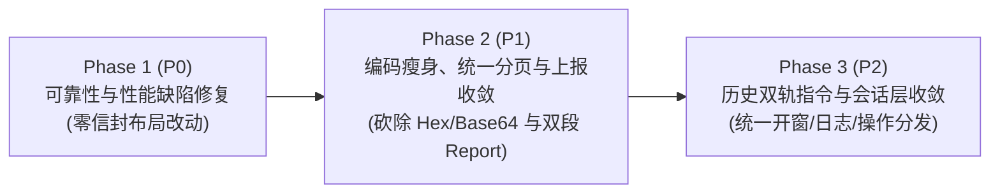
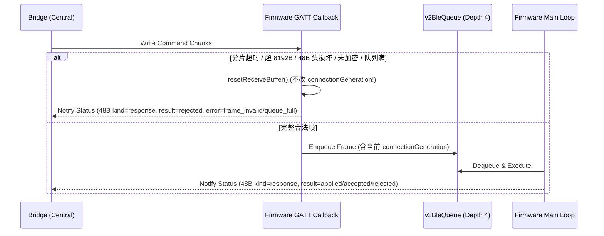

# Bridge—设备通信协议问题修复与精简设计方案

制定日期：2026-11-01
状态：设计定稿（待按阶段实施）
关联文档：[bridge-device-protocol.md](bridge-device-protocol.md)、[bridge-device-compact-envelope-design.md](bridge-device-compact-envelope-design.md)、[bridge-device-communication-scenarios.md](bridge-device-communication-scenarios.md)、[generic-display-platform-design.md](generic-display-platform-design.md)

---

## 1. 背景、设计目标与不变量边界

在对当前仓库固件（`src/`）与 Bridge（`bridge/crates/core|ble|app`）通信协议的全面代码审查中，识别出两类核心问题：
1. **可靠性与并发隐患（P0）**：BLE 异常帧静默丢弃、单帧超时误增 `connectionGeneration` 连带丢弃合法队列、Bridge BLE 单次超时触发进程级永久隔离（Quarantine）与 20ms 高频 GATT 轮询；HTTP 写操作每次强制前置全量 `/api/status` 预检并自毁会话、>512B 响应重放缓存截断导致合法重试误报 `409 retired`、手写 HTTP 短连接与主循环同步外呼阻塞。
2. **过度设计与历史包袱（P1/P2）**：48B 二进制信封内叠床架屋（JSON-in-Hex-in-JSON 双倍膨胀分页、BLE 纯 ASCII 字段 Base64 编码、4 套并存分片机制）、5 层重叠的 Session/Nonce/Fence 标识、3 套并行的设备在线上报通道、以及网络激活/Wi-Fi 路由/历史诊断的双轨并存。

### 1.1 必须遵守的系统不变量（源自 `AGENTS.md`）
本方案所有改动严格受以下产品与工程不变量约束：
- **明确结果与原事务恢复**：HTTP/BLE/MCP/UI 每个请求必须返回真实成功或结构化错误、失败阶段和可操作反馈；已发出但结果未知时必须返回 `unknown` 并查询原业务事务，严禁冒充成功或换 ID 重发。
- **不维护双协议与版本兼容过渡**：按 [48 B 信封设计 §9](bridge-device-compact-envelope-design.md#9-用户约束不维护协议版本历史)，Bridge 与设备同步更新软件版本，直接交付最终协议，不引入双协议分支、能力协商矩阵或降级回退。
- **安全与鉴权不降级**：`/update`、`/doUpdate`、`/claim` 及业务命令的设备 token / BLE 绑定加密与 owner/lease 校验保持不变；`session_id` 仅作会话关联标识，不替代认证凭据。
- **嵌入式资源预算硬约束**：不增加常驻空仓库或大尺寸静态缓冲；主循环与 Wi-Fi 任务栈深必须通过 `python3 tools/check-wifi-stack.py <matching.elf>` 校验；持久层变更须验证重试、幂等与掉电恢复。

### 1.2 分阶段演进路线



---

## 2. Phase 1（P0）：可靠性、并发与冗余 RTT 修复方案

### 2.1 [P0-1] 消除 HTTP 写操作前置的强制全量 `/api/status` 预检与会话自毁

#### 现状根因
- 在 [`DeviceClient::session_post`](file:///Users/slepher/project/codex_status/bridge/crates/core/src/device_client.rs#L618-L625)、[`activate`](file:///Users/slepher/project/codex_status/bridge/crates/core/src/device_client.rs#L637) 与 [`install_bundle`](file:///Users/slepher/project/codex_status/bridge/crates/core/src/device_client.rs#L684) 中，每次发送业务写指令前均调用 [`session_nonce()`](file:///Users/slepher/project/codex_status/bridge/crates/core/src/device_client.rs#L600-L616)，内部发起一次**非 compact 的全量 [`status(ip, token)`](file:///Users/slepher/project/codex_status/bridge/crates/core/src/device_client.rs#L525-L534)**。
- 固件端 [`v2HttpBegin`](file:///Users/slepher/project/codex_status/src/firmware/transport.cpp#L473-L483) 收到带客户端打开标识的 `op == 1 (status)` 时，会无条件重置全局 `v2HttpSession` 与 `v2HttpHighestRequest`。
- 结果：每次 `data` / `plan` 写操作不仅白白多花 1~N 次 RTT 拉取完整状态，而且任何并发的只读 `status` 都会立刻冲毁正在进行的写会话。

#### 设计方案
1. **扩展客户端 `HttpSessionState` 元数据缓存**：
   在 [`device_client.rs`](file:///Users/slepher/project/codex_status/bridge/crates/core/src/device_client.rs#L35-L45) 的 `HttpSessionState` 中，随会话一并缓存已认证的身份摘要：
   ```rust
   struct HttpSessionState {
       session: [u8; 16],
       next_request_no: u64,
       device_mac: String,
       boot_id: String,
       session_nonce: String,
   }
   ```
2. **写操作直接复用活跃会话，按需懒打开（Lazy Open）**：
   - 新增内部辅助函数 `ensure_http_session(ip, token)`：若 `http_sessions` 中已有对应 `(ip, token)` 的有效会话，直接返回缓存的 `(device_mac, session_nonce)`，**零额外网络请求**。
   - 仅当本地尚无该 `(ip, token)` 会话时，调用一次 `compact_status(ip, token)` 完成会话握手并填充 `HttpSessionState`。
   - 若后续写请求在**发送前/握手校验阶段**收到服务端确定性的 `409 session_mismatch` 或 `session_expired`（即服务端因重启或超时未执行该业务指令），客户端清除本地旧会话，执行一次 `compact_status` 重建会话，并在校验 `boot_id` / 原业务状态后安全重发或转为原事务查询。
3. **固件端区分“打开新会话”与“会话内只读 Status”**：
   在 [`v2HttpBegin`](file:///Users/slepher/project/codex_status/src/firmware/transport.cpp#L463-L507) 中：
   - 当 `header.op == 1 (status)` 且 `header.request_no == 1`（或 `header.session != state.v2HttpSession`）时，才视为显式开会话请求；
   - 当 `header.op == 1` 但 `header.session == state.v2HttpSession` 且 `header.request_no == state.v2HttpHighestRequest + 1` 时，作为当前会话内的普通顺序请求执行，**不重置 `v2HttpSession`**。
   - 将只读查询与写事务的会话槽解耦：固件维护 `v2HttpSession` 时，允许只读 `status` 在不破坏当前有效 `v2HttpSession` 的前提下校验 token 返回状态，防止后台状态轮询冲掉正在进行的 `bundle` / `data` 事务。

---

### 2.2 [P0-2] 修复 HTTP 重放缓存 512B 截断导致的 `409 retired` 误报

#### 现状根因
- 固件 [`v2HttpReply`](file:///Users/slepher/project/codex_status/src/firmware/transport.cpp#L340) 与 Bridge [`RequestFence::record`](file:///Users/slepher/project/codex_status/bridge/crates/core/src/compact_frame.rs#L114) 将重放帧缓存上限硬编码为 `512` 字节。
- 当 HTTP 响应超过 512B（如 `/api/status`、`/api/wifi/snapshot`）且响应包在网络中丢失时，客户端使用原 `(session, request_no)` 重试，固件在 [`v2HttpBegin`](file:///Users/slepher/project/codex_status/src/firmware/transport.cpp#L497-L501) 命中 `request_no == v2HttpHighestRequest` 但 `v2HttpLastFrame` 为空，直接返回 `409 {"error":"retired"}`。

#### 设计方案
1. **区分幂等只读操作与状态变更写操作**：
   在固件 [`v2_command_envelope.h`](file:///Users/slepher/project/codex_status/src/v2_command_envelope.h) 与 Bridge [`compact_frame.rs`](file:///Users/slepher/project/codex_status/bridge/crates/core/src/compact_frame.rs) 中定义纯函数 `isIdempotentReadOp(uint16_t op)`：
   - 只读操作集合：`status (1)`、`sync_page (7)`、`wifi_snapshot (14)`、`wifi_result (16)`、`business_query (21)`、`history (25)`、`wifi_owner (26)`、`wifi_info (27)`、`wifi_active (28)`、`wifi_setup_status (31)`、`wifi_status (33)`、`wifi_scheme_get (34)`、`wifi_capabilities (35)`。
   - 在 [`v2HttpBegin`](file:///Users/slepher/project/codex_status/src/firmware/transport.cpp#L493-L501) 中，当 `header.request_no == state.v2HttpHighestRequest` 且请求 SHA-256 摘要一致时：
     - 若 `state.v2HttpLastFrame.length() > 0`，直接原样回放缓存帧；
     - 若 `state.v2HttpLastFrame.length() == 0` 且 `isIdempotentReadOp(header.op)` 为真，**放行重新执行该只读处理器**并回显原 `request_no`，绝不返回 `retired`；
     - 若为写操作，由于所有写操作回执帧（48B 头 + JSON ACK）严格小于 384B，必然命中 512B `v2HttpLastFrame` 缓存。
2. **写操作回执长度守卫**：
   在 [`v2HttpReply`](file:///Users/slepher/project/codex_status/src/firmware/transport.cpp#L332-L343) 中增加断言/告警：非只读操作的响应若超过 512B，裁剪诊断冗余字段以保证 100% 落入 `v2HttpLastFrame` 重放缓存，从而在不增加任何固件常驻 RAM 的前提下彻底消灭同号重试的 `409 retired`。

---

### 2.3 [P0-3] 修复 BLE 静默丢帧、`connectionGeneration` 误杀与 Bridge 永久隔离 / 20ms 轮询

#### 现状根因
1. **固件静默丢帧**：[`appendCommandFrame`](file:///Users/slepher/project/codex_status/src/ble_bridge.cpp#L151-L183) 和 [`serviceV2Ble`](file:///Users/slepher/project/codex_status/src/firmware/transport.cpp#L631-L699) 在分片超时、超长、解码失败、未绑定或 2 槽队列满时直接 `return false`，不发任何 GATT Status 通知。
2. **误增 `connectionGeneration`**：`appendCommandFrame` 在单帧接收超时或残片错误时调用 `++connectionGeneration`，导致队列中待执行的合法帧在 [`serviceV2Ble`](file:///Users/slepher/project/codex_status/src/firmware/transport.cpp#L635) 被连带丢弃，且 `v2SessionNonce` 被静默重置。
3. **Bridge 永久隔离与高频轮询**：[`NativeLease::drop`](file:///Users/slepher/project/codex_status/bridge/crates/ble/src/lib.rs#L159-L167) 一旦超时即将 `NATIVE_RADIO_STATE` 永久置为 `2`（需重启进程）；[`command_inner`](file:///Users/slepher/project/codex_status/bridge/crates/ble/src/lib.rs#L1590-L1658) 以 20ms 间隔高频轮询 `read_attribute(status)`。

#### 设计方案



1. **分离“接收帧复位”与“连接代次（`connectionGeneration`）”**：
   - 在 [`ble_bridge.cpp`](file:///Users/slepher/project/codex_status/src/ble_bridge.cpp#L151-L183) 中，`connectionGeneration` **仅在物理连接建立（`onConnect`）、断开（`onDisconnect`）或安全认证失效时自增**。
   - 单帧分片间隔超时（>2000ms）、超长（>8192B）或 `compactFrameDecode` 失败时，仅调用 `resetReceiveBuffer()` 清空 `rxBuffer` 并自增独立的 `rxFrameEpoch`，绝不触碰 `connectionGeneration` 与 `v2SessionNonce`。
2. **所有 BLE 拒绝路径必须生成确定性 48B 错误响应帧**：
   - 新增固件辅助函数 `bleReplyTransportError(const uint8_t* rawPrefix, size_t len, const char* code, const char* stage)`：
     - 若 `len >= 48` 且 `rawPrefix[0] == 0xC2`，从头部提取 `op`、`session`、`request_no`、`context_ref`；否则填 `op = 0`、`request_no = 0`、当前 `v2SessionNonce`。
     - 构造 `kind = 1 (response), result = 2 (rejected)` 的 48B 帧，载荷为 `{"ok":false,"error":"<code>","stage":"<stage>"}`，通过 `bleUpdateStatusValue` 写入 GATT Status 并立即 Notify。
   - 覆盖全部 4 类原静默丢弃点：
     1. 未绑定/未加密写入 → `error: "ble_auth_required", stage: "gatt_write"`；
     2. 分片超时/超长/解码失败 → `error: "frame_invalid", stage: "reassembly"`；
     3. `v2BleQueue` 满（同时将队列深度从 `2` 提升至 `4`，仅存指针/轻量描述符，不增常驻大块 RAM） → `error: "device_busy", stage: "queue"`；
     4. `serviceV2Ble` 业务校验拒绝 → 既有结构化错误帧。
3. **Bridge 端用“通知驱动 + 低频退避兜底”替代 20ms GATT 轮询**：
   - 在 [`bridge/crates/ble/src/lib.rs`](file:///Users/slepher/project/codex_status/bridge/crates/ble/src/lib.rs#L1576-L1663) 中，利用外设的 GATT Notification 流（或状态变更信号）作为主唤醒源；
   - 兜底主动 `read_attribute(status)` 轮询间隔由固定的 `20ms` 改为指数退避：`150ms → 300ms → 500ms`，将 BLE 空口读取频率降低 **10~25 倍**。
4. **Bridge 端将进程级永久 Quarantine 改造为可恢复的三态熔断器**：
   - 将 `NATIVE_RADIO_STATE` 替换为带时间戳与连续失败计数的状态结构：
     - **单次写/断连超时**：进入 `Cooldown`（冷却 3 秒），后台释放当前 `Peripheral` 连接句柄，后续请求在冷却结束后正常放行；
     - **连续 3 次底层驱动超时**：进入 `Degraded` 状态，自动重建 `btleplug::Manager / Adapter` 实例；
     - 仅当重建 Adapter 仍超时，才报告 `ble_adapter_unresponsive` 并允许用户在 UI 点击重试时再次触发 Adapter 重建，彻底废除“必须重启整个 Bridge 进程”的死锁逻辑。

---

## 3. Phase 2（P1）：线协议编码瘦身、统一分页与上报收敛

### 3.1 [P1-1] 废除 `chunk_hex` 双倍膨胀分页与 BLE `*_b64` 包装

#### 现状根因
- `/api/status`（[`status_pages.h`](file:///Users/slepher/project/codex_status/src/status_pages.h#L28-L39)）与 BLE `wifi_read`（[`ble/src/lib.rs`](file:///Users/slepher/project/codex_status/bridge/crates/ble/src/lib.rs#L1707-L1711)）将 UTF-8 JSON 文本转成十六进制 `chunk_hex` 再包进 JSON，体积膨胀 100%（1800B 原文变 3600B Hex）。
- [`ble_wire.cpp`](file:///Users/slepher/project/codex_status/src/ble_wire.cpp#L23-L27) 将纯 ASCII 的 `request_id`、`bridge_id`、`active_context_id`、`active_template_id`、`job_id`、`fw` 编码为 Base64 字段（`*_b64`），体积膨胀 33%。

#### 设计方案
1. **统一分页格式（复用 UTF-8 边界安全切片，移除 Hex 编码）**：
   - 统一 `/api/status`、`/api/wifi/snapshot` 与 BLE 快照分页为同一种无 Hex 膨胀格式（复用 [`wifi_management.inc`](file:///Users/slepher/project/codex_status/src/wifi_management.inc#L32-L55) 中已验证的 `utf8SafeEnd` 切分算法）：
     - **HTTP `/api/status` 分页**：单页最大原始字节数从 `1800B`（3600B Hex）直接提升至 **`3600B` 原始 UTF-8 子串**（字段名统一为 `"chunk"`，移除 `"chunk_hex"`）。一个 7KB 的完整状态从原来的 4 次 HTTP 往返缩减为 **2 次**，固件端每次分页省去 3600B 的 Hex 临时 `String` 堆分配。
     - **BLE 分页**：在 464B 载荷预算内，单页有效 JSON 子串从约 `160B`（320B Hex）提升至 **`320B` 原始 UTF-8 子串**，BLE 读取 Wi-Fi 列表与状态的往返次数减半。
2. **移除 `ble_wire.cpp` 与 `ble/src/lib.rs` 中的 `*_b64` 字段**：
   - 在 [`ble_wire.cpp`](file:///Users/slepher/project/codex_status/src/ble_wire.cpp#L44-L101) 中，直接输出 `"request_id"`、`"bridge_id"`、`"active_context_id"`、`"active_template_id"`、`"job_id"`、`"fw"` 明文 ASCII 字符串，删除 `encoded()` Base64 辅助函数；
   - 在 [`ble/src/lib.rs`](file:///Users/slepher/project/codex_status/bridge/crates/ble/src/lib.rs#L935-L966) 的 `decode_wire` 中移除 Base64 解码胶水。

---

### 3.2 [P1-2] 合并设备→Bridge 上报通道，消除固件主循环同步阻塞

#### 现状根因
- 设备同时维护 UDP `:8767` 广播、HTTP `POST /api/device/presence`、以及两段式 `POST /api/device/session` + `POST /api/device/report`（[`radio.cpp`](file:///Users/slepher/project/codex_status/src/firmware/radio.cpp#L487-L649)）。
- Bridge 收到两段式 `ready_report` 后仍将其视为不可信 hint，必须反向发起认证 `POST /api/status` 确认（[`app/src/rendezvous.rs`](file:///Users/slepher/project/codex_status/bridge/crates/app/src/rendezvous.rs#L350-L395)）。
- 固件在 `loop()` 主线程中直接同步执行两次 `HTTPClient` POST，网络不通时阻塞主线程高达 1.5~2 秒。

#### 设计方案
1. **砍除 `/api/device/session` + `/api/device/report` 两段式握手，统一归入单包 `/api/device/presence`**：
   - 设备在线/就绪上报收敛为：
     1. **UDP `:8767` 广播**：用于局域网零配置发现；
     2. **单次 HTTP `POST /api/device/presence`**：携带既有 `Authorization: Bearer <endpoint_cred>` 与轻量 JSON 载荷（含 `device_mac`、`boot_id`、`ip`、`ready_reason`、`active_context_id`、`data_pending_seq`）。
   - Bridge 收到 UDP 或 `/api/device/presence` 后，统一触发反向认证 `/api/status` 确认并推进会合/同步状态机。
   - 彻底删除 Bridge 端的 `ReportSession` 内存表（[`main.rs`](file:///Users/slepher/project/codex_status/bridge/crates/app/src/main.rs#L3100-L3150)）、`/api/device/session` 路由及固件端 `serviceReadyReport` 的两段式状态机。
2. **固件出站 Presence 移出主循环（非阻塞化）**：
   - 将 HTTP Presence 发送封装为非阻塞异步状态机或独立轻量任务（设置连接超时 `250ms`、读写超时 `250ms`），主循环 `loop()` 仅通过原子标志位投递上报意图，**主循环零网络 I/O 阻塞**。

---

### 3.3 [P1-3] Bridge HTTP 客户端零拷贝头解析与同事务连接复用

#### 设计方案
1. **消除整包 UTF-8 拷贝**：
   在 [`device_client.rs::transport_request`](file:///Users/slepher/project/codex_status/bridge/crates/core/src/device_client.rs#L130-L150) 中，找到 `\r\n\r\n` 偏移 `header_end` 后，仅对 `&raw[..header_end]` 执行 ASCII/UTF-8 解析提取 HTTP 状态码，对 `&raw[header_end + 4..]` 直接作为二进制帧切片处理。
2. **同事务短时 Keep-Alive 连接复用**：
   在 `DeviceClient` 中按 `ip` 维护最多 1 条空闲超时 `5s` 的 Keep-Alive `TcpStream`（若服务端返回 `Connection: close` 则自动回退重建），使 `bundle_chunk` 连续上传或多页状态读取复用同一 TCP 连接，省去十余次重复 TCP 三次握手。

---

## 4. Phase 3（P2）：历史双轨指令与会话/回执层收敛

### 4.1 [P2-1] 统一网络开窗指令，终结双轨与借壳开窗
- **现状**：`PowerPlan.network`、`network_start (op=22)` 与借壳诊断的 `sync_open (op=24, reason="data")` 三条路径均在控制 Wi-Fi 窗口开启。
- **收敛方案**：
  1. **计划内伴随开网**：周期性或随计划下发的开网保留在 `PowerPlan.network`；
  2. **独立即时开网**：所有 BLE 触发的即时临时 Wi-Fi 开窗（无论是配网、`data` 大快照同步、还是 `sync-v1` 诊断拉取）统一使用 **`network_start (op=22)`**，通过载荷字段 `reason: "wifi_setup" | "data_sync" | "diag_sync" | "bundle"` 区分窗口预算与退出条件；
  3. `sync_open (op=24)` 回归纯诊断用途或并入 `network_start`，不再在 `sync_open` 中混入 `data_seq` 业务逻辑。

### 4.2 [P2-2] 下线旧版 `/history`，统一归口 `sync-v1`
- 移除固件与 Bridge 中的 legacy `GET /history`、BLE `op=25 (history)` 及 `PowerPlan.history_sync_ms` 字段；
- 设备端运行日志、睡眠唤醒轨迹与崩溃摘要统一通过 `sync-v1`（`sync_begin/page/ack/complete`，`op=6..9`）分页拉取与确认。

### 4.3 [P2-3] 消除 `/api/wifi/command` 的 `"op"` 拆装胶水
- 在固件 [`v2HttpRoute`](file:///Users/slepher/project/codex_status/src/firmware/transport.cpp#L510-L625) 与 [`radio.cpp`](file:///Users/slepher/project/codex_status/src/firmware/radio.cpp#L660-L675) 中，`wifiControlCommand` 直接接收 48B 信封头的 `uint16_t op` 枚举进行 switch 分发，删除 Bridge 侧从 JSON 剥离 `"op"` 后固件侧再用 `compactOperationName(header.op)` 重新注入 `JsonDocument` 的冗余胶水。

### 4.4 [P2-4] 理顺传输会话与业务幂等的两层职责矩阵
将现有的 5 层标识收敛为清晰的 **“传输层 + 业务层”双层模型**：

| 层级 | 唯一标识机制 | 作用域与生命周期 | 移除的冗余项 |
| :--- | :--- | :--- | :--- |
| **传输层（防连接内乱序/丢包重传）** | 48B 信封头 `session_id (16B)` + `request_no (u64)` | 单次 HTTP 会话或单次 BLE 加密连接代次；仅存 RAM | 移除 JSON 载荷与 HTTP 扩展头中的 `X-Session-Nonce` / `session_nonce` 明文传参；移除设备出站 `ReportSession` |
| **业务层（跨连接/跨重启最终一致性）** | `boot_id` + 业务专属持久凭证（`plan_id` / `data_seq` / `job_id` / Wi-Fi `WFS4`） | 跨传输载体（BLE ↔ HTTP）、跨休眠唤醒；按需存 NVS | 移除 `request_id` 内部自定义的 CRC32 字符串拼接与 `w3_` 特殊前缀解析，统一由 48B 帧完整性 + 业务序号保障 |

---

## 5. 资源预算影响与验收矩阵

### 5.1 嵌入式资源与性能对比评估

| 指标 | 当前实现 | 方案实施后 | 变化与依据 |
| :--- | :--- | :--- | :--- |
| **HTTP 写操作（Data/Plan）RTT** | 2~4 RTT（每次必先全量 `/api/status`） | **1 RTT**（直接复用有效 `HttpSessionState`） | 写延迟降低 **50%~75%**，消除并发 `status` 自毁会话 |
| **状态/Wi-Fi 分页峰值临时堆内存** | 1800B 原文 + 3600B `chunk_hex` `String` + JSON 封装 ≈ **6.2 KB** | 3600B UTF-8 `chunk` 直接切片 + JSON 封装 ≈ **4.0 KB** | 峰值堆分配下降 **~2.2 KB**，单页有效载荷翻倍，分页 RTT 减半 |
| **BLE 等待回执空口轮询率** | 50 Hz（每 20ms 一次 `read_attribute`） | **Notify 驱动 + ≤6.6 Hz 退避兜底**（150ms→500ms） | 空口轮询流量下降 **90%+**，消除射频争用 |
| **固件主循环 `loop()` 阻塞峰值** | 最高 **1500ms ~ 2000ms**（同步双次 HTTP POST） | **< 5ms**（移出主循环异步发送 + 砍除双段握手） | 保障按键、BLE 消费与墨水屏刷新实时性 |
| **固件常驻 RAM / NVS 占用** | `v2BleQueue` 2 槽；`ReportSession` 逻辑；Hex/Base64 缓冲 | `v2BleQueue` 扩至 4 槽（仅 +32B 描述符）；删除 `serviceReadyReport` 状态机 | 常驻 RAM 净减少，NVS 格式与配额保持不变 |

### 5.2 阶段验收清单（Verification Checklist）

1. **P0 验收**：
   - `cargo test --workspace` 全绿；新增 Fake ROM 用例覆盖：
     - 连续 `data` + `plan` 下发仅产生 1 次初始 `status` 握手，后续写操作直接单次 POST 完成；
     - 超过 512B 的 `/api/status` 与 `/api/wifi/snapshot` 在模拟丢包重发相同 `(session, request_no)` 时正常返回响应，不再触发 `409 retired`；
     - BLE 注入超长帧（>8192B）、残片超时、损坏 48B 头、未绑定写入及 4 并发请求压测，验证每帧均返回结构化 `rejected` 错误帧，且队列中正常请求不被 `connectionGeneration` 误杀；
     - 模拟 BLE 单次 GATT 超时，验证 Bridge 在冷却后自动恢复通信，不触发永久 `quarantined`。
2. **P1/P2 验收**：
   - 验证 `/api/status` 超 4048B 时的多页 UTF-8 `"chunk"` 拼接与原完整 JSON 逐字节一致；
   - 验证设备唤醒上报仅通过单包 `/api/device/presence` + Bridge 反向 `/api/status` 完成会合；
   - 固件构建（`pio run -e zectrix-note4-b`）通过，并执行 `python3 tools/check-wifi-stack.py` 确认栈深在预算内。
