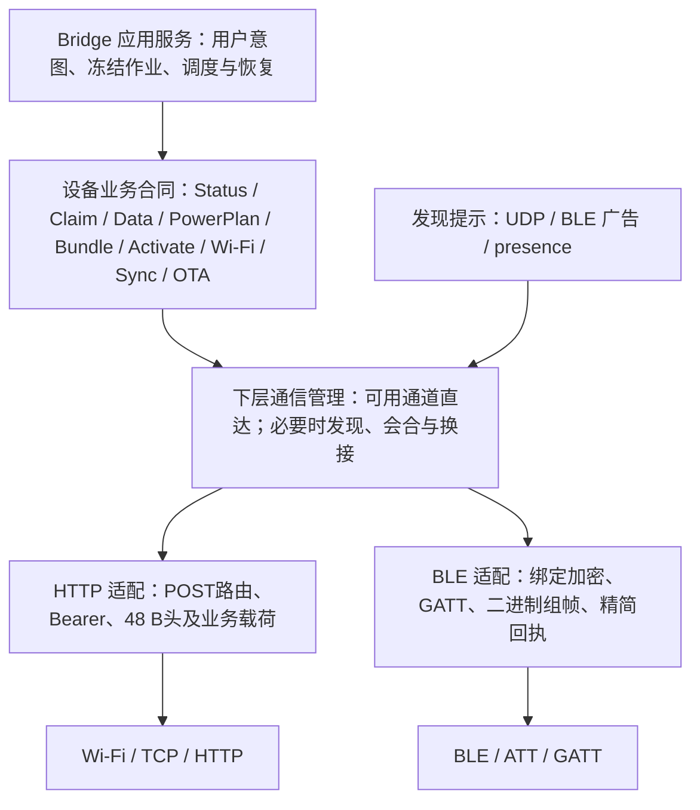

# Bridge 与设备协议：业务合同及载体映射

2026-10-11 BOOT/联网合同（已实现，Note4部署见下）：BLE status 保持原 `s` 数组布局，新增 `ac` 布尔值映射 `automatic_contact`；false 表示健康 HTTP 下仅开放主动 GATT，Bridge 不启动普通交汇。可选 `ne` 映射 `network_error`：1=`wifi_connect_failed`、2=`bridge_http_unreachable`、3=`wifi_link_lost`；仅失败报告轮携带。旧报文缺少 `ac` 保留普通交汇语义。认证 HTTP status 新增 `power.manual_remaining_s` 与 `network.bridge_reachable/error/automatic_ble`；人工剩余时间持续报告，不随首个正式 Plan 消失。presence 的 202 JSON 回应包含 `bridge_id`、`device_http_verified`，后者仅由同 boot_id 的近期认证 HTTP 状态支持，发现提示自身不构成认证证据。最终窗口与恢复合同见[通信场景](bridge-device-communication-scenarios.md)及[实施验收](../project-workflow/bridge-macos/boot-network-20261011.md)。

2026-10-11 后续修正（源码候选，未部署）：有效202/accepted且bridge_id匹配即证明设备→Bridge方向可达；device_http_verified=false仅表示反向认证证明尚不可用，不计为Bridge不可达，也不授予任何业务权限。Bridge不可达不得主动拆除已取得IP的Wi-Fi关联，BOOT/正式/临时窗口仍按原期限结束，真实连接失败/丢失按Wi-Fi故障处理。boot_id为本次MCU启动固定的32位十六进制标识；session_nonce继续在BLE会话切换时轮换并执行原重放围栏，二者不可互代。status/presence/report使用同一稳定boot_id。实现及回归见[修复记录](../project-workflow/bridge-macos/boot-network-fix-20261011.md)。

设备模板字段统一使用当前独立绑定，退役device.state无兼容入口；C++/Rust/预览均拒绝该绑定。持久CT中旧字段返回ct_bind_unsupported，路径与编号不一致返回ct_bind_mismatch，字符串边界无效返回ct_req/ct_string；当前有效字段的数字标识不重排，退役14号不重用。已安装模板加载失败进入内置恢复界面，认证status的content_error报告原因，等待显式发布有效Bundle；文件不因读取失败自动删除。[字段退役与恢复回归](../project-workflow/bridge-macos/device-fields-only-20261011.md)。

核对日期：2026-10-11，源码基线 `9c38e45`。Note4已认证运行0.18.82-note4，配套Windows Bridge已部署；具体镜像和验收以[PROGRESS](../PROGRESS.md)为准。本次只同步文档，不新增测试或设备操作，不证明其他设备/macOS已部署。

当前 wire 为固定48 B二进制头加业务载荷，认证业务HTTP使用POST；详细布局见[48 B信封](bridge-device-compact-envelope-design.md)。普通BLE接纳开网后提前结束，设备通过独立HTTP会话报告；单份Bundle暂存后覆盖，正式计划跨重启保留。下文区分外层frame、仍存在的JSON业务字段及实际成功证据。

## 1. 对“高层不区分 Wi-Fi / 蓝牙”的确认

**作为架构合同，这一点成立：同一业务操作的身份、授权、数据含义、提交条件、幂等与结果判定不应因载体改变。高层描述“对哪台设备做什么、何时算完成”，载体层描述“如何发送、编码和接收”。**

**Bundle、OTA、模板激活使用 HTTP 是正确的载体选择。HTTP 已可用而 BLE 未启用时，直接通过 HTTP 通信，不要求开启 BLE、进入交汇（会合）或完成 handoff。交汇属于下层连接管理，不是高层业务的前置阶段。**

高层不要求每种载体支持全部操作，也不规定 HTTP 与 BLE 的开启顺序。状态投影、报文包装、容量及执行时机差异在下层记录，不能仅凭这些差异认定高层合同未解耦。Data/Plan、Wi-Fi 控制及 claim 的共享处理核心提供了统一业务语义的源码证据。

本文 §3–§4 定义业务合同；§5–§6 描述具体载体协议；§7 链接独立的下层执行场景与实现对照。源码中的失败反馈是否满足合同单独核对，不与载体能力是否对等混为一谈。

## 2. 分层与边界



- 业务层：设备身份、当前会话、owner、上下文/版本、操作及结果。
- 载体适配：认证凭据的传递、命令到路由/特征的映射、分片、分页与 ACK 关联。
- 链路层：地址、连接、MTU、收发及有界超时。
- 下层通信管理：已有可用通道直接通信；需要恢复通道时发现候选、会合或换接。向高层提供可用性与明确结果，不将 BLE 生命周期或 handoff 强加为业务阶段；发现提示不能替代授权。

Codex app-server → Bridge 的 JSON-RPC、UI IPC、Bridge MCP 不属于本协议。Codex 是数据源；设备不理解账号、push/pull 分类或 Bridge 本地模板编辑状态。

## 3. 载体无关的身份与授权

| 概念 | 合同 |
|---|---|
| `device_mac` | Wi-Fi MAC 为稳定设备主键；IP、BLE 地址、显示名只用于定位或显示 |
| `bridge_id` / principal | 稳定调用者身份，与登记的 endpoint/bond 关联；不是当前连接的临时地址 |
| namespace | Wi-Fi 事务回执及重放围栏的隔离维度；不是配置编辑权限的创建者隔离 |
| endpoint token | 设备业务通道认证；HTTP Bearer 或 BLE 命令 `token` |
| device operation token | claim、OTA、诊断等管理入口凭据；与 endpoint token 分开，仅经受控绑定 BLE 链路获取/轮换 |
| `session_nonce` / frame `session_id` | nonce是业务身份检查使用的32位十六进制值；frame session是16 B原始认证会话标识，HTTP打开后由设备分配，BLE绑定连接代次。不能混同持久事务或凭据 |
| owner / lease | 只由显式 claim 建立；有效他人 owner 拒绝写入，lease 到期清空；与电源期限独立 |
| `active_context_id` | 设备当前激活上下文；模板切换产生新上下文，旧上下文数据不能应用 |
| `request_id` | 请求关联；具体幂等条件仍由各操作定义，不能假定所有请求都有同一持久回执机制 |

普通读写不能隐式取得 owner。匹配 owner 的活动更新时间与显式 claim 续约不应混同，更不能据此延长 light deadline。

当前 Wi-Fi 配置权限：有效 session + owner 可读取、修改、删除及启用全部来源配置；来源 bond 保留为来源/active 引用。配置 ID 冲突明确拒绝 `ambiguous_network_id`；回执查询与防重放仍按 principal/namespace 隔离。详见最新部署记录，早期“其他创建者只读”的文档已过时。

## 4. 业务操作与成功判据

| 逻辑操作 | 输入/条件 | 成功证据及副作用 |
|---|---|---|
| Status | 已认证设备身份；读取能力、会话及当前状态 | 当前真实上下文、已应用序号、计划、可用性；读取不续电源期限 |
| Claim / Renew | 设备操作 token、Bridge 身份、有限 lease | owner 处理结果；占用不等于发布授权 |
| Data | 当前 context、`seq`、完整 `fields` 快照 | ACK `data_seq` 与业务结果；原子应用，不发送部分字段 |
| PowerPlan | `plan_id`、`mode`、light 时长、会合周期 | 提交并读回NVS后返回原计划/剩余期限及retention=nvs；正式计划修改正式light期限，物理BOOT窗口另有下界 |
| Bundle Install | 冻结 `job_id`、完整 Profile/模板/资产、预期 context、长度及 CRC | 接收内容不代表发布完成；暂存下载并预检后停止内容、覆盖单份包，最后提交小型记录；覆盖失败进入内置恢复，无旧内容回退；BEGIN/CHUNK/COMMIT 的实际传送见 §5.2 |
| Template Activate | `template_id`、预期 context、稳定请求身份 | 成功返回新 context；同一请求不重复切换 |
| Wi-Fi Snapshot | 冻结快照及分页关联 | 同 snapshot/revision 的全部页完整收到才可暴露完整配置 |
| Wi-Fi Apply | `expected_revision`、冻结整行变更 | 原子保存及读回校验后的 committed 回执；保存不会自动启用网络 |
| Wi-Fi Trial / Activate | 有限预算、目标 network/version、当前权限 | accepted 仅代表接纳；完成回执与认证网络状态证明结果 |
| Wi-Fi Result / Result ACK | 原事务身份及当前查询权限 | 查询原事务或确认已收到回执；退役围栏阻止旧写重放 |
| Diagnostic Sync | 冻结 batch、分页、ACK/complete | begin/page/ack/complete 全程绑定批次；不能将本地归档冒充设备确认 |
| Firmware OTA | 冻结镜像与作业、身份/target/版本/长度/hash 预检 | 上传 ACK 不代表部署成功；重启后的认证运行镜像 SHA256 匹配才是 `image_verified` |

Wi-Fi运行恢复与配置提交分开：认证`wifi_match`确认内容匹配、`active=true`及有效版本，且无密码替换意图时，Bridge可使用已确认PowerPlan的`network_start`重连当前配置，不新建activate作业。历史未确认提交仍阻挡配置变更及网络切换；不因恢复连接清除原事务或伪造确认。

Profile 包含 1–8 个有序模板，全部参与设备按键循环。Bridge 保存模板/Profile 只落盘；发布冻结完整 Bundle，是用户显式动作。现行发布不是 manifest 增量协议，也不能裁剪成旧 3 槽。

### 4.1 Data 与电源的幂等

Data 在同 context 下允许 `seq` 跳号：同序号同内容不重复绘屏，同序号不同内容 `seq_conflict`，旧序号 `stale_seq`，错误 context 拒绝。字段按设备当前 CompiledTemplate 的索引与类型校验。

字段需求以认证 `/api/status` 的 `data_contract` 为准，不从 Bridge 本地模板或 Profile 推导。BLE仅在同context/active且合同已知时复用；未知或变更合同先有界读取HTTP状态。发布/激活ACK改变上下文时立即清除旧合同，即使template_id同名也不能复用旧字段索引；认证回读完成后才允许Data。回读失败返回next_stage=read_device_contract，不发空字段包。只有成功 ACK 更新 Bridge 确认指纹和 full-sync deadline。push/pull 是 Bridge 数据绑定合同，设备只收到完整最新快照。

Bridge重启后，所需数据源尚无首份成功快照时，不生成新的missing Data覆盖设备已有值。HTTP/BLE共用投递入口返回`waiting_for_data_source`、`next_stage=read_data_source`，不pin新Data、不推进seq或确认基线，也不因此创建正式Light意图。成功读取后的真实字段缺失仍按模板规则投递；已固定的未确认Data继续原seq/原内容恢复，不因源暂不可用换包。2026-10-18源码与宿主回归状态见[调查与修复](../project-workflow/bridge-macos/first-contact-usage-20261018.md)，部署以PROGRESS为准；设备wire未变。

PowerPlan在已授权principal范围内使用单调plan_id，PPL1保存原ID/参数/实际授予量/RTC起止；重启不清除可验证的重放围栏。重复同内容不延长期限，同ID不同内容冲突，旧ID拒绝。claim、读状态、传数据、传 Bundle 都不续电源期限。BOOT provisional 从物理唤醒起算 300s，timer wake 不获得该兜底；USB 在线与正式 light 模式分别描述。

### 4.2 结果与恢复

高层必须分清：未发送失败、确定拒绝、已接纳未完成、已完成、已发送但结果未知。HTTP 2xx、BLE Write Response、TCP 可达都不是业务成功。

平台 ACK 常见字段：`op`、`result`、`display_state`、`retention`、`error`，按操作附 `data_seq` / `plan_id` / `active_context_id` / `accepted_remaining_s`。

- `result=applied` 与 `display_state=pending/failed` 可以同时出现：数据已应用不等于实体显示成功。
- `display_state` 区分 `unchanged/displayed/pending/failed`；`retention` 表达ram/rtc/flash/nvs等实际保留范围，不能由载体猜测。
- Wi-Fi 返回还使用 `ok`、`outcome` 和异步状态，不应强行假定所有操作返回完全相同 JSON。
- 过期缓存明确提示重新读取设备并保留 Bridge 编辑；revision/context 冲突不能无限挂“待确认”。
- 已发出写且丢响应时，保留原 ID，查询原事务或操作对应状态证据；不能换 ID 盲重发。并非每类操作都有通用 `result` 端点。
- 操作和收尾共用有界预算；换连接/载体不重置事务，不新增期限。

### 4.3 Wi-Fi 事务寿命、快照与回执退役

Bridge Wi-Fi 读/同步等作业当前默认有效期24h；这是作业有效期，不是 RF 窗口，也不是自动删除设备回执的期限。本地 cancel/expired 保留 `sent/may_have_committed`，不能推断设备已经回滚或未提交。

完整配置读取采用冻结 snapshot/revision；当前设备冻结 TTL 30s。分页期间快照过期、revision 变化或失去所需 owner 权限明确拒绝；不以部分页替换完整缓存，保留旧缓存及 Bridge 编辑。只因进入页面、提交保存或查询结果，不反复读取整份配置。

现行 WFS4 新写事务使用 `w3_` 加16位小写十六进制非零单调序号，Bridge 持久分配并冻结。设备按 principal+namespace 保留最高已接纳序号；有回执先核对原业务指纹，无回执且序号已被围栏覆盖则拒绝重新执行。`outcome=retired` 只表示原回执已退役/序号已围栏，不证明原操作成功。

Bridge 持久确认原终态后才能 `result_ack(query_id)`；设备删除可退役的具体终态回执但保留高水位。不自动删除 pending/未知结果，账本满明确 `result_capacity`，游标满明确 `cursor_capacity`。旧任意ID回执不能套用新序号退役，返回 `legacy_receipt_retained`。换通道、重绑定或恢复旧 Bridge 备份不能清围栏或自动替已发事务换ID。

### 4.4 配置保存、匹配与迁移

配置保存版本和当前活动版本独立：更新/删除保存项不等于当前连接副本立刻替换，显式启用才切换。主机 host_ssid→设备 ssid 映射允许两端SSID不同；metadata/credential匹配只是保存内容判断，不替代原事务 committed 回执或实际 HTTP 认证。

旧槽迁移是显式受控兼容操作，不是自动 read/import。当前 BLE `wifi_migrate` 要求绑定认证、匹配 owner 与物理恢复机会，读取设备自身旧 NVS，原子迁移并验证后逐键退役；不把凭据返回或写日志，不启用网络/续期。`retirement_pending` 表示新数据可能已持久而旧键清理未完成，不等于迁移回滚。兼容代码最终移除需独立验收。

### 4.5 正式计划恢复与启动通道

PPL1为单条NVS blob（48 B显式头+实际principal，最多176 B，含CRC），没有项目自管A/B。新计划先原子保存并读回验证，再返回持久成功；写失败返回rejected/plan_storage_failed，无法确定返回unknown/plan_storage_unknown，后续先核验原记录。重复同ID同内容不写闪存、不重起算期限。

运行中用单调截止；Note4重启使用外部RTC原起止恢复剩余量，保守扣除整秒误差。RTC失效/回拨或过期不复活Light；校时前按单调剩余量重锚，保存失败不改变RTC。恢复计划不恢复过期owner或旧认证session，也不会在报告后删除计划。

| 启动情况 | 通道与期限 |
|---|---|
| USB continuous，或普通重启后正式Light有效 | 恢复已有网络，直接HTTP presence和认证回读，不先等待BLE；使用原剩余量 |
| 无USB、正式Sleep普通重启 | 一次有界BLE交汇回报，再按有效计划运行；不自动授300秒Light |
| Light过期/时间无法验证 | 不恢复旧Light，沿有界联系/恢复路径取得当前决定 |
| 物理BOOT/PWR唤醒 | 独立人工窗口优先；首次临时BLE不等于手动GATT ON；Sleep时本地时钟薄唤醒不每分钟交汇 |

### 4.6 OTA调度与确认

入队先持久化冻结镜像/请求ID，Notify唤起既有调度并保留10秒轮询兜底。认证presence=continuous直接准入；有限Light剩余至少120秒可用，否则由正式Plan取得足够机会。USB不要求先发新的120秒计时计划，也不等待下一BLE周期。

上传ACK、重启上线和目标镜像验证为三个阶段。Bridge保存before_boot_id及confirmation_started_at；旧boot响应不能完成确认，重启有120秒宽限，其后有界只读查询原任务/运行镜像。只有认证目标MAC/target/完整指定长度SHA256匹配才记image_verified，等待确认不再次上传。OTA重启不自动续Light，没有设备端一次性“写marker→发送→清除”报告机制；正式计划和Bridge持久作业各自负责恢复。

### 4.7 本地模板元数据与诊断

`device.wifi_state`为文本idle/connecting/connected/off，`device.wifi_blink`仅connecting提供数值0/1。`device.ble_manual_active`是本地数值0/1，CompiledTemplate绑定21、ABI2不变，只表示手动GATT窗口，不等于自动交汇或实际射频。三者由设备本地生成，Bridge Data不索取这些字段。认证radio分别报告ble_manual_active、ble_radio_on、ble_connected；network.automatic_ble报告自动需求。

Note4 .82的模板device.battery及内置屏幕使用5秒采样的90/10 EMA显示缓存；保护和诊断battery/battery_mv仍为未做时间平滑的原始读数。公开/status.json另报battery_display、battery_sample_mv、battery_sample_ms。诊断读取和重绘不推进EMA；没有新的Data字段、BLE字段或NVS记录，USB在场不作为充电证明。

## 5. 实际 HTTP 绑定

设备通常监听TCP 80。下表业务路由全部POST，Content-Type精确为`application/vnd.codex-status.frame`，消息体为48 B头+业务载荷；普通完整帧上限4096 B，载荷最多4048 B。固定op与路由必须一致。JSON只是载荷，不能把裸JSON、旧GET或Base64头发送到这些路由。

HTTP每次保留Bearer鉴权：普通业务使用endpoint token；claim的Bearer绑定endpoint会话，另用X-Device-Token携设备操作token；OTA镜像证明允许设备操作token建立其独立会话。/update和/doUpdate的管理鉴权保持独立。HTTP明文Bearer不提供TLS级加密。

| POST路径 | frame op | 逻辑操作 / BLE边界 |
|---|---:|---|
| `/api/status` | 1 | 完整认证状态/data_contract，必要时冻结分页；BLE status只提供精简投影 |
| `/claim` | 4 | 显式claim/续约；BLE claim另需ble_claim=1和operation_token，不支持普通force/release |
| `/api/data`、`/api/plan` | 2、3 | 完整Data与正式PowerPlan，BLE共享业务规则 |
| `/api/sync/begin`、`page`、`ack`、`complete` | 6–9 | 诊断批次；BLE sync_config/sync_open只是配置/准入 |
| `/api/bundle/begin`、`chunk`、`commit` | 10–12 | 完整Bundle安装，仅HTTP |
| `/api/activate` | 13 | 模板激活，仅HTTP |
| `/api/wifi/snapshot`、`apply`、`result`、`result_ack` | 14–17 | Wi-Fi共享处理器 |
| `/api/wifi/command` | 18 | 统一Wi-Fi控制 |
| `/api/ota/image` | 19 | 载荷image_bytes=N；认证运行分区指定前缀SHA256证明 |

GET `/update`与POST `/doUpdate`仍为鉴权页面/multipart原生ROM上传，不包装48 B业务帧，也未采用CSZ1压缩。公开`/status.json`、`/log`、`/pmstats`是恢复/诊断视图，不能代替认证状态。POST `/diag`、GET `/history`及`/frame`按各自handler授权。

### 5.1 外层frame与JSON业务字段

外层头负责kind/op/result/payload_len、16 B session、非零u64 request_no及16 B完整context；布局见[48 B编码](bridge-device-compact-envelope-design.md#2-固定布局)。Status打开使用本次唯一的客户端打开标识，设备返回独立服务端session；OTA op19打开还带open=true。会话失效先有界重建，再查询原业务，不换ID盲重发可能已提交的写入。

**当前JSON载荷仍包含共享处理器所需的身份/关联字段**，并没有全部由会话替代；48 B只约束外层头。Data载荷结构如下，实际身份和fields须从当前认证状态取得：

```json
{
  "device_mac": "7C:4F:AD:B9:34:08",
  "bridge_id": "<stable-bridge-id>",
  "request_id": "<stable-business-request-id>",
  "session_nonce": "<current-business-nonce>",
  "active_context_id": "<current-context>",
  "seq": 42,
  "fields": []
}
```

空fields仅示意位置，不是可发送的有效快照。Plan增加plan_id/mode/light_duration_s/rendezvous_period_s；通用Data/Plan禁止旧protocol/rv。JSON request_id、Data seq、Plan plan_id及Wi-Fi事务序号不等于frame request_no：换连接重开会话不改变原业务身份。

### 5.2 单份Bundle、动态容量与压缩

BEGIN/COMMIT载荷关联同一业务request/nonce及length/content_crc；完整正文带job、目标/预期context、对象内容。CHUNK的frame载荷是原始冻结字节，offset/request_id/session_nonce仍由查询参数及对应X-*头关联。Bridge chunk范围256–4048 B（默认4048），设备返回next_offset并严格核对。长度/CRC/offset全部针对冻结传输字节。

`bundle_storage_protocol=2`的max_bundle_bytes来自实时空闲空间，零容量明确拒绝，不能恢复固定256/512 KiB产品上限。下载使用incoming，原内容继续运行；完成预检后才停止内容、显示内置维护画面，退役旧context/合同并覆盖content.bin；缓存/字体校验和小型BCS2提交记录完成后可运行。覆盖失败回内置恢复并认证重传，无旧包回退；原生固件OTA双槽保留。AP01应用加载/退出仍待实机验证。

`bundle_compression=1`为zlib-blocks-v1：CSZ1的24 B显式LE头+每块长度表+独立zlib流，块原文16384 B，末块可短；同时验证精确输出长度、整原文CRC及无尾随。max_bundle_decoded_bytes限制解压总量。Bridge只在有收益时冻结压缩字节，重试/重启不重编码；设备压缩驻留并按块解压，不整包解压暂存。JSON canonical/hash不变，CSZ1不等于CSB3。完整格式/空间预算见[单份内容设计](../project-workflow/single-copy-updates/design.md)。

### 5.3 Wi-Fi载荷差异与错误

Wi-Fi HTTP command的业务JSON当前仍可带protocol:2，BLE对应业务入口拒绝protocol/rv；二者外层都必须使用frame，不能把这一载荷差异解释成双协议降级。HTTP command的op=apply与BLE op=wifi_command/command=apply进入共享处理器，业务事务身份保持。

401/403的发送前失败或明确拒绝进入确定失败；查询历史未知事务遇拒绝不能抹掉原sent/unknown。409保留revision_conflict/context等真实error/stage，不统一伪装occupied。格式/content-type/鉴权错误可能是未封帧的载体错误，不能因收到HTTP200或非frame错误页就当业务成功。

## 6. 实际 BLE / GATT 绑定

Service UUID：`e7f1a000-4b2a-4c9e-9a11-3c0d5e9a0000`。

下表 UUID 只列首段，其余均为 `-4b2a-4c9e-9a11-3c0d5e9a0000`。

| 首段 | 名称 / 属性 | 当前用途 |
|---|---|---|
| `e7f1a001` | INFO / Read | MAC、IP、固件、能力、wake、bond/encryption 提示；不是业务授权 |
| `e7f1a002` | Endpoint / Write + Write ENC | 登记 Bridge host/port/endpoint token/principal，与已绑定 BLE 身份关联 |
| `e7f1a003` | Usage / Write + Write ENC | 保留旧特征；当前回调不处理业务，不能据名字写 Data |
| `e7f1a004` | Status / Read + Notify | auth/endpoint 回执、业务状态与命令 ACK；需关联本请求，不能拿上次属性值当新 ACK |
| `e7f1a005` | Template Control / Write + Write ENC | 当前统一命令入口，名称为历史保留，不仅用于模板 |
| `e7f1a006` | Template Data / Write + Write ENC | 保留旧特征；当前回调不安装 Bundle |
| `e7f1a007` | Auth / Write + Write ENC | `cmd=token` 获取/轮换 device operation token |

### 6.1 首次关联与命令传递

绑定并加密后写 Endpoint JSON：`schema=2`、host、port、token、bridge_id。设备将其与实际 bond identity 关联；不能通过提交任意 principal 绕过已有绑定更新规则。

普通命令写 `e7f1a005`，使用48 B二进制头加JSON载荷；载荷包含 `op/request_id/device_mac/bridge_id/session_nonce/token`，Bridge 可附校时字段。`status` 是取得当前 nonce 的握手例外，不要求调用者已经知道 nonce。claim 另传 `operation_token`，当前普通入口拒绝 force/release。

其他已实现BLE命令包括`network_start`、`sync_config`、`sync_open`、有界 `history` 及 `wifi_*` 管理查询/控制。不能把未实现操作转发到旧 Usage/Template Data 特征以规避 `http_required`。

### 6.2 分片、大小与 wire 投影

Bridge业务写入对完整frame分片；按48 B头中的payload_len判定完整组帧，不依赖JSON括号。客户端分片仍使用保守上限180B。这是客户端保守值，不是 ATT MTU 恒等式，实际写入仍须满足协商 MTU。分片中途失败应结束受污染接收链路，不拼接下一条请求。

设备接收上限：Endpoint 1024B、Auth 256B、普通 Control 8192B；Wi-Fi Control 另限制 4096B。INFO/Status单属性上限512 B；业务响应包含48 B头，因此响应JSON最多464 B。Endpoint/Auth握手和INFO仍使用各自JSON投影，不冒充业务frame。请求与响应有不同上限，不能把 8192B 当可读属性容量。

`ble_wire=1` 是 BLE 编码版本，与 endpoint `schema=2`、Wi-Fi 能力 `wifi_management=3`、编译器 ABI、固件版本分别独立。

| BLE 字段 | 解码后含义 |
|---|---|
| INFO `f` | 固件版本的标准 Base64 |
| ACK `rid` | request_id 的标准 Base64；Bridge 解码后关联请求 |
| ACK `w=[generation,wake_seq]` | 当前唤醒身份 |
| ACK `ctx` | active_context_id 的标准 Base64 |
| Status `s` | 有序精简状态数组，顺序见下文 |

`s` 顺序：nonce、Base64 context、Base64 active template、Base64 committed job、applied seq、light、plan ID、remaining seconds、provisional seconds、sync available、sync enabled、rounds、due、retry skip、pending batch、commit seq。

业务ACK外包kind=response的48 B头，回显op/request_no/session；内部JSON仍可用`ack=command`或`ack=wifi`。Bridge `decode_wire` 还原关联信息。过长 history 可分页并标记 `more`；不能裁剪身份。结果封装仍超限时返回 `result=unknown,error=reply_too_large`，不能将可能已执行的命令伪装成拒绝。

## 7. 下层执行场景与实现的独立入口

具体载体协议（本文 §5–§6）只描述消息、路由、特征、分片与关联。下层“何时直连、何时交汇、何时开启 HTTP、何时关闭 BLE”的执行规则独立维护：

- [下层通信场景与执行规则](bridge-device-communication-scenarios.md)：S01–S24，应有行为与验收准则，不依赖报文字段或源码函数。
- [场景与当前实现对照](bridge-device-communication-implementation.md)：源码证据、ready 的不同含义、当前状态机/超时常量及未证明边界，不将场景合同写成已实现结果。

最新设计正常路径为“BLE接纳及分项反馈 → 结束普通BLE → 准备HTTP → 设备主动HTTP报告 → Bridge访问设备服务完成原工作”。该正常路径已实现；源码、既有测试与实机覆盖范围见独立对照；HTTP直达不要求BLE。

日常设备主动联系若在 BLE 能力/预算内即可完成，本轮只走 BLE，不启动 Wi-Fi/HTTP，也不执行 handoff。这是下层执行范围，不能据此假定已实现新的“一次联系返回全部工作”报文；当前 Status/Data/Plan 等 wire 沿用各自现有映射。

发现 wire 仍属于下层协议：UDP 8767、BLE 广告及设备→Bridge 的 HTTP `POST /api/device/presence` 都是 hint，不替代认证状态。候选发现使用 IP 属性、UDP、Windows ARP 和手动 BLE，mDNS 已关闭，命名实例不监听固定 UDP 8767。

## 8. 实现边界与文档冲突处理

以下分开记录下层绑定差异、旧文档差异和业务合同的反馈边界；载体分工本身不是待修缺陷：

- 通用命令拒绝protocol/rv，Data请求使用seq，ACK使用data_seq；不要照抄历史设计里的旧字段。Wi-Fi载荷例外见§5.3。
- “HTTP/GATT 同一逻辑状态”不等于相同 JSON 或相同字段完整性；普通 BLE 状态没有完整 data_contract。
- claim 共用核心，BLE 与 HTTP 管理入口可承载的动作不同；Bundle/OTA/模板 Activate 使用 HTTP 属正确的下层分工，不要求补齐 BLE 入口。
- 两载体响应都通过frame的op/request_no/session关联；业务JSON未必回显request_id，不能要求所有JSON形状相同。
- 现行 BLE 仍存在未绑定写拒绝、畸形/超长组包、mailbox 满等入口直接返回/丢弃路径；Bridge 提供有界超时，但不等于每次固件拒绝都有结构化 ACK。项目“任何请求必须明确返回”的合同不能据此宣布全链路已达成。
- Data 的下层执行时机不同：BLE 会合后绘屏，HTTP 当次尝试绘屏；高层统一读取 applied 与 display_state，不将会合规定为所有 Data 的必经阶段。

权威架构与现场分别见 [通用平台设计](generic-display-platform-design.md)、[电源与身份](power-state.md)、[最新交接](../PROGRESS.md)。Wi-Fi 原设计见 [统一控制设计](../project-workflow/bridge-macos/wifi-unified-protocol-design.md)，其中旧 WFS3/创建者只读/旧信封例子须结合当前 WFS4 与源码阅读。实施及验收待办仅以 [backlog](roadmap/backlog.md) 为准。

旧实现、阶段现场、遗漏合同与待实现草案的逐项区分见 [历史对账](bridge-device-protocol-history-audit.md)。Bundle v3 与字体增量发布仍是未来方案，不能从历史草案 URL 推定当前设备支持。

## 9. 源码核对入口

| 内容 | 源码 |
|---|---|
| HTTP/GATT适配、业务执行、完整状态及启动 | [transport.cpp](../src/firmware/transport.cpp)、[platform.cpp](../src/firmware/platform.cpp)、[diagnostics.cpp](../src/firmware/diagnostics.cpp)、[application.cpp](../src/firmware/application.cpp)；main.cpp仅胶水入口 |
| 通用会话与 ACK | [v2_command_envelope.cpp](../src/v2_command_envelope.cpp) |
| Data / Plan 决策 | [v2_data_command.cpp](../src/v2_data_command.cpp)、[v2_plan_command.cpp](../src/v2_plan_command.cpp) |
| Wi-Fi 统一处理与事务 | [wifi_management.inc](../src/wifi_management.inc)：wifiControlCommand；[wifi_setup.cpp](../src/wifi_setup.cpp) |
| GATT 表、组包、安全写门禁 | [ble_bridge.cpp](../src/ble_bridge.cpp)、[ble_bridge.h](../src/ble_bridge.h) |
| BLE wire 精简投影 / 512B 约束 | [ble_wire.cpp](../src/ble_wire.cpp)、[ble_wire.h](../src/ble_wire.h) |
| 会合生命周期与HTTP报告（另见radio.cpp） | [rendezvous_protocol.h](../src/rendezvous_protocol.h)、[rendezvous_protocol.cpp](../src/rendezvous_protocol.cpp) |
| Bridge HTTP / Bundle / Wi-Fi 客户端 | [device_client.rs](../bridge/crates/core/src/device_client.rs) |
| Bridge GATT 客户端 / 解码 / 超时与关联 | [ble lib.rs](../bridge/crates/ble/src/lib.rs)：command_with_id、decode_wire |
| Bridge 冻结作业及 Wi-Fi 恢复 | [platform/service.rs](../bridge/crates/core/src/platform/service.rs)、[platform/wifi.rs](../bridge/crates/core/src/platform/wifi.rs) |

## 10. 相关实现与验收

- [48 B编码](bridge-device-compact-envelope-design.md)：已实现外层frame，保留当前JSON字段的实际边界。
- [协议闭环](../project-workflow/bridge-macos/protocol-implementation-20261011.md)：BLE-only准入、ready与HTTP能力、401/403及409、Wi-Fi元数据修复。
- [BOOT/GATT与计划/OTA](../project-workflow/bridge-macos/note4-boot-gatt-followup-20261011.md)：PPL1、物理窗口、原期限恢复、OTA确认和同名模板合同失效。
- [电量平滑](../project-workflow/bridge-macos/note4-battery-smoothing-20261011.md)：仅本地显示处理，不改原始保护和数据协议。

B6/C8的RF/电池Sleep重启/掉电/跨平台矩阵及历史间歇延迟仍开放，不用上述局部验证代替完整验收。

## 2026-10-11 临时 Light 同步窗口合同（.83源码候选）

自动全量Data同步允许在自然联系机会唤醒并进入**临时 Light 传输状态**，不创建、不续期600秒正式Light PowerPlan。真实push可见变化与用户显式Light仍按正式计划执行。full_sync_deadline、数据投递许可及设备认证合同不变；只有成功Data ACK推进确认指纹/全量同步期限。小Data在原BLE会合中完成并收尾，大Data通过既有sync_open开临时HTTP窗口；不能为周期快照、其in_flight或重试冒充真实push。

临时窗口复用WIFI_SYNC_ONCE，从设备首次接受sync_open起最多90秒，保持单独的绝对截止。正式Light remaining归零不撤销该临时传输授权，也不允许无限延期：网络关联/ready报告、Bridge身份核对和分页工作受各自有限预算及临时总截止约束。两端采用有效正式Light截止与有效临时截止的较晚者，再受原交换/本轮工作预算限制；Bridge以认证采样时刻锚定并扣除1秒余量，不能重新授予或在每页重计90秒。USB/manual窗口与owner/低电规则仍独立。

BLE sync_open支持reason=data和正整数data_seq，绑定当前MAC/principal/session/wake、原open_id与待投递Data seq。此准入不修改正式计划ID、期限或持久Light记录。相同open_id/原因/seq重放不重启计时，不同内容明确batch_conflict，已关闭原窗口重放明确window_closed；重启或后续自然联系仍须重新认证并在有界合法机会查询/继续原Data事务，不冒充ACK或换Data seq。

窗口内先完成已冻结完整读取，再完成已准入Data，最后诊断complete；诊断完成不能抢先关掉尚未完成的Data/读取。绑定Data成功（含已应用同seq的确认）且无其他诊断义务时200ms收尾；诊断已完成且Data未完成则保留原临时窗口至完成/硬截止。没有正式Light/物理/USB下界时收尾进入Sleep；仍有正式Light时只结束临时窗口，保留原正式剩余量。失败/丢ACK保留原seq/批次及unknown查询，不隐式续期。恢复/认证/传输错误、权限撤销与低电仍可终止。

状态报告以power.plan_id/remaining_s说明正式计划，以sync.phase=WIFI_SYNC_ONCE、sync.remaining_ms及sync.data_pending_seq说明临时传输。设备临时运行mode可为light且正式remaining_s=0；不得据mode推断存在正式Light授权。协议载体仍为48 B frame和现有同步路由；模板canonical哈希、CompiledTemplate格式及字段绑定未改变。

实施、测试和资源边界见[执行记录](../project-workflow/bridge-macos/sync-window-fix-20261011.md)。当前部署以PROGRESS为准，不能将.83候选写成已部署。

### Bridge 预算与取消边界（2026-10-15）

同一BLE阶段的token、自动恢复及Wi-Fi分页请求共用绝对截止；每条命令在carrier内取阶段剩余、单命令上限及认证RF截止最小值，业务外层不得用短timeout取消在途分片。首次token失败停止本轮；旧history只用一份有界诊断预算，不再嵌套500ms/2s/5s。NotSent、WriteUnknown、AckUnknown保留真实分类，真正未知写继续隔离，完整写后丢ACK不冒充部分写。

HTTP快速就绪判断可读认证compact；需要sync窗口/data_contract的最终proof使用原总期限内的完整分页，不能周期性以3s重启全读或将单页200视为完成。claim身份预检、认证回退及socket发送共享原截止，后台worker排队不续期。宿主RPC与恢复GET的总预算覆盖锁/连接/发送/接收；取消半条RPC JSON后退役该stdin。实现与验收见 `project-workflow/bridge-macos/timeout-budget-followup-20261015.md`。


### Bridge Wi-Fi 事务执行终点（2026-10-19）

执行终点与设备结果证据独立。取消、过期、身份不可恢复，或未知结果的三次原ID确认查询机会耗尽（独立于发送前等待授权/输入的尝试次数）时，执行结束并释放后续事务准入；失败/取消/过期不会把设备结果改成拒绝或成功。历史request/principal/namespace/sent/may_have_committed/confirmation原样保留，未知结果仍可识别；不删除历史记录、猜测旧namespace、重发旧写或补造回执。仍在执行的未知事务只查询原ID并阻止冲突写；新事务独立通过当前认证、owner、版本与修订校验。确认成功可立即结束，未发送/待授权/待输入仍受既有24小时意图期限限制。过期检查先于控制事务去重，旧执行不得被相同意图复用而复活。

已发送的激活/试连与保存一样，在后续会合按原ID查询；确认查询不依赖重新写入或当前网络重试退避。自动激活明确已接受但尚未完成时保留待确认状态，继续当前已确认Plan下的network_start，使设备在BLE释放后完成切网；待完成不等同于失败或成功。

该修复适用于共享Wi-Fi事务层，并非跨网络特例；当前网络变更后重新用认证wifi_match读取目标，终结历史结果不会作为当前连接失败继续传播。实现/回归/部署见[执行记录](../project-workflow/bridge-macos/wifi-transaction-finality-20261019.md)。
