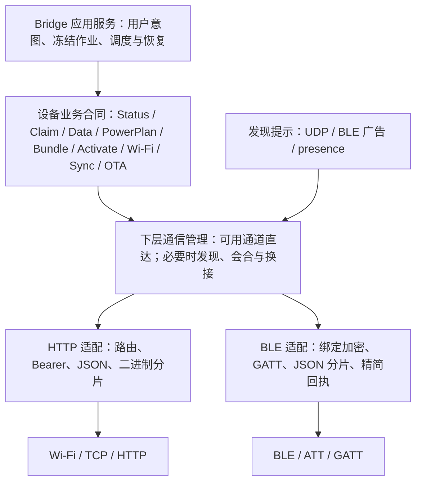

# Bridge 与设备协议：业务合同及载体映射

核对日期：2026-10-08。范围：当前工作树的固件及 Bridge；部署现场以 [PROGRESS](../PROGRESS.md) 最新节为准，当前已证 Note4 为 0.18.69-note4。本文不证明其他设备或 macOS 已部署同一实现。

## 1. 对“高层不区分 Wi-Fi / 蓝牙”的确认

**作为架构合同，这一点成立：同一业务操作的身份、授权、数据含义、提交条件、幂等与结果判定不应因载体改变。高层描述“对哪台设备做什么、何时算完成”，载体层描述“如何发送、编码和接收”。**

**Bundle、OTA、模板激活使用 HTTP 是正确的载体选择。HTTP 已可用而 BLE 未启用时，直接通过 HTTP 通信，不要求开启 BLE、进入交汇（会合）或完成 handoff。交汇属于下层连接管理，不是高层业务的前置阶段。**

高层不要求每种载体支持全部操作，也不规定 HTTP 与 BLE 的开启顺序。状态投影、报文包装、容量及执行时机差异在下层记录，不能仅凭这些差异认定高层合同未解耦。Data/Plan、Wi-Fi 控制及 claim 的共享处理核心提供了统一业务语义的源码证据。

本文 §3–§4 定义业务合同；§5–§6 描述具体载体协议；§7 链接独立的下层执行场景与实现对照。源码中的失败反馈是否满足合同单独核对，不与载体能力是否对等混为一谈。

## 2. 分层与边界



- 业务层：设备身份、当前会话、owner、上下文/版本、操作及结果。
- 载体适配：认证凭据的传递、命令到路由/特征的映射、分片、分页与 ACK 关联。
- 链路层：地址、连接、MTU、收发及有界超时。
- 下层通信管理：已有可用通道直接通信；需要恢复通道时发现候选、会合或换接。向高层提供可用性与明确结果，不将 BLE 生命周期或 handoff 强加为业务阶段；发现提示不能替代授权。

Codex app-server → Bridge 的 JSON-RPC、UI IPC、Bridge MCP 不属于本协议。Codex 是数据源；设备不理解账号、push/pull 分类或 Bridge 本地模板编辑状态。

## 3. 载体无关的身份与授权

| 概念 | 合同 |
|---|---|
| `device_mac` | Wi-Fi MAC 为稳定设备主键；IP、BLE 地址、显示名只用于定位或显示 |
| `bridge_id` / principal | 稳定调用者身份，与登记的 endpoint/bond 关联；不是当前连接的临时地址 |
| namespace | Wi-Fi 事务回执及重放围栏的隔离维度；不是配置编辑权限的创建者隔离 |
| endpoint token | 设备业务通道认证；HTTP Bearer 或 BLE 命令 `token` |
| device operation token | claim、OTA、诊断等管理入口凭据；与 endpoint token 分开，仅经受控绑定 BLE 链路获取/轮换 |
| `session_nonce` | 当前设备启动会话的认证状态给出的 32 位十六进制字符串；防止旧会话命令继续生效 |
| owner / lease | 只由显式 claim 建立；有效他人 owner 拒绝写入，lease 到期清空；与电源期限独立 |
| `active_context_id` | 设备当前激活上下文；模板切换产生新上下文，旧上下文数据不能应用 |
| `request_id` | 请求关联；具体幂等条件仍由各操作定义，不能假定所有请求都有同一持久回执机制 |

普通读写不能隐式取得 owner。匹配 owner 的活动更新时间与显式 claim 续约不应混同，更不能据此延长 light deadline。

当前 Wi-Fi 配置权限：有效 session + owner 可读取、修改、删除及启用全部来源配置；来源 bond 保留为来源/active 引用。配置 ID 冲突明确拒绝 `ambiguous_network_id`；回执查询与防重放仍按 principal/namespace 隔离。详见最新部署记录，早期“其他创建者只读”的文档已过时。

## 4. 业务操作与成功判据

| 逻辑操作 | 输入/条件 | 成功证据及副作用 |
|---|---|---|
| Status | 已认证设备身份；读取能力、会话及当前状态 | 当前真实上下文、已应用序号、计划、可用性；读取不续电源期限 |
| Claim / Renew | 设备操作 token、Bridge 身份、有限 lease | owner 处理结果；占用不等于发布授权 |
| Data | 当前 context、`seq`、完整 `fields` 快照 | ACK `data_seq` 与业务结果；原子应用，不发送部分字段 |
| PowerPlan | `plan_id`、`mode`、light 时长、会合周期 | 返回接受的计划及实际剩余秒数；正式计划是改变 light deadline 的入口 |
| Bundle Install | 冻结 `job_id`、完整 Profile/模板/资产、预期 context、长度及 CRC | 接收内容不代表发布完成；验证完整包并原子切换 A/B Bundle后，设备状态可确认提交；BEGIN/CHUNK/COMMIT 的实际传送见 §5.2 |
| Template Activate | `template_id`、预期 context、稳定请求身份 | 成功返回新 context；同一请求不重复切换 |
| Wi-Fi Snapshot | 冻结快照及分页关联 | 同 snapshot/revision 的全部页完整收到才可暴露完整配置 |
| Wi-Fi Apply | `expected_revision`、冻结整行变更 | 原子保存及读回校验后的 committed 回执；保存不会自动启用网络 |
| Wi-Fi Trial / Activate | 有限预算、目标 network/version、当前权限 | accepted 仅代表接纳；完成回执与认证网络状态证明结果 |
| Wi-Fi Result / Result ACK | 原事务身份及当前查询权限 | 查询原事务或确认已收到回执；退役围栏阻止旧写重放 |
| Diagnostic Sync | 冻结 batch、分页、ACK/complete | begin/page/ack/complete 全程绑定批次；不能将本地归档冒充设备确认 |
| Firmware OTA | 冻结镜像与作业、身份/target/版本/长度/hash 预检 | 上传 ACK 不代表部署成功；重启后的认证运行镜像 SHA256 匹配才是 `image_verified` |

Profile 包含 1–8 个有序模板，全部参与设备按键循环。Bridge 保存模板/Profile 只落盘；发布冻结完整 Bundle，是用户显式动作。现行发布不是 manifest 增量协议，也不能裁剪成旧 3 槽。

### 4.1 Data 与电源的幂等

Data 在同 context 下允许 `seq` 跳号：同序号同内容不重复绘屏，同序号不同内容 `seq_conflict`，旧序号 `stale_seq`，错误 context 拒绝。字段按设备当前 CompiledTemplate 的索引与类型校验。

字段需求以认证 `/api/status` 的 `data_contract` 为准，不从 Bridge 本地模板或 Profile 推导。BLE 同 context 可复用已取得合同；未知或变更合同先有界读取 HTTP 状态。只有成功 ACK 更新 Bridge 确认指纹和 full-sync deadline。push/pull 是 Bridge 数据绑定合同，设备只收到完整最新快照。

PowerPlan 在当前会话使用单调 `plan_id`；重复同内容不延长期限，同 ID 不同内容冲突，旧 ID 拒绝。claim、读状态、传数据、传 Bundle 都不续电源期限。BOOT provisional 从物理唤醒起算 300s，timer wake 不获得该兜底；USB 在线与正式 light 模式分别描述。

### 4.2 结果与恢复

高层必须分清：未发送失败、确定拒绝、已接纳未完成、已完成、已发送但结果未知。HTTP 2xx、BLE Write Response、TCP 可达都不是业务成功。

平台 ACK 常见字段：`op`、`result`、`display_state`、`retention`、`error`，按操作附 `data_seq` / `plan_id` / `active_context_id` / `accepted_remaining_s`。

- `result=applied` 与 `display_state=pending/failed` 可以同时出现：数据已应用不等于实体显示成功。
- `display_state` 区分 `unchanged/displayed/pending/failed`；`retention` 表达 ram/rtc/flash 保留范围，不能由载体猜测。
- Wi-Fi 返回还使用 `ok`、`outcome` 和异步状态，不应强行假定所有操作返回完全相同 JSON。
- 过期缓存明确提示重新读取设备并保留 Bridge 编辑；revision/context 冲突不能无限挂“待确认”。
- 已发出写且丢响应时，保留原 ID，查询原事务或操作对应状态证据；不能换 ID 盲重发。并非每类操作都有通用 `result` 端点。
- 操作和收尾共用有界预算；换连接/载体不重置事务，不新增期限。

### 4.3 Wi-Fi 事务寿命、快照与回执退役

Bridge Wi-Fi 读/同步等作业当前默认有效期24h；这是作业有效期，不是 RF 窗口，也不是自动删除设备回执的期限。本地 cancel/expired 保留 `sent/may_have_committed`，不能推断设备已经回滚或未提交。

完整配置读取采用冻结 snapshot/revision；当前设备冻结 TTL 30s。分页期间快照过期、revision 变化或失去所需 owner 权限明确拒绝；不以部分页替换完整缓存，保留旧缓存及 Bridge 编辑。只因进入页面、提交保存或查询结果，不反复读取整份配置。

现行 WFS4 新写事务使用 `w3_` 加16位小写十六进制非零单调序号，Bridge 持久分配并冻结。设备按 principal+namespace 保留最高已接纳序号；有回执先核对原业务指纹，无回执且序号已被围栏覆盖则拒绝重新执行。`outcome=retired` 只表示原回执已退役/序号已围栏，不证明原操作成功。

Bridge 持久确认原终态后才能 `result_ack(query_id)`；设备删除可退役的具体终态回执但保留高水位。不自动删除 pending/未知结果，账本满明确 `result_capacity`，游标满明确 `cursor_capacity`。旧任意ID回执不能套用新序号退役，返回 `legacy_receipt_retained`。换通道、重绑定或恢复旧 Bridge 备份不能清围栏或自动替已发事务换ID。

### 4.4 配置保存、匹配与迁移

配置保存版本和当前活动版本独立：更新/删除保存项不等于当前连接副本立刻替换，显式启用才切换。主机 host_ssid→设备 ssid 映射允许两端SSID不同；metadata/credential匹配只是保存内容判断，不替代原事务 committed 回执或实际 HTTP 认证。

旧槽迁移是显式受控兼容操作，不是自动 read/import。当前 BLE `wifi_migrate` 要求绑定认证、匹配 owner 与物理恢复机会，读取设备自身旧 NVS，原子迁移并验证后逐键退役；不把凭据返回或写日志，不启用网络/续期。`retirement_pending` 表示新数据可能已持久而旧键清理未完成，不等于迁移回滚。兼容代码最终移除需独立验收。

## 5. 实际 HTTP 绑定

设备通常监听 TCP 80。业务 JSON 使用 endpoint Bearer；claim、OTA 等管理入口使用 device operation token。具体入口各自校验，不把两种 token 混用。HTTP 与 BLE 都不是本文可据以声称端到端加密的同一安全通道：HTTP 当前为普通 HTTP，BLE 写入口要求 bond + encryption。

| HTTP 方法 / 路径 | 逻辑操作 | BLE 对应或边界 |
|---|---|---|
| GET `/api/status` | 完整认证状态与 data_contract | `status` 精简；`wifi_status` 分页投影在线/管理状态，均不能默认替代完整 data_contract |
| POST `/claim` | claim/续约及管理动作 | `claim`，需 `ble_claim=1`，普通 BLE 不支持 force/release |
| POST `/api/data` | Data | `data`，完整且符合本轮预算的小快照 |
| POST `/api/plan` | PowerPlan | `plan` |
| POST `/api/activate` | 模板 Activate | 未实现，BLE 普通分发返回 `http_required` |
| POST `/api/bundle/begin`、`chunk`、`commit` | 完整 Bundle 安装 | 未实现；开合法网络窗口后走 HTTP |
| POST `/api/wifi/command` | 统一 Wi-Fi 控制 | `wifi_command` + `command`，或已映射的 `wifi_*` |
| POST `/api/wifi/snapshot`、`apply`、`result`、`result_ack` | Wi-Fi 兼容入口，进入共用处理器 | `wifi_snapshot`、`wifi_save`、`wifi_result`、`wifi_result_ack` |
| POST `/api/sync/begin`、`page`、`ack`、`complete` | 诊断批次同步 | BLE `sync_config` / `sync_open` 是配置/开窗控制，不是批次传输替代 |
| GET `/api/ota/image?image_bytes=N` | 认证运行镜像 hash 证明 | 无同等镜像证明入口 |
| GET `/update`；POST `/doUpdate` | OTA 页面 / multipart 镜像上传 | 无 BLE 镜像上传 |

公开 `/status.json`、`/log`、`/pmstats` 是恢复/诊断视图，不能代替认证业务状态或凭据。`/diag`、`/history`、`/frame` 属辅助诊断入口，授权以实际 handler 为准，不因列入诊断就推定公开。

### 5.1 通用 Data / Plan 命令信封

当前源码中的通用会话校验要求 `device_mac`、`bridge_id`、`request_id`、`session_nonce`；**不要添加旧的 `protocol` 或 `rv` 字段**，`v2CheckCommandSession` 会拒绝其非空值。HTTP 路由已确定操作；BLE 另加 `op` 和 endpoint `token`。

以下是载荷结构示意，MAC/context/nonce/序号必须从真实目标和当前状态获得，`fields` 结构以设备报告合同为准：

```json
{
  "device_mac": "7C:4F:AD:B9:34:08",
  "bridge_id": "<stable-bridge-id>",
  "request_id": "<stable-request-id>",
  "session_nonce": "<current-session-nonce>",
  "active_context_id": "<current-context>",
  "seq": 42,
  "fields": []
}
```

此处空 `fields` 仅表示结构位置，不是可直接发送的完整有效 Data。Plan 在同一信封增加 `plan_id`、`mode=sleep|light`、`light_duration_s`（light 必需）、`rendezvous_period_s`。

### 5.2 Bundle 的载体分片

BEGIN/COMMIT JSON 关联同一 request/nonce 与 `length`、`content_crc`。完整 Bundle 内部携带 job、预期上下文及对象内容。CHUNK 发送原始字节，使用 request_id/session_nonce/offset 查询参数，客户端还发送 `X-Request-Id`、`X-Session-Nonce`、`X-Offset`。

Bridge 默认 chunk 4096B，客户端参数限制 256–16384B；这些是 HTTP 客户端传输参数，不是 Profile 容量。设备返回 `next_offset`，Bridge 严格核对；提交前重新核对 owner、会话、context、完整长度/CRC 和全部对象。

### 5.3 Wi-Fi 控制的例外信封

当前 Bridge HTTP `wifi_command` 仍写入 `protocol: 2`；BLE 对应入口反而拒绝 `protocol`/`rv`。这是现行适配/兼容差异，不能把通用 Data 规则盲套到 Wi-Fi HTTP，也不能逐字节照搬 HTTP JSON 到 BLE。

逻辑操作为 `apply` 时：HTTP `/api/wifi/command` 使用 `op=apply`；BLE 控制特征使用 `op=wifi_command, command=apply`，或者兼容 `op=wifi_save`。业务变更、expected_revision、稳定事务 ID 不因这层包装而改变。result 查询使用独立查询请求关联和 `query_id` 指向原写事务。

## 6. 实际 BLE / GATT 绑定

Service UUID：`e7f1a000-4b2a-4c9e-9a11-3c0d5e9a0000`。

下表 UUID 只列首段，其余均为 `-4b2a-4c9e-9a11-3c0d5e9a0000`。

| 首段 | 名称 / 属性 | 当前用途 |
|---|---|---|
| `e7f1a001` | INFO / Read | MAC、IP、固件、能力、wake、bond/encryption 提示；不是业务授权 |
| `e7f1a002` | Endpoint / Write + Write ENC | 登记 Bridge host/port/endpoint token/principal，与已绑定 BLE 身份关联 |
| `e7f1a003` | Usage / Write + Write ENC | 保留旧特征；当前回调不处理业务，不能据名字写 Data |
| `e7f1a004` | Status / Read + Notify | auth/endpoint 回执、业务状态与命令 ACK；需关联本请求，不能拿上次属性值当新 ACK |
| `e7f1a005` | Template Control / Write + Write ENC | 当前统一命令入口，名称为历史保留，不仅用于模板 |
| `e7f1a006` | Template Data / Write + Write ENC | 保留旧特征；当前回调不安装 Bundle |
| `e7f1a007` | Auth / Write + Write ENC | `cmd=token` 获取/轮换 device operation token |

### 6.1 首次关联与命令传递

绑定并加密后写 Endpoint JSON：`schema=2`、host、port、token、bridge_id。设备将其与实际 bond identity 关联；不能通过提交任意 principal 绕过已有绑定更新规则。

普通命令写 `e7f1a005`，JSON 包含 `op/request_id/device_mac/bridge_id/session_nonce/token`，Bridge 可附校时字段。`status` 是取得当前 nonce 的握手例外，不要求调用者已经知道 nonce。claim 另传 `operation_token`，当前普通入口拒绝 force/release。

其他已实现 BLE 命令包括 `handoff`、`sync_config`、`sync_open`、有界 `history` 及 `wifi_*` 管理查询/控制。不能把未实现操作转发到旧 Usage/Template Data 特征以规避 `http_required`。

### 6.2 分片、大小与 wire 投影

Bridge 当前 JSON 写分片上限 180B；完整 JSON 在设备缓冲组装后分发。这是客户端保守值，不是 ATT MTU 恒等式，实际写入仍须满足协商 MTU。分片中途失败应结束受污染接收链路，不拼接下一条请求。

设备接收上限：Endpoint 1024B、Auth 256B、普通 Control 8192B；Wi-Fi Control 另限制 4096B。INFO/Status 单属性完整序列化结果上限 **512B**。请求与响应有不同上限，不能把 8192B 当可读属性容量。

`ble_wire=1` 是 BLE 编码版本，与 endpoint `schema=2`、Wi-Fi 能力 `wifi_management=3`、编译器 ABI、固件版本分别独立。

| BLE 字段 | 解码后含义 |
|---|---|
| INFO `f` | 固件版本的标准 Base64 |
| ACK `rid` | request_id 的标准 Base64；Bridge 解码后关联请求 |
| ACK `w=[generation,wake_seq]` | 当前唤醒身份 |
| ACK `ctx` | active_context_id 的标准 Base64 |
| Status `s` | 有序精简状态数组，顺序见下文 |

`s` 顺序：nonce、Base64 context、Base64 active template、Base64 committed job、applied seq、light、plan ID、remaining seconds、provisional seconds、sync available、sync enabled、rounds、due、retry skip、pending batch、commit seq。

业务 ACK 包装为 `ack=command` 或 `ack=wifi`；Bridge `decode_wire` 还原关联信息。过长 history 可分页并标记 `more`；不能裁剪身份。结果封装仍超限时返回 `result=unknown,error=reply_too_large`，不能将可能已执行的命令伪装成拒绝。

## 7. 下层执行场景与实现的独立入口

具体载体协议（本文 §5–§6）只描述消息、路由、特征、分片与关联。下层“何时直连、何时交汇、何时开启 HTTP、何时关闭 BLE”的执行规则独立维护：

- [下层通信场景与执行规则](bridge-device-communication-scenarios.md)：S01–S20，应有行为与验收准则，不依赖报文字段或源码函数。
- [场景与当前实现对照](bridge-device-communication-implementation.md)：源码证据、ready 的不同含义、当前状态机/超时常量及未证明边界，不将场景合同写成已实现结果。

最新设计正常路径为“BLE接纳及分项反馈 → 结束普通BLE → 准备HTTP → 设备主动HTTP报告 → Bridge访问设备服务完成原工作”。这是目标规则，当前旧handoff实现见独立对照；HTTP直达不要求BLE。

日常设备主动联系若在 BLE 能力/预算内即可完成，本轮只走 BLE，不启动 Wi-Fi/HTTP，也不执行 handoff。这是下层执行范围，不能据此假定已实现新的“一次联系返回全部工作”报文；当前 Status/Data/Plan 等 wire 沿用各自现有映射。

发现 wire 仍属于下层协议：UDP 8767、BLE 广告及设备→Bridge 的 HTTP `POST /api/device/presence` 都是 hint，不替代认证状态。候选发现使用 IP 属性、UDP、Windows ARP 和手动 BLE，mDNS 已关闭，命名实例不监听固定 UDP 8767。

## 8. 实现边界与文档冲突处理

以下分开记录下层绑定差异、旧文档差异和业务合同的反馈边界；载体分工本身不是待修缺陷：

- 泛化设计 §8 的通用 `protocol`、Data `data_seq` 是旧表述；现行通用命令拒绝 `protocol/rv`，Data 请求使用 `seq`，ACK 使用 `data_seq`。Wi-Fi HTTP 的 protocol 例外见 §5.3。
- “HTTP/GATT 同一逻辑状态”不等于相同 JSON 或相同字段完整性；普通 BLE 状态没有完整 data_contract。
- claim 共用核心，BLE 与 HTTP 管理入口可承载的动作不同；Bundle/OTA/模板 Activate 使用 HTTP 属正确的下层分工，不要求补齐 BLE 入口。
- 固件普通 HTTP ACK 构造器未统一回显 request_id，BLE 会追加关联信封；客户端不能假定每个 HTTP 返回都有通用 ACK envelope。
- 现行 BLE 仍存在未绑定写拒绝、畸形/超长组包、mailbox 满等入口直接返回/丢弃路径；Bridge 提供有界超时，但不等于每次固件拒绝都有结构化 ACK。项目“任何请求必须明确返回”的合同不能据此宣布全链路已达成。
- Data 的下层执行时机不同：BLE 会合后绘屏，HTTP 当次尝试绘屏；高层统一读取 applied 与 display_state，不将会合规定为所有 Data 的必经阶段。

权威架构与现场分别见 [通用平台设计](generic-display-platform-design.md)、[电源与身份](power-state.md)、[最新交接](../PROGRESS.md)。Wi-Fi 原设计见 [统一控制设计](../project-workflow/bridge-macos/wifi-unified-protocol-design.md)，其中旧 WFS3/创建者只读/旧信封例子须结合当前 WFS4 与源码阅读。实施及验收待办仅以 [backlog](roadmap/backlog.md) 为准。

旧实现、阶段现场、遗漏合同与待实现草案的逐项区分见 [历史对账](bridge-device-protocol-history-audit.md)。Bundle v3 与字体增量发布仍是未来方案，不能从历史草案 URL 推定当前设备支持。

## 9. 源码核对入口

| 内容 | 源码 |
|---|---|
| HTTP 路由、BLE dispatcher、共享 Data/Plan、claim、完整状态、OTA | [main.cpp](../src/main.cpp)：setupWebServer、serviceV2Ble、applyV2Data、applyV2Plan、handleBleClaim、handleV2Status |
| 通用会话与 ACK | [v2_command_envelope.cpp](../src/v2_command_envelope.cpp) |
| Data / Plan 决策 | [v2_data_command.cpp](../src/v2_data_command.cpp)、[v2_plan_command.cpp](../src/v2_plan_command.cpp) |
| Wi-Fi 统一处理与事务 | [wifi_management.inc](../src/wifi_management.inc)：wifiControlCommand；[wifi_setup.cpp](../src/wifi_setup.cpp) |
| GATT 表、组包、安全写门禁 | [ble_bridge.cpp](../src/ble_bridge.cpp)、[ble_bridge.h](../src/ble_bridge.h) |
| BLE wire 精简投影 / 512B 约束 | [ble_wire.cpp](../src/ble_wire.cpp)、[ble_wire.h](../src/ble_wire.h) |
| 会合与 handoff 证明 | [rendezvous_protocol.h](../src/rendezvous_protocol.h)、[rendezvous_protocol.cpp](../src/rendezvous_protocol.cpp) |
| Bridge HTTP / Bundle / Wi-Fi 客户端 | [device_client.rs](../bridge/crates/core/src/device_client.rs) |
| Bridge GATT 客户端 / 解码 / 超时与关联 | [ble lib.rs](../bridge/crates/ble/src/lib.rs)：command_with_id、decode_wire |
| Bridge 冻结作业及 Wi-Fi 恢复 | [platform/service.rs](../bridge/crates/core/src/platform/service.rs)、[platform/wifi.rs](../bridge/crates/core/src/platform/wifi.rs) |

## 9. 新信封提案（未实施）

用户要求信封小于 50 B 的设计见 [48 B 信封设计](bridge-device-compact-envelope-design.md)。它通过认证会话绑定去掉每条消息的重复身份字符串，采用固定二进制布局；不改变现行业务合同，不代表当前设备支持，HTTP 认证头和业务载荷另计。
