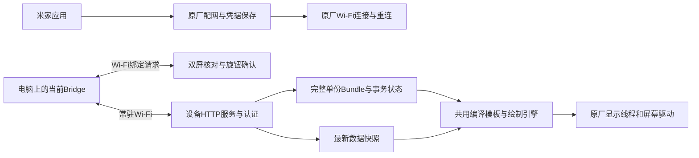
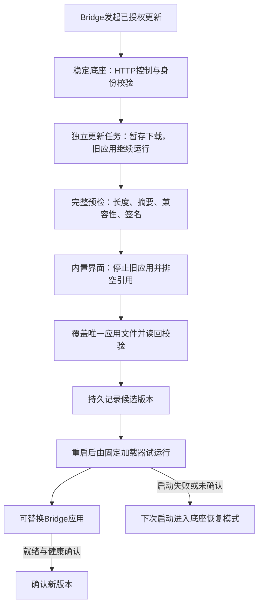

# AP01 0031 接入当前Bridge：设计与资源预算

> 2026-10-14最终用户决策：设备没有fallback；0031为基线，采用OTA与常规通信/绘图双进程；绑定改为[Wi-Fi双屏4位固定码核对＋AP01旋钮确认](screen-binding-design-20261014.md)，仅防误绑定，首版不要求严格加密。支持多对多持久绑定，有效owner时拒绝新码，空闲后可匹配。OTA独立存活是新增实现目标，绝非已有恢复能力；保留原生双槽不推导自动回退。原厂NuttX进程/任务的地址空间隔离仍未证实。

> 2026-10-14历史BLE路线核验（已不作为当前前置条件）：原厂ATT检查的真实指令固定拒绝加密/认证权限，10个场景和6144个组合验证通过。仅复用原厂GATT表不足以绑定，必须先补齐同一host的SMP、加密事件与持久密钥；相关适配及新增资源预算尚未完成，不能沿用下文历史估算作为已可容纳的证明。见[绑定专项](ble-binding-20261014.md)。

> 2026-10-13目标核对：部署目标为**0031自定义App变体**，沿用本文稳定底座＋App和单份更新设计；首次刷入及验收见[刷入方案](first-flash-plan-20261013.md)，已有产物与缺口见[准备索引](preparation-index-20261013.md)。0041签名/资源分析仅作版本对照，不列入部署路线。历史预算须按当前源哈希复算，不能当作实机容量。

> 2026-10-12 同步：平台更新规则唯一引用 [C9 单份更新设计](../single-copy-updates/design.md)，实施与部署见 [C9 状态](../single-copy-updates/status.md)，待办归主项目 C9。Note4 已实现单份 Bundle、下载暂存、动态容量与分块压缩；AP01 当前交付为设计和静态证据，独立应用加载、解压接口及实机尚未验证。原生固件 OTA 双槽保留。

2026-10-11。对应BRIEF-RE-002 / SPEC-RE-002。交付状态为设计及尺寸试编译完成，设备端移植、可刷ROM和实机验收尚未完成。以下KiB按1024字节，MiB按1048576字节。

## 1. 结论与范围

采用用户指定方案：AP01作为供电期间Wi-Fi常驻、不进入设备休眠的显示终端；米家和原厂固件负责配网；Bridge绑定采用Wi-Fi双屏核对与设备旋钮确认，普通token用于已绑定身份检查。日常数据、状态、模板、发布与设备管理全部走Wi-Fi。断网报离线，不自动转到BLE传送业务数据。

资源层面有继续实现的依据：0031启动代码把4 MiB外部内存加入现有修改版使用的通用堆；256 KiB正文示例曾按约160–400 KiB常驻、384–768 KiB安装/恢复峰值做预算；动态容量及内置更新界面下释放旧内容后的通用预算须按实际条目重新计算。上述为设计目标，不是空闲量或运行测量。现有59.5 KiB注入空间不能据此认为足以装下完整接入；还要解决扩展代码空间、原厂网络/显示接口，以及安全绑定。

这是将Bridge的设备协议和本地绘制能力移到AP01，电脑上的Rust/Tauri程序仍运行在电脑。保留1–8项完整有序Profile、完整单份Bundle、单一活动上下文、设备身份和所有权检查、真实错误与完成回执；不把远程图片下载冒充完整平台接入。

原厂复用依据必须先读[0031分区与启动入口复查](knowledge/0031分区与启动入口复查.md)第4、7、8节，以及[原厂定时任务机制与webclient上下文构造](https://github.com/andy-JustSayWhen/cuktech-ap01-firmware-tools/blob/3bd98a8ca4fb35a9f8869121b13961d405b16dff/knowledge/AP01-%E5%AE%98%E6%96%B9%E5%9B%BA%E4%BB%B6%E5%88%86%E6%9E%90/%E5%8E%9F%E5%8E%82%E5%AE%9A%E6%97%B6%E4%BB%BB%E5%8A%A1%E6%9C%BA%E5%88%B6%E4%B8%8Ewebclient%E4%B8%8A%E4%B8%8B%E6%96%87%E6%9E%84%E9%80%A0.md)。后者已有客户端不等于已找到HTTP服务端接口。本设计没有授权调用尚未确认参数的原厂函数。

## 2. 拟采用的结构

保留原厂系统启动、堆、Wi-Fi/蓝牙栈、米家任务、文件系统挂载、显示驱动和首次更新入口。服务从经过验证的任务创建路径启动，网络读写有期限，绘制请求投递到原厂显示线程。不能从网络线程直接操作界面，也不能把长连接和模板解析放到原厂定时器回调里。原厂界面/米家任务的内存不会因为自定义业务精简就自动释放。

新增状态由明确初始化函数创建、按需分配并持有；所有失败路径释放临时对象。现有result_loader.ld只有载荷代码和只读数据区，没有给一般C++程序提供可写全局、清零区和全局构造流程。不得直接把当前设备源码链接到这个脚本后当成可执行移植，也不把宿主测试用Arduino/String/文件系统模拟层作为设备运行时。

### 2.1 常驻Wi-Fi与米家配网

拟扩展设备能力为`power_mode=always_on`、`ble_pairing=false`、`binding_method=screen_confirm_v1`、`ble_data=false`、`wifi_provisioning=mijia`；这些字段是设计草案，当前Bridge没有实现。旧设备缺字段继续使用现有行为，不能因为看不到新字段就默认常驻。AP01不走Bridge BLE配对或业务路由；原厂米家蓝牙不受此能力字段控制。

AP01不实现深睡、定时唤醒、限时联网窗口、BLE会合、无线交接和BLE业务分片/回退。Bridge对此目标不生成休眠/开窗计划，不等待唤醒，不保留等待窗口的任务；仍保留数据更新计划、owner租约、请求超时、重试预算和原事务查询。普通请求不通过虚构PowerPlan续期。设备若收到不支持的休眠命令，返回明确不支持，不能回执成功后继续联网。

米家管理Wi-Fi配置及重连；Bridge提供连接状态与离线诊断，不提供该目标的Wi-Fi密码编辑、扫描保存、切换或BLE网络修复流程。界面及MCP依据设备能力直接说明“通过米家管理网络”，不把这类请求留在等待状态。Wi-Fi中断时先让原厂恢复连接；改变路由器配置走米家流程。

用户显式发起Wi-Fi绑定，设备无有效owner且未维护时显示固定四位核对码；旋钮确认后原子保存该Bridge独立凭据。绑定长期保存，owner租约到期不删除；已绑定重连不弹码，多个绑定共存但单一owner。数字不是密码，不作为身份主键；原厂米家蓝牙任务和配网保留，详细并发/失败合同见[双屏方案](screen-binding-design-20261014.md)。

绑定后通过带令牌HTTP显式claim；之后才允许发布。所有权冲突、会话过期、身份不一致按当前协议拒绝，续约不等于发布。断电后依靠完整Bundle恢复页面，联网后刷新状态；常驻不代表永不掉电，仍保留原子提交和恢复。

### 2.2 显示与Bridge修改范围

拟定固件目标`cuktech-ap01-0031`、显示目标`lcd-jd9853-320x240-1bpp`，实机验收前`hardware_verified=false`。初版保持当前黑白绘制语义，适配到彩色屏输出，暂不新增彩色模板语言。显示方向和320×240尺寸仍需真机确认。

电脑侧同步修改设备能力校验、模板编译画布、字体目标验证、共用渲染、设备发现/业务传输选择、网络管理界面及MCP、电源计划分派。当前部分编译路径把非Note4目标按200×200处理，仅增加一个目标名称不够。拟保留现有共用C++绘制语义及模板格式，主机预览与设备逐像素比对；未知字体/type/bind整包拒绝，不悄悄降级。

优先使用两份320×240单色帧和16行RGB565转换区，通过已确认的原厂显示入口传送。硬件传输是否可直接使用外部堆未知，转换区的分配/对齐须按原厂要求实现。若必须另建完整彩色帧，每份额外153600字节，必须重算预算，不能藏在显示适配内。复用原厂已有帧的前提是证明所有权、线程和同步关系。

## 3. 历史测量尺寸与估算方法

[resource-budget.json](../../artifacts/ap01-research/raw/bridge-budget-20261011/resource-budget.json)保存源文件SHA256、工具版本、编译命令及算式结果。`resource_budget.py`提取本仓库codex_status生产定义，用RV32编译器生成只包含常量的数据对象，再提取结构尺寸。这证明报告所记源哈希下的固定布局大小，不证明C++程序能链接、启动或正确运行。以下结构尺寸、字体符号及预算均来自2026-10-11探针，移植当前源码前须重新生成；原始产物保留不改。

| 项目 | 字节 | 依据 |
| --- | ---: | --- |
| 单个编译模板CtTemplate | 11321 | 历史RV32试编译；64操作、32需求、16资源 |
| 单个序列化编译模板 | 11333 | 12字节头加结构体 |
| 单色屏一帧 | 9600 | 320×240÷8 |
| 两份单色帧 | 19200 | 保留当前画面和待提交画面 |
| 16行彩色转换区 | 10240 | 320×16×2 |
| 完整RGB565彩色帧 | 153600 | 320×240×2；基本预算未另建此帧 |
| 历史持久槽头/元数据记录 | 130 / 138 | 原探针尺寸；当前单份格式以C9实现为准，不套用此记录 |

当前生产编译模板格式按最大项数固定布局，这是现有格式的成本；接入端仅长期持有活动模板，其他模板在文件内，安装/切换时再按需要申请一个临时模板。不把8个模板同时常驻，也不把大结构放进服务任务栈。以后若改为实际条目格式，应作为独立协议版本同时修改两端，不在本轮私自改变现有编译格式。

### 3.1 新增内存预算

以下为新增服务的预算，不包含原厂已占内存；数值为容量上限/允许量，不要求启动时预分配固定大数组。实际条目按数量分配，记录所有权与释放时机。

| 基本项目 | 字节预算 |
| --- | ---: |
| 活动编译模板 | 11321 |
| 两份单色画面 | 19200 |
| 16行彩色转换 | 10240 |
| 请求/响应帧各4096字节 | 8192 |
| HTTP头与小型重放回执 | 1536 |
| 会话、owner、事务等控制状态暂估 | 4096 |
| 原始数据与字段内容暂估 | 16384 |
| JSON解析对象/临时空间暂估 | 32768 |
| 单个新增服务任务栈暂估 | 12288 |
| 文件流缓冲暂估 | 8192 |
| 基本合计 | **124217，约121.3 KiB** |

还要加活动字体F、网络连接/原厂函数新增分配量及堆管理成本。动态包按实际解码字体核算；单字体48 KiB、最多8项仍为当前格式规则，未压缩正文为P时，字体原始字节理论总量不超过min(384 KiB,3P/4)；若正文压缩，必须改用解压后长度核算，包中其他内容还占空间。固定256 KiB示例的192 KiB字体上界不能用于所有动态包。

基本124217字节只是一组规划允许量，不要求预分配。空配置无需加载模板和字体，典型4模板/32 KiB字体对应约153.3 KiB加网络成本；实际准入上限要检查可用堆、最大连续块、解析对象和栈。256 KiB样例原常驻160–400 KiB、安装384–768 KiB不作为所有动态包的承诺。

下载和预检期间旧应用继续运行，暂存占用与旧内容共同计入准入；校验完成、即将覆盖时才切到稳定底座内置界面，排空旧绘制、线程、回调和文件引用，释放旧模板/字体，再采用新内容。退出失败则拒绝覆盖。完整生命周期引用平台C9。

主项目生产Bundle安装已采用有界读取、字段过滤和逐项模板／字体解析，压缩正文按块读取；当前实现见 [bundle_store.cpp](../../src/bundle_store.cpp) 和 [bundle_payload.cpp](../../src/bundle_payload.cpp)。AP01仍须适配文件与内存接口，不能把Note4测试当作AP01峰值证明。按空、单、典型和实际上限记录解析、字体、解压器及网络的同时存活量，服务栈须有调用链和实测依据。

### 3.2 代码和只读资源

现有GIF无损整理后腾出的代码区为60934字节，约59.5 KiB。历史Note4编译产物中的已选字体表为34239字节，另选四个模板核心函数合计11498字节；后者不含全部辅助函数、JSON、字符串、认证、HTTP、存储和运行时。证据见[符号参考](../../artifacts/ap01-research/raw/bridge-budget-20261011/esp32-symbol-reference.json)。这是Xtensa代码参考，不能直接换算成AP01机器码长度；字体数值只代表该历史镜像。当前主项目已支持随Bundle发布的CSFN v2字体和UTF-8文本，相关候选与实机状态见 [字体专项](../bridge-macos/release-fonts-status.md)。AP01须按实际字体资产预算并声明能力，不能把历史字体表作为当前ROM的固定成本。

因此59.5 KiB不能作为完整接入的已可用预算。首个完整链接目标暂定**256 KiB代码及只读资源**，这是空间规划，不能声称已编译达到。现有第一段GIF原长385834字节；如改为小型占位动画，可在同一原始资源范围内研究腾出256 KiB，剩余动画最大约123690字节，尚需对齐。必须重新核对资源描述符、所有引用和补丁允许范围，不能只修改链接脚本上限。此选择会缩减原厂该动画内容，属于设计取舍，尚未制作。

保留原厂Wi-Fi/蓝牙/显示/文件系统实现，避免再链接一套网络或蓝牙栈。去掉自定义休眠、联网窗口、BLE业务回退和Bridge配网管理，能减少代码与测试组合；实际节省多少必须由链接映射文件证明，本轮不填虚构数字。当前工具链仅保留C前端，完整共享C++引擎还需匹配的C++编译与运行时适配；默认C++全局初始化、异常和动态字符串依赖必须逐项解决。

### 3.3 动态单份内容的持久空间

存储和准入规则引用 [平台单份更新设计](../single-copy-updates/design.md)。Bundle保持完整有序1–8项，按实际可用空间、模板数量、文件系统预留和运行成本准入。主项目已用bundle_storage_protocol=2报告动态max_bundle_bytes，压缩另报告max_bundle_decoded_bytes；旧设备保留256 KiB兼容上限。AP01应在实现并验证后声明相应能力。

本轮预算使用一份64字节头、正文P、每模板32字节索引及11333字节编译缓存；共同预留暂定64 KiB，具体字段格式在实现前验证。8项/256 KiB正文单份文件353128字节，加预留418664字节；再加一份256 KiB应用共680808字节，约664.9 KiB。原厂占用及实际额外开销另扣，精确场景见[单份预算JSON](../../artifacts/ap01-research/raw/bridge-budget-20261011/single-copy-budget.json)。

/resource名义1.25 MiB，实际空闲未知。下载准入必须容纳当前驻留内容、完整暂存包、缓存和预留；不能预先回收旧内容、删除原厂文件或格式化分区。覆盖阶段的空间和损坏恢复要求引用平台C9。上述680808字节是样例稳态占用，同大小未压缩包暂存时为942952字节，原厂占用另扣。压缩暂存与驻留方式的比较、原厂解压证据见 [C9 AP01评估](../single-copy-updates/design.md#ap01-压缩暂存评估)；最终应用存储格式尚未定稿。

### 3.4 传输与处理时间

沿用当前4096字节HTTP帧上限，48字节帧头之外最多4048字节供对应内容使用，属性也消耗预算。256 KiB纯Bundle正文至少65个分块请求；数据快照通常远小于屏幕像素，不需每次传153600字节彩色帧。当前模型允许8192字节快照，但不能因此保证单个HTTP帧可以携带它；必须在两端统一有效长度并明确拒绝超限，若以后增加分片则单独升级协议并测试完整性。

本轮未测试吞吐、CPU占用或刷新延迟。验收目标可先设普通数据更新1秒内采用、最大包30秒内完成，均为局域网原型目标而非产品承诺。常驻Wi-Fi省去唤醒等待，但处理函数、文件读写和显示仍需实测有限超时。

## 4. 分阶段实现与可行性判断

| 阶段 | 产物与完成条件 | 当前判断 |
| --- | --- | --- |
| A：静态预算 | 原厂堆调用、数据布局、存储算式、当前共享代码成本参考 | 已完成；不等于运行验证 |
| B：最小设备适配 | 可靠任务启动、堆统计、只读网络状态、HTTP有限响应、显示线程投递；验证原厂米家配网保留 | 接口/线程ABI仍需逆向，未实现 |
| C：授权接入 | Wi-Fi双屏核对与旋钮确认、多对多binding及MAC/token/owner验证，Bridge常驻能力与仅Wi-Fi业务路由 | 关键未决项；不能以免认证接口替代 |
| D：完整Bundle | C++共享引擎链接、流式安装、单份校验提交、字体生命周期、主机像素一致 | 内存有设计余量；代码空间及文件系统待验证 |
| E：候选ROM与实机 | 精确0031基线、资源补丁范围、镜像校验、首次安装/运行核对、独立恢复验证 | 无硬件，不宣称可部署 |

当前结论是**技术上值得继续，资源未显示出硬性不可行；不能保证现在即可接入**。4 MiB堆配置显著改善内存前景。首要障碍是功能接口和授权方式，其次是代码注入空间与实际/resource余量，CPU性能尚无实测。

首次安装沿用已有0031修改包的原厂更新路径作为研究基础，作者报告不能代替目标机器验收；独立恢复、硬件USB数据能力、Boot2和安全配置仍未知。日后支持Bridge更新也必须复用已核实的原厂更新写入/切槽，并保留认证，不能将文件系统写操作当作安全烧录。0041不在本设计兼容范围。

本轮选择构建**数据尺寸探针**而不生成可刷ROM：完整C++适配、服务端调用、绑定和启动尚未就绪，当前拼出文件无法证明可执行。没有修改或重启当前Bridge，没有访问设备、米家账号或用户运行数据，也没有提交代码。

## 5. 验证要求

1. 构建：固定0031哈希；完整链接无未解析符号；列出全部注入段和运行时初始化；字体与代码总尺寸满足实测资源区；没有越界补丁。
2. 功能：米家初次配网/换网可用；Bridge授权失败完整拒绝；Wi-Fi在线更新和断网恢复；BLE不承载业务；此目标不生成/执行休眠计划，原设备保持原电源行为。
3. 资源：空/单/典型/8项分别记录持久字节、空闲堆、最大连续块、栈高水位、安装/字体切换/缓存损坏恢复峰值；包括分配失败。动态准入上限的峰值按实际内容重算并报告，不用压栈掩盖。
4. 持久化：每个写入和提交阶段模拟掉电、截断、损坏、超长及未知格式；恢复有效新内容或内置维护界面，允许旧内容丢失；重试查询原事务，结果不确定不能冒充完成。
5. 渲染与协议：同一模板/字体/数据逐像素一致；完整1–8模板循环；真实data_contract；快照长度与HTTP帧一致；MAC/token/owner/session冲突与错误阶段透传。

原始证据和试编译产物集中在[bridge-budget-20261011](https://github.com/andy-JustSayWhen/cuktech-ap01-firmware-tools/blob/3bd98a8ca4fb35a9f8869121b13961d405b16dff/project-workflow/ap01/raw/bridge-budget-20261011)。源文件有并行开发变化时以resource-budget.json记录的源哈希为准；Note4运行版本/部署以主项目PROGRESS为准，本报告不替代现场记录。

## 6. 独立应用OTA及稳定更新服务

用户要求评估Wi-Fi直接OTA应用，并提出更新协议应成为独立服务，再扩展调查原厂HTTP接入点。本节为可选架构评估，不声称现有修改版已实现动态应用更新。原厂证据先见[分区与启动第9节](knowledge/0031分区与启动入口复查.md)和[网络监听与HTTP复查](knowledge/0031网络监听与HTTP复查.md)。

### 6.1 方案选择

| 方案 | 复用对象 | 新增工作与限制 | 判断 |
| --- | --- | --- | --- |
| 原厂完整镜像OTA | 原厂下载、校验、双固件槽 | 每次更新包含系统和应用的完整镜像；现有首次触发流程仍涉及米家控制面 | 0031作者已有记录，可作底座首次安装基础 |
| 直接挂原厂HTTP服务 | 原厂HTTP监听及路由 | 本轮未找到此服务；已定位的是回环米家内部监听和HTTP客户端 | 暂无证据支持，不据字符串硬接 |
| 新增薄HTTP控制服务，原厂客户端拉包 | 内核网络、现有webclient、文件系统 | 增加少量控制/状态路由，底座复用客户端下载应用；应用执行加载仍需验证 | **完整Bridge兼容方向的首选研究方案** |
| 全部由设备主动拉取 | 现有webclient | 可减少设备监听代码，但Bridge须增加命令队列、设备主动回执和新的传输适配，配对后仍认证 | 适合更新下载/原型；当前Bridge完整业务不能直接套用 |
| 新底座调用米家内部更新入口 | 127.0.0.1:54322或原厂命令分派 | 要核实内部帧、调用权限、任务上下文及原厂校验；不是把内部口开放到局域网 | 有价值的后续逆向方向，纯局域网触发尚未证明 |
| 差分重建完整镜像 | 原厂双固件槽与更新校验 | 只传变化内容，在非活动固件槽重建完整镜像；需核实镜像映射及安全写入/提交 | 有吸引力的中间方案，避免动态代码执行和额外应用文件 |
| 每次开机从Bridge取应用到内存 | 原厂下载、可执行内存加载 | 减少应用落盘，但断网冷启动无法运行该应用；仍需解决代码执行与认证 | 仅开发可选，不满足离线恢复的完整交付 |

固定底座与可更新应用之间采用明确的版本化C接口，传入功能表及上下文，封装经核实的原厂绝对地址。应用不得自行猜测0031系统地址，底座基线不匹配立即拒绝。共用字体或稳定绘制代码可以留在底座，减少独立应用包，但这部分以后更新仍需要更新底座，不应宣传任意代码都能独立更新。

### 6.2 更新服务的责任与生命期

稳定底座保留网络控制入口、绑定和令牌校验、设备身份/owner、更新任务状态、包验证、单份应用校验、启动失败状态和恢复模式。应用仅注册业务处理并使用底座服务。更新任务不能由应用拥有，也不能在卸载应用时被删除；采用两个独立进程：OTA进程负责认证更新、包校验、安装与查询；业务进程负责常规通信和绘图。两者复用原厂Wi-Fi/蓝牙栈，OTA接收和查询不能依赖业务进程的事件循环或锁。原厂执行单元、IPC和停止/重启ABI须先核实；仅有双任务不能当作内存隔离。

基础控制服务在未加载应用时仍能查询状态、接收已授权修复包。请求先验证身份与owner，再创建持久事务；查询和重试使用同一事务ID。应用未运行时业务接口返回明确不可用，不能拖成无限等待。所有权与配对服务的具体原厂适配仍待实现，不能用公开无认证恢复口代替。

首版采用“暂存下载、预检、停止旧应用、覆盖并读回校验、记录候选、重启、试运行、确认”的更新方式，不做运行中替换代码。这样避免旧回调、线程栈和堆对象仍引用旧代码。下载完整不等于安装成功；只有新应用报告匹配版本、代码摘要和就绪状态后才确认；设备重启期间报告结果未知并查询原事务。下载或预检失败保留旧应用；进入覆盖后允许失去旧应用，不完整或未通过验证的应用不得执行，底座继续提供内置界面和认证修复入口。

独立任务不提供内存隔离。当前未证明AP01原厂可提供进程级隔离，应用内存越界或内核死锁仍可能影响更新任务。失败后回到内置恢复界面依赖独立的启动记录及实际可用的看门狗/重启机制，需实测；原厂双固件槽仍保留，它与项目单份应用文件的重传恢复各自独立。底座损坏也不能靠应用更新服务自行恢复，仍需完整镜像/硬件恢复方案。

### 6.3 更新协议与下载复用

控制面只接收小型更新说明、开始/取消/查询/激活请求。下载在独立任务中调用已核实的原厂webclient，逐块写暂存文件，限制总长度、超时和连接数；先完整预检，再停止应用并覆盖，不在内存中收齐整包。HTTP业务路由仍使用当前完整协议，不能因为更新采用主动下载就擅自把整个Bridge变成图片轮询服务。

应用说明应显式包含设备目标、0031底座标识、应用接口版本、应用版本、持久数据格式兼容范围、压缩前后长度、各段长度、入口偏移、摘要及签名信息。所有长度/计数/入口/重定位范围先校验再分配；未知格式和不支持的重定位直接拒绝，不执行任意上传文件。摘要只能检查完整性，发布授权仍由已认证会话和包签名提供。

可用用户自有发布密钥签名，私钥留在电脑受控存储，底座仅保存验证公钥；这不需要取得厂家私钥。它也不绕过首次安装时的原厂校验，0041不因此获得兼容性。传输中不把Bridge令牌放在URL或日志；客户端下载鉴权头和服务器身份验证能力须逐项核对后选用，不能假定原厂webclient已有所有接口。

优先检查原厂是否启用可加载程序格式；无正面证据时研究受限应用包加载器。内存执行区域、权限、缓存同步、地址重定位、全局数据初始化、调用约定和C++构造流程全部是前置条件。原厂事实文档第7节的4 MiB通用堆证据不自动满足代码执行条件。加载器首个验证应为小型、可返回的函数模块及健康回执，成功后再接共享引擎；本轮没有硬件，不能以离线对象编译通过替代运行验证。

### 6.4 独立应用在单份策略下的成本

项目自管应用与Bundle均只保存一份，固件原生双槽保留。动态正文与应用共用空间时先申报和串行准入，不能同时承诺两份互相占用的free。当前一份256 KiB应用加8模板/256 KiB正文及预留共680808字节，512 KiB正文场景共942952字节；实际原厂占用另扣。以上均为稳态样例；暂存包必须另外计入，应用和Bundle更新串行准入。完整公式及限制以平台C9为准。

如果应用代码及只读段有256 KiB复制到RAM执行，就在按实际内容计算的运行预算上再加256 KiB及装载/重定位成本。更新进入内置界面并停掉旧应用，释放旧代码/对象后才装载新应用，不需要同时运行两份。可执行内存、原厂接口及任务/回调彻底退出仍需验证。

稳定底座可以保留共用绘制和字体以缩小应用包，但相应部分更新仍需更新底座。单份应用的资源评估包括唯一已安装文件、暂存包、读回缓冲及运行内存，实际加载验证仍未完成。

### 6.5 实施次序

先核实内核socket/bind/listen/accept及有界超时，完成可认证的小型控制服务；并行研究原厂内部OTA命令路径在设备侧如何安全触发。之后验证可执行内存和最小模块加载，实测/resource占用，再决定独立应用包的硬上限及共享代码放置。最后实现包格式、单份校验、启动确认和内置恢复，并接入完整Bridge业务。上述“并行”描述研究依赖，不要求启动多个代理。

本轮评定：Wi-Fi传送完整ROM已有0031作者实践；Wi-Fi独立更新新增应用在架构上成立，但当前ROM/修改版没有被证明具备现成应用安装器。稳定更新服务是合理设计方向，原厂HTTP客户端和内部网络监听是可利用的基础，原厂局域网HTTP服务尚未确认。可执行模块加载与实际动态资源准入仍是主要验证条件。

### 6.6 差分重建：只传应用变化，仍按完整镜像启动

用户希望扩大方案范围，另列一条不依赖独立应用加载器的路线：电脑从精确已知旧镜像和新镜像生成变化包，稳定更新服务在非活动固件槽组合旧内容与变化块，验证完整目标镜像后交给原厂更新提交流程。网络只传变化，启动仍是原厂可识别的系统加应用镜像。它不能宣传为独立应用格式安装，也不能保证刷新闪存的量等于网络变化量。

变化包至少包含基线/目标完整摘要、目标长度、格式版本、底座兼容性和有界复制/替换记录。禁止对活动槽原地打补丁。重建必须流式进行，不在RAM保留两份6.8 MB镜像；也不在/resource存完整新ROM。写入途中掉电仍保留旧活动槽，完整校验后才提交切槽；若原厂接口不能安全实现上述过程，则退回它已支持的完整下载/安装方式。

前置未知包括：设备实际槽字节与下载BIN的映射、运行时读回/加密状态、原厂擦写接口对正在执行代码的保护、镜像尾记录和分区选择记录如何提交。不能直接拿本文编译时地址对闪存写入。基线不匹配拒绝差分，不尝试“尽量套用”；能否回退到完整包由用户发起的同一更新事务明确决定。

此路线复用两个7 MiB固件槽的既有更新用途，不把备用槽当额外文件仓库。无需新增独立应用文件，理论上保留前文Bundle存储预算；额外变化包暂存、进度记录和擦写缓冲仍需核算。只要原厂安全写入/提交接口可复用，可据实际代码加载和写入接口成本，与单份独立应用方案比较。

研究优先次序据此细化：稳定认证更新控制与原厂完整OTA调用优先；随后比较差分重建与动态应用两条路线。只有实际写入接口、运行资源和恢复验证完成后才选择生产方案。当前不在无硬件条件下宣布其中任一路线已可刷入。
