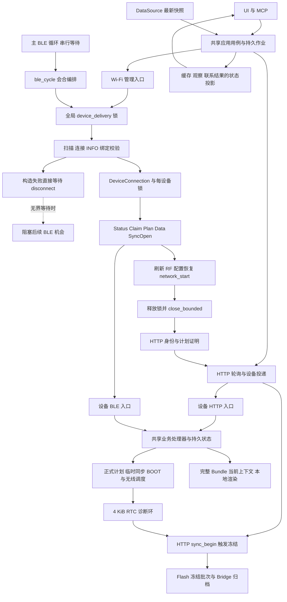
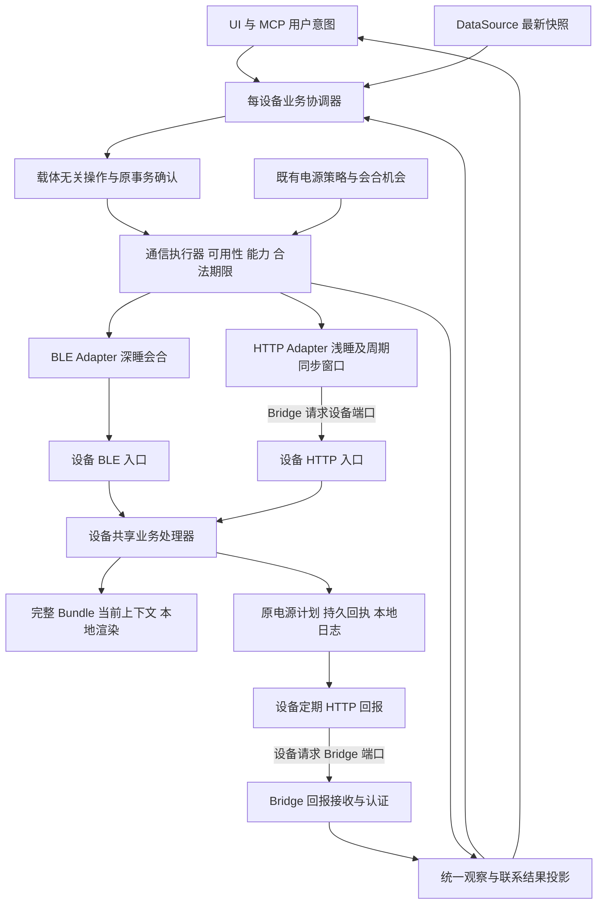

# Bridge 与设备协议架构复核及重新设计

2026-10-12；关联 backlog B6/C8。基线为 HEAD `e468b3ac3f0b43498f113434c992889cbe13db43` 加当前未提交工作区。本文是设计提案，不替换权威设计，不表示批准实施或已部署。

后续细化以[三层职责、状态机、错误及独立OTA设计](protocol-redesign-design.md)和[分阶段实施验收计划](protocol-redesign-plan.md)为准。用户明确最终不保留旧版协议支持；独立OTA保留简单鉴权上传，不加入Bridge业务协议。本报告的源码发现仍有效。

结论：确实存在架构问题。最突出的不是保护条件数量，而是连接生命周期、事务结果和状态证据没有各自唯一的负责人，导致上层必须理解下层的失败细节，并在多个位置重新拼接恢复流程。现有鉴权、幂等、完整快照和电源期限多数有必要保留；优先收敛职责，比统一延长超时或重写 wire 格式更有效。

## 1 范围与证据

入口为 [总体交接](overall-analysis-handoff-20261012.md)、PROGRESS 和 backlog B6/C8；对照现行平台设计、电源合同及 Bridge—设备协议，追踪 Bridge 调度→BLE 构造→业务命令→HTTP换接→事务确认，以及固件共享处理器、诊断存储和 UI 投影。

- **源码事实**：以下行号针对本次工作区；静态构造的故障路径没有冒充执行过的测试。
- **现场证据**：13:19 后扫描停止、HTTP仍服务、设备继续timer唤醒，引用原取证报告；本次未读取设备或重新核验进程。
- **推断**：进程当时具体停在 connect 失败后的 disconnect 是高置信推断，仍缺运行栈；首次连接失败原因未知。
- **部署**：交接记录设备为 0.18.83-note4，0.18.85及分类修复Bridge为候选。当前源码不能代替现场版本。
- 本次只做静态审查与文档记录；未构建、运行测试、启停Bridge、烧录或提交。不是全仓安全审计，也没有证明所有协议分支正确。

## 2 当前实际架构

图中 BLE 锁不是覆盖全部HTTP尾部：正常路径在清理前释放，再按需取得每设备锁。问题在于构造失败根本到不了这一出口。Wi-Fi即时维护入口还会先取得每设备锁再建链，影响范围比自动会合更大。

权威设计 §2 已要求每设备串行、不同设备独立失败、共享BLE有界公平调度。当前实现具有相应的锁和共享处理器，但尚未形成能保证这些性质的完整执行单元。它是部分实现偏离既定设计，同时也暴露了设计没有把取消、构造失败和原生回调所有权定义到底。

## 3 复核发现

### 3.1 P1 连接生命周期没有统一出口

`bridge/crates/ble/src/lib.rs:1067,1104,1110,1122,1137` 的五类构造失败都直接 `disconnect().await`。此时还没有成功返回 DeviceConnection，因此成功路径的 `close_bounded` 不能保护它们。`app/rendezvous.rs:61` 已持全局锁，`app/main.rs:3484` 串行等待整轮。

扫描的三秒也不等于完整扫描有界：`ble/lib.rs:256,273,296,326,366` 中期限主要包住 `events.next()`，没有统一覆盖 start_scan、events、peripheral、properties、stop_scan。`token_link_info:561` 的初次INFO读取在业务十秒预算之外。显式配对的较长等待应与普通自动会合分开。

本地 btleplug 0.11.8 的 `corebluetooth/peripheral.rs:266` 等待disconnect reply，而 `internal.rs:856` 在外设不在map时未完成该reply。源码支持永久pending的可能性；不能据此声称取得了现场卡栈。

**架构原因**：调度器持锁、连接层持外设、调用者负责正常close，但构造失败和取消后的资源无人统一负责。单命令有timeout推导不出整轮会返回。

**修复方向**：一个连接生命周期 Module 接管扫描、构造、失败和正常收尾；其 Interface 保证在截止内返回结果或标记适配器失效。所有调用者都经过这一出口。Rust future超时仅停止等待，不证明CoreBluetooth请求被撤销；迟到回调必须按连接代际隔离。

### 3.2 P1 查询失败会被当作原操作拒绝

`bridge/crates/core/src/platform/service.rs:663–682` 中 trial/activate 对 `job.sent=true` 查询原result，但随后任意 `ok=false && error!=storage_unknown` 都调用 `wifi_definite_rejection`。该函数在 `629–632` 清除 `sent/may_have_committed`。

可静态构造路径：原trial已发且结果未知→查询result→设备 `src/wifi_management.inc:128` 因存储初始化失败返回 `error=storage`→Bridge把作业改failed并清除可能提交标记。查询失败没有提供原写未提交的证据。若返回属于waiting类别，还可能重新走发送原ID的分支；设备回执/围栏通常能阻止重复执行，本文不声称已证重复提交。

同函数对sync/recovery_save的已发查询分支，以及HTTP异常处理，已经更保守。这是同一不变量在不同业务分支重复实现后产生的漂移。

**修复方向**：明确分开 `OriginalWriteReply` 与 `ResultQueryReply`。只有原发送被证明未发、原写确定拒绝或可关联的原事务拒绝回执，才改变对应提交判断；查询本身失败只能记录此次查询失败，不能回退原事务状态。

### 3.3 P2 事务隔离键在不同层不一致

现行协议要求 principal+namespace 隔离。`src/wifi_management.inc:135` 的result及 `src/wifi_setup.cpp:335–337` 的trial/activate按该维度查找；但 apply在 `wifi_management.inc:164–165` 先按bridge+request命中，再将不同namespace判为冲突，`src/wifi_storage.inc:79` 也拒绝同bridge+request的不同namespace记录。

静态反例：namespace A已有某序号，namespace B在独立空间使用同序号。查询/部分命令认为它们不同，apply/持久校验却认为重复。当前Bridge按设备递增分配ID降低触发概率，但不消除协议差异。

**修复方向**：所有查找、去重、指纹、存储校验、回执ACK共享同一 `TransactionKey(principal, namespace, request_id)` 定义；不要通过取消namespace隔离解决。

### 3.4 P2 历史观察被升级成当前事实

`app/platform.rs:525–536` 的contact_state只把新attempt中的blocked/mac_mismatch单列，offline不能覆盖旧sleep推断；旧 `power.mode=sleep` 足以持续显示预计休眠。`app/ui/index.html:1287–1295` 用缓存http_ready生成当前Wi-Fi文案，没有按年龄判断。`core/platform/wifi.rs:140–147` 的confirm_http不更新时间，HTTP证明也没有独立采样时间。

已有 `platform.rs:467–494` 的跨boot检查和字段采样时间有价值，不能说当前完全没有新鲜度设计。问题是观察、最近失败、调度器是否继续运行没有作为独立事实输出。

**修复方向**：一个共享投影 Module 输出最后设备观察、最近联系结果、调度健康及有期限的电源预期；UI和MCP共同使用。读失败不删除上次值，也不让上次值继续冒充在线证明。

### 3.5 P1 故障证据保存依赖故障恢复

`src/v2_sync.h:23–41` 定义4096 B RTC环，`v2_sync.cpp:195–215` 每条占24 B头加最多96 B载荷，满时淘汰最旧记录，不受上传ACK保护。`v2_sync_protocol.cpp:129,158–181` 在sync_begin时冻结；HTTP注册在 `firmware/transport.cpp:1045`。40 KiB预留和16 KiB最大blob（`v2_sync_store.cpp:10–13`）服务于冻结批次，不是持续离线日志。

报告中2393 B/567.1 s样本外推：4 KiB约16.2分钟，两小时约30.4 KB原始记录。最大120 B记录仅能容纳34条；没有写入率上界就没有保留时长保证。降低初始化噪声有帮助，但不修复保存时机。

**修复方向**：本地记录与上传分离。RTC作缓冲，重要失败、容量阈值及睡前触发有界Flash提交；上传读取已存段，落盘验证后ACK。明确保留的是全部原始事件还是受控摘要；有限空间不能承诺无限故障事件全保留。

### 3.6 P2 诊断持久格式依赖原生布局

`src/v2_sync_store.cpp:15–55` 的Meta内含SyncStoreBatch，按sizeof直接读写，CRC按offsetof计算。已有MAGIC、CRC、双槽和读回校验，但仍依赖编译器布局；SMS1标识不能代替显式字段编码和长度边界。这与当前AGENTS的持久格式要求冲突。

应独立迁移为明确版本/长度/逐字段格式，验证后才退役旧格式，保留原子性与读回。不是本次失联的已证原因，也不应在修disconnect时顺带重写存储。

### 3.7 P2 测试接缝绕过了最危险的生产路径

`ble/lib.rs:984–1030` 的Fake入口经HTTP取INFO后直接构造 `peripheral=None` 返回；真实scan/connect/setup在后面。`app/platform.rs:2900` 附近已有close挂起回归，但覆盖的是成功构造link后的清理。

因此“错误文案正确”“协议Fake通过”“成功路径close有界”都不能证明真实建链失败后仍会扫描。应在原生backend操作处设窄 Seam，使生产Adapter与故障Adapter走相同生命周期控制流；原HTTP Fake继续承担固件业务合同验证，无须替换成庞大模拟器。

### 3.8 旧active_protected失败更像用例落后

`tools/test-wifi-management.cpp:123–125` 已增加other bond的第二个配置，`:196–198` 仅删除原bond的active保存行却仍要求active_protected。生产 `src/wifi_management.inc:239–245` 明确允许在另有配置时删除保存行，并保留live active副本直到显式激活。

静态核对支持“旧断言过严”的解释；本次未执行测试。应拆成仅剩唯一配置时拒绝、存在其他配置时允许且当前连接副本不变两项，先与产品合同核对，不为让旧测试绿而回退多来源管理语义。

### 3.9 P2 取消执行意图也终止了确认义务

`core/platform/wifi.rs:224–228,291–295` 把cancelled/expired列为terminal且不再runnable；`:447` 拒绝对过期/终态作业确认回执。同时 `:220–222` 正确禁止退役仍可能提交的记录。这样安全围栏还在，但自然机会的正常执行路径不再查询/收敛原结果，可能长期占用账本。

设备侧 `src/wifi_setup.cpp:597–610` 在trial/activate前持久记录pending；重启失去live transaction后，`wifi_management.inc:138–148` 返回unknown且拒绝ACK退役。它符合“不把未知冒充失败”的安全合同，却缺少持久最终结果或可证明的中断终态；有限回执容量可能被逐渐耗尽。

这是**安全与活性没有同时闭合**的设计问题。用户取消/过期应停止新副作用；已经发送的确认义务应独立保留，借后续自然窗口有界query-only。能证明终态时持久记账并ACK，不能证明时明确呈现未解决义务和容量影响。不能为释放空间自动删未知，也不能为确认义务无限保持射频在线。具体中断证明与恢复出口需要新合同，不声称当前设备已经支持。

## 4 哪些复杂度必要 哪些可以消失

| 机制 | 判断 | 收敛方式与删除条件 |
|---|---|---|
| MAC、绑定加密、token、owner、session | 必须保留 | 放在可信入口/shared handler；Bridge预检不替代设备校验 |
| 原事务ID、回执、重放高水位、revision/context检查 | 必须保留 | 统一事务键与结果类型；不能靠重试覆盖未知 |
| 分片写不确定后禁止复用链路 | 必须保留 | 由载体Adapter提供发送证据，业务只处理结果 |
| BOOT、正式PowerPlan、临时传输、USB、RF期限 | 物理/授权含义不同 | 保留不同来源，集中计算一次有效预算；不能粗暴合成一个可续期计时器 |
| 五处分支断连及上层drop/close组合 | 可合并 | 生命周期Module承担全部出口后删除调用者重复收尾 |
| 多层字符串错误归类 | 可合并 | 内部使用阶段、发送证据、业务结果、恢复动作；最后一层才投影有限错误码 |
| 设备JSON中 `_sent_plan/_sync_open_unknown` 等本地旗标 | 可替换 | 原始设备观察只读；本地会合上下文用类型表达合法状态 |
| sync FnMut 与异步BLE之间线程/通道往返 | 可收敛 | `app/wifi.rs:744–767` 的spawn_blocking/mpsc/sync_channel源于同步事务核；纯状态转移加异步驱动即可，无需新crate |
| 旧wifi_management版本分支 | 删除 | 用户明确不保留旧协议；移除`app/wifi.rs:560–580,796–840`等旧分支，旧软件明确拒绝；持久凭据/未知回执另行安全处理 |
| Windows首次connect重试、重发现服务 | 暂保留 | 有平台证据；按失败类及剩余预算收归Adapter，不能盲目推广也不能凭观感删除 |
| 诊断落盘验证、批次/hash、gap与ACK | 必须保留 | 持久日志独立后再评估批次机制；未可靠替代前不删 |

“删除测试”：删去生命周期Module会把清理复杂度重新分摊给所有调用者，说明它值得存在；删去独立错误字符串转换层若仅减少反复翻译且无不变量丢失，则可以直接合并。改进目标是Locality和Depth，不是增加接口数量。

## 5 不沿用当前实现 从需求重新设计

### 5.1 用户确认的固定原则

2026-10-12用户明确：电源策略及双通道总体原则不变，重新设计仅调整职责与实现结构。

- 深睡模式按既定周期通过BLE会合，定期开HTTP窗口做一次信息同步，再按原电源规则收尾。
- 浅睡模式直接HTTP通信，不要求先经过BLE会合。
- 设备定期回报通过HTTP请求Bridge；Bridge发起的请求反向访问设备HTTP端口。两个方向各自认证和判断结果。
- 上层协议只表达设备、业务操作及成功判据，不指定当前使用HTTP还是BLE；下层总是选择当前可用且支持该操作的通道。
- 通道选择服从已有电源/RF窗口和授权，不能为了“总能找到通道”自行唤醒、续期或无限回退。暂时没有合法通道时，明确等待下次机会；不支持的操作明确拒绝。

设备本地渲染、完整Bundle、单一active context、原生OTA双槽、Bridge生成正式PowerPlan、显式发布和owner/鉴权/重放保护均保持。此前提出的“日常改为设备主动HTTP拉取、BLE仅配网恢复”不再作为本次设计方向或待验证迁移方案。

最终只交付当前协议，不保留版本协商、降级或旧命令执行。独立`/update`、`/doUpdate`及ArduinoOTA继续使用设备token和原生上传；它们不要求Bridge、owner、业务session、frame或作业。Bridge管理OTA只是可选客户端自动化，`/api/ota/image`是可选只读运行镜像证明。

### 5.2 在固定原则内重新划分职责

更好的选择是把业务语义与通信执行彻底分开，而不是改变深睡/浅睡的通信策略。

| 职责 | 拥有的状态与行为 | 不向调用者泄漏的细节 |
|---|---|---|
| 每设备业务协调器 | 冻结命令、最新快照、原事务确认、业务顺序 | GATT对象、连接清理、HTTP换接步骤 |
| 通信执行器 | 合法机会、通道能力和新鲜度、完整截止、选择与切换 | 分支级重试/断连、原生回调、分片与分页 |
| HTTP/BLE Adapter | 具体收发、身份/会话绑定、发送证据 | 不替业务决定成功、不改变原事务ID |
| 设备共享业务处理器 | 校验、owner裁决、幂等、提交与回执 | 不因载体不同而改变业务结果 |
| 观察投影与本地日志 | 样本来源/时间、联系结果、调度健康、离线证据 | 不将缓存值变成当前可达性或授权 |

上层可以提交概念请求 `execute(device, operation, original_id, deadline)`；这里的Interface不是承诺所有操作支持两个通道。下层知道Bundle/OTA等需要HTTP，BLE支持的小操作则可在合法会合内完成。无需为这一划分新增crate、通用消息总线或actor框架。

### 5.3 修订后的目标架构

这张图只重划实现职责，不新增工作拉取协议，不改变HTTP请求方向。设备回报请求的成功证明设备→Bridge方向可达，不自动证明Bridge→设备端口可达；反向请求仍须独立认证核验。回报接收与BLE扫描独立运行，BLE清理挂起不能阻止HTTP回报处理。

下层按以下规则选择通道：

1. HTTP已有可信可用机会且支持该操作时直接使用，不增加BLE前置。
2. 深睡的BLE会合内，支持的小操作可直接完成；定期HTTP信息同步按既有电源/同步计划开窗，不由普通业务请求重算期限。
3. 只有HTTP支持的操作等待合法HTTP机会；不能因为“上层不关心通道”就把Bundle等拆成未定义的BLE操作。
4. 确定未发送且尚有合法机会时，可以选择另一可用通道；已发送而结果未知时，换通道只确认原事务，不重发新ID。操作专属幂等规则仍由业务合同定义。
5. 每次尝试有完整截止，清理也包含其中。切通道不重置业务期限、RF期限或电源期限；所有通道不可用则明确返回等待/失败原因，不形成无限回退链。

“可用”包含当前方向的认证身份、有效会话、操作支持、预算及发送安全性，不只看缓存connected或TCP能连。owner等业务前提仍由设备处理器最终裁决，Bridge预检不替代它。实际发送结果更新下层观察，上层只获得统一业务结果及可操作反馈。

### 5.4 载体无关的事务模型

只保留三类真实需求：

1. **最新数据快照**：按active_context+seq识别，一次发送冻结完整字段及指纹；ACK仅确认该包。可合并尚未发送的新值；发出后不偷换同序号内容。未知先查原序号/状态，不用新ID掩盖。
2. **控制命令**：发布、激活、配置、OTA及正式PowerPlan等冻结意图，来源为用户显式动作或已授权自动策略，稳定事务身份，确定终态或未知。命令不能像数据快照一样被后台静默覆盖。
3. **观察与诊断**：只读事实、时间、boot/代际及来源，不赋予owner、发布许可或电源续期。

概念上的结果 Interface 为 `(stage, dispatch_evidence, operation_outcome, recovery_action)`，不是把所有错误压成一个success布尔。发送证据区分未发、写入未知、完整发出；业务结果区分拒绝、接纳未完成、已完成、未知。无需所有字段都变成wire字段；Adapter负责证据，事务Module负责动作。

查询超时只终结本次尝试；未知事务可以继续存在，但不占连接或锁，也不无限显示“正在发送”。原操作的确定权限拒绝/修订冲突，或未发送意图的缓存过期，进入明确终态或需要用户处理的状态；若这些错误发生在查询已发送事务时，只记录查询失败，保留原事务未知。换载体重开session不改变原事务身份。

执行意图的期限与确认义务的期限分开：取消不等于撤销已经提交的设备操作。过期后只停止新写入，仍可在自然联系时确认原ID；界面同时说明“执行已取消，原操作结果仍未知”。这也避免通过增加超长作业TTL掩盖账本无法收敛的问题。

同一通信机会可以执行多个操作，但不新增批量工作交换端点，也不承诺Plan/Data/Bundle跨域原子提交。每项沿用自己的ID和回执；部分成功按真实结果恢复，不能重做整轮而延长Plan。新的会合session和connection generation不是新的业务请求ID。

### 5.5 生命周期与实现边界

Bridge保留当前crate布局，收敛为三个有明确责任的Module：

- **每设备协调器**：持久命令、最新快照、准入集合、结果状态。设备级业务串行；不持有原生BLE句柄。
- **通信机会执行器**：HTTP直达或BLE机会选择、整体截止、RF上限、连接代际、有限清理；BLE独占许可只覆盖射频资源使用，HTTP尾部交回对应设备执行，不继续阻塞全局扫描调度。
- **观察投影**：统一设备样本、最后尝试、预期与调度健康。UI和MCP不自行猜测。

已有设备共享handler值得保留：`firmware/radio.cpp:652–665` 的HTTP和 `firmware/transport.cpp:787–800` 的BLE均进入wifiControlCommand；`radio.cpp:435–439` 集中构造权限上下文。这部分不是必须推倒的负担。

机会截止覆盖排队/锁等待、扫描、建链、业务和收尾；每阶段额度仅用于更紧的限制与归因。分别维护正式电源、BOOT人工、临时传输和RF截止，计算执行上限，不允许调用者重新起算。给清理预留额度，超时后的设备结果保留unknown，原生句柄作废。适配器恢复也必须有限、可观测，不能不断spawn新的挂起任务。

业务状态转换可写成小型纯函数，外部异步驱动执行效果；只有HTTP/BLE/故障注入实际变化的地方才设Seam。这样一次修复能覆盖所有调用者，测试直接跨生产Interface验证生命周期，提高Locality，不机械增加模块文件。

### 5.6 诊断保留的资源取舍

新设计把“离线保存”作为设备本地职责，把“同步确认”作为独立传输职责。按实际条目编码、CRC/长度/版本验证、分段原子提交及读回，原始文本与关键摘要分别限流；重复同类失败保存首末时间和次数。

示例预算仅用于设计：若固定每分钟最多64 B摘要，两小时为7680 B，另需突发、格式、索引及回收余量；这不等于8 KiB Flash就足够，也不承诺保存所有原始日志。RTC只需一个有界写缓冲，Flash实际分配按条目增长，不预留空仓库副本。

实现前必须给出空/单条/典型/上限的持久字节与RAM/栈峰值，以及真实擦写次数、写入时延/能量和掉电恢复；目前这些值未知。只写明日志容量，不定义最大事件率和淘汰规则，无法验收“两小时”。

## 6 验证顺序

**本次建议**：保持用户确认的电源/双通道原则，集中修生命周期、事务结果和职责泄漏。验收关注同一业务在不同合法通道上的结果一致性、失败后继续工作，以及原电源截止不变；不再安排HTTP拉取替代BLE的原型或迁移评估。

| 顺序 | 工作及完成条件 | 关联 |
|---|---|---|
| 1 | 统一建链失败/成功/取消收尾；注入connect失败+disconnect pending，有限返回、锁释放、下一次生产扫描入口执行、HTTP仍可用 | B6 |
| 2 | 修原事务查询失败语义及TransactionKey一致性；查询storage/session/401均不能抹未知围栏，跨namespace分别去重；取消/过期后原事务仍有有界确认出口 | B6 |
| 3 | 三类状态投影；旧connected、后续HTTP失败、BLE调度停滞可以同时准确呈现，UI/MCP一致 | B6/C8 |
| 4 | 设备本地离线摘要/日志持久化与显式格式迁移；两小时断网、重复故障、掉电、容量边界及gap都有证据 | C8 |
| 5 | 深睡BLE会合与周期HTTP同步、浅睡HTTP直达、设备HTTP回报与Bridge反向请求分别验收；业务层不分通道，故障换接不重发未知写、不续电源期限 | B6/C8 |

这些是既有backlog下的实施顺序与验收标准，不新增独立待办系统。原有分类候选仍有价值，不能因为这里建议重设计就把候选当作无效；也不能因为候选测试多就跳过上述门槛。

最小故障矩阵还需覆盖：start_scan/stop_scan pending、外设移出map、discover/身份验证失败后的清理、锁等待耗尽、分片取消、迟到ACK、HTTP跨boot/MAC、原写未知后查询失败、两个设备一坏一好、Bridge重启后原ID恢复。每项同时断言结果语义与后续可继续工作。真实CoreBluetooth、RF、ESP32网络、Flash掉电和功耗由实机证明，Fake不能替代。

## 7 审查结论

防御代码多而关键失败仍漏掉，是因为当前Interface要求调用者同时理解资源回收、传输证据、业务提交、RF窗口和状态投影。进一步把每个分支包timeout只会继续复制这些知识。

更好的选择是保持既有深睡BLE会合/周期HTTP同步、浅睡HTTP直达及双向HTTP请求原则，让连接生命周期、事务结果、观察事实和本地日志各有唯一负责人。业务层始终面对载体无关的操作；通信层集中选择合法可用通道并负责有限结束。减少的是各层重复理解和修补下层故障的负担，同时保留必要的双通道能力与协议保护。
