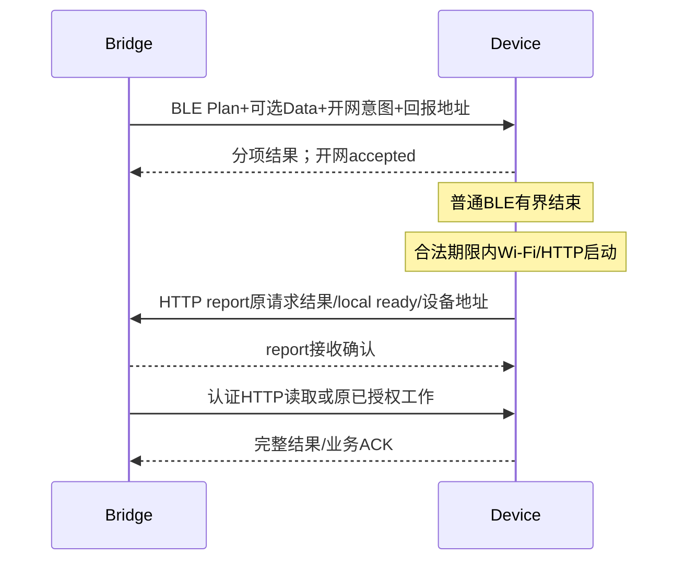

# Bridge—设备精简信封与 HTTP 回报实施计划

日期：2026-10-08。状态：P0–P5已接工作树生产路径，Fake ROM可靠性验收进行中。**当前不能部署**：设备主动report sender→Bridge接收器→设备认证回读的同一Fake网络闭环及实机验收尚未完成；Fake用loopback监听，生产接收器正确拒绝loopback源/设备IP，现有分层测试不能替代该闭环。BLE丢ACK旧属性无节流造成的Windows合成loopback socket 10048已以有界20ms轮询修复，app完整回归73/73；同源Fake 57/57且两个显式app→Fake集成各1/1。匹配Note4 ELF静态栈门禁全PASS，包括无条件要求真实BLE dispatcher符号、976/1024 B单帧与3440/4096 B列出本地链。待办唯一来源为 [backlog A9](../../docs/roadmap/backlog.md#a9-powerplan-与-data-同轮联合下发2026-10-05) 及 B6/C4/C8；本文件定义实施顺序和门禁。

### P0 冻结值（2026-10-08）

- 固定48 B信封及大端偏移以 `docs/bridge-device-compact-envelope-design.md` §2为准。业务op登记：1 Status、2 Data、3 Plan、4 Claim、5 Renew、6 SyncBegin、7 SyncPage、8 SyncAck、9 SyncComplete、10 BundleBegin、11 BundleChunk、12 BundleCommit、13 Activate、14 WifiSnapshot、15 WifiApply、16 WifiResult、17 WifiResultAck、18 WifiCommand、19 OtaImage、20 ReadyReport、21 BusinessQuery、22 NetworkStart、23 SyncConfig、24 SyncOpen、25 History、26 WifiOwner、27 WifiInfo。未登记编号拒绝；路由与编号必须一致。结果0 applied/completed、1 accepted、2 rejected、3 unknown；拒绝/未知的stage、error、原业务查询入口在payload。request/report的result必须为0。
- HTTP `Content-Type: application/vnd.codex-status.frame`；完整帧长度严格为48+payload_len。BLE属性上限512 B，普通BLE完整帧上限8192 B，Wi-Fi完整帧上限4096 B；长度先验后按需分配。每方向仅一条未响应请求，每方向保留最高已接纳号及最多一份结果（含摘要），完整缓存上限512 B；超出时只留摘要及原业务查询入口，不把会话缓存当持久回执。同号同内容且结果仍保留才回放，否则retired；同号异内容拒绝；明确响应包括accepted即释放消息槽。
- BLE认证控制交换绑定实际加密peer、连接代次、完整MAC、principal、设备boot nonce与当前context；断线失效。HTTP Bridge→设备仍逐请求校验既有endpoint/operation token，再建立并检查独立随机session绑定；设备→Bridge报告经现有Bridge bearer只获hint提交权限，HTTP新session绝不继承旧BLE授权。原BLE session/request只作历史关联；业务结果仍须设备认证HTTP回读或原事务查询。会话ID本身不授权。初版同一设备最多一个当前BLE会话和一个当前HTTP会话，过期/重启/凭据变更时按需替换，零会话不分配工作区。
- HTTP Status/OTA认证开会话请求在session槽带客户端本次独有的16 B打开标识，OTA初次打开还使用固定业务载荷`{"open":true}`区分重启后的旧server session；设备响应改为服务端随机session。相同打开标识+相同请求仅在结果仍保留时回放，否则retired，同标识异载荷拒绝。新打开标识建立新会话，不重用先前BLE会话；打开标识和服务端session均不代替逐请求凭据。BLE Status仍使用零session并由绑定连接代次建立会话。
- ReadyReport 业务载荷固定字段为 `device_mac`、`boot_id`、`principal`、`instance_id`、`origin_session`、`origin_request_no`、`business_id`、`context_id`、`ip`、`port`、`http_ready`、`plan_result`、`data_result`、`network_result`、`remaining_ms`；本报告的session/request_no只从48 B头读取。接收路径要求源IPv4=载荷IPv4、同会话源地址、business_id=本地冻结Plan ID；响应仅 `report_received` / 结构化拒绝。重复同一报告不创建新任务；接收器先回响应，离开接收锁后认证回读。Bridge→设备开网意图使用IPv4 4 B+实例port u16，拒绝loopback、unspecified与路由歧义；地址及原截止只驻设备RAM。报告每次开网最多3次，连接/响应各最多1000 ms，退避250/1000 ms，均夹紧设备原单调截止；Bridge只用本地截止和保守remaining，不直接比较双方时钟。
- 正式Plan与Data采用Plan-first分项结果；Data失败不回滚Plan，成功Data ACK才更新Bridge指纹。Status为稳定900 s精简投影，仅在既有合法联系机会顺带发送，不为此开Wi-Fi；Status/report只读owner，不调用ownerTouch或续Light。默认deep owner到期自然失效，下一次副作用需显式claim。

## 1. 最终职责和数据流

- 业务合同负责完整身份、owner、Data context/seq/CRC/完整快照、正式Plan期限、业务事务及真实分项结果；不会依赖BLE或HTTP角色。
- Bridge application service冻结原工作和电源意图，按能力/预算分流；已有HTTP直达，BLE够用就在交会内完成，需HTTP才给开网意图。
- 下层会话适配绑定完整身份/认证/启动会话/上下文；48 B信封编解码不重新发明业务ID或任务存储。
- 设备下层控制BLE结束、Wi-Fi/HTTP准备、HTTP report及有界重试；Bridge接收提示并经认证事实验证原工作。状态包括ble_accepted、ble_released、local_http_ready、report_received、device_http_verified、business_completed，禁止用一个ready或success覆盖全部阶段。
- HTTP接收提示不能隐式claim或创建发布作业；正式PowerPlan才改变Light期限。定期Status、owner维护、Data投递和诊断同步是独立调度需求。

## 2. 当前能力与迁移边界

| 现有位置 | 已有能力 | 本次需改变 |
|---|---|---|
| src/bridge_store.*、BLE endpoint设置 | EndpointRec存host/port/token及principal/namespace | 复用身份绑定；本轮临时回报地址放RAM，避免每次联系写NVS |
| src/main.cpp servicePresence | HTTP客户端POST presence、150ms连接/请求预算 | 原事务关联、读响应、有界同报告重试及错误阶段；避免堵塞生产loop |
| app/main.rs presence_hint、LAN router | 通知接收、认证status读回、按MAC合并机会 | report模式/入口与明确接收确认；保留旧hint语义，不能把shared bearer+MAC宣告当业务证明 |
| app/rendezvous.rs、src/rendezvous_protocol.* | 等HTTP proof后BLE handoff的旧状态机 | 更新后的设备BLE接纳后提前结束，删除旧handoff流程，不提供兼容分支 |
| core/coordinator.rs、platform service、device_client.rs | 冻结数据/计划、ACK记账、HTTP status预检 | 复用A9联合Plan请求、原事务查询和有效会话；移除每请求完整status预读的重复开销 |
| BLE DeviceConnection、ble_wire、v2_command_envelope | JSON分片、512 B响应边界、旧session校验 | 一次性替换最终编码、固定48 B、二进制分片及结果分项 |

当前Data+Plan联合执行只有计划，不能声称已实现。既有presence并非本轮所需可靠完成回报。相关能力和设备现场以PROGRESS为准；不读取私有凭据或连接设备完成本次计划。

## 3. 必须先冻结的合同

1. 采用A9已有Plan-first、分项结果、允许partial语义，外层鉴权失败无副作用。合法Plan不被Data合同错误或丢ACK阻断；不承诺跨RAM/RTC/NVS原子。Data只有实际applied才更新指纹/full_sync_deadline，绘制pending单独报告。
2. 48 B只计算信封；HTTP认证头、BLE分片头及业务payload另计。marker/op/result字段采用唯一固定格式，不重用现行拒绝字段protocol/rv。
3. session_id是标识而非凭据；明确方向认证和权限绑定，再删每消息重复身份。BLE结束后旧BLE session失效；HTTP先走独立认证控制握手，新HTTP session发送report，载荷关联原BLE session/request仅作历史引用。临时会话失效不删除业务持久事务；恢复查询原ID，不自动新事务。
4. context_ref不改变完整active_context_id。当前完整ID为16hex字符，首版槽内原样16 B ASCII并固定格式，零字节槽表示无context；其他长度明确拒绝，不截断、不引入随机alias仓库。
5. 每方向一次未决请求为初版，request_no单调且不回绕，同号异内容拒绝，每方向最高已接纳号+至多一份当前结果/摘要，request_no <= highest_accepted且无保留匹配结果时拒绝并提供原业务查询入口。收到明确响应（包括accepted）释放消息请求槽，异步业务由原业务ID管理，新编号查询不能被自己阻塞；response不占反向请求槽，跨HTTP连接由会话适配串行。跨重启业务幂等继续沿用seq/plan_id/namespace/job_seq，不能由会话缓存代替。
6. BLE释放不等HTTP成功；冻结原绝对截止，网络/report不续租；有独立物理恢复窗口则仅结束普通交会。发出BLE回执不保证Bridge收到，后续report必须能补原分项事实。
7. 900 s为稳定Status报告频率，不自动替换现行Data交会机会/owner续约/诊断15轮同步。默认深睡无需维护时允许owner自然到期，下次副作用显式claim；Status/report使用无续期权限检查。当前ownerTouch确实会续lease，须定向对齐权威合同，不能靠一个“Status不续租”文字宣称满足。

## 4. 分阶段实施及责任范围

### P0 — 文档与ABI冻结

所有后续阶段依赖P0。责任：docs协议/场景/实现对照、现有A9计划及power-state相关合同。

冻结operation/result编号、固定report schema/响应、方向认证、完整context编码与校验、请求窗口、deadline来源及ownerTouch语义。将旧handoff规则移到明确历史对照，更新当前场景矩阵；业务与载体分开。不提供历史协议或旧设备兼容，Bridge/设备分别更新软件版本，不匹配明确失败提示更新。完成判据：不存在同一版本相反的BLE关闭顺序、原子性或周期规则；每个未知结果有原事务查询入口。

### P1 — 复用A9联合请求，先验证业务语义，暂用开发编码

依赖P0。责任：core/coordinator与platform service/model、app/rendezvous、core/device_client、固件v2_plan_command/v2_data_command、main dispatcher、render同源适配。

发送前冻结Plan+完整Data；扩展既有plan请求携可选data和分项结果，先Plan后Data，不依赖Data ACK成功才生成计划。大数据只下Plan及HTTP工作意图。保留业务序号、上下文和CRC验证及原期限。不匹配的软件版本/格式明确失败，不走旧协议路径；分阶段代码只在开发验证，不作为对外双协议交付。完成判据：成功/partial/Plan拒绝/Data拒绝/分配失败/ACK丢失/重复/到期矩阵通过，原Plan期限不延长。

### P2 — 回报入口、地址与可信结果

依赖P0；P1可独立并行实施但整体验收依赖P1。责任：app/main LAN router、application service、core device_client、BLE endpoint适配、src/main servicePresence与bridge_store适配。

复用LAN监听与HTTPclient基础，定义唯一report格式及有界响应读取。通过认证BLE传Bridge可达IP/真实实例port、原请求及截止；固定report路径，设备RAM暂存。按路由选择接口，拒绝loopback/unspecified/错误实例，地址变化明确重建。保留presence hint用途；不能把Bridge共享token和MAC声明直接变为device-authenticated结果。首版保留报告为受控hint，业务结果通过设备认证回读/原事务查询核实；报告接收确认不是业务成功。若要直接接受报告中的结果，另决定设备定向凭据方案，不把共享token当设备身份证明，管理token不混用。

每次开网最多3次同report发送，连接/响应各最多1000 ms、退避250/1000 ms，全部夹紧原设备单调deadline；Bridge按自身deadline与保守remaining夹紧，不比较双方单调时间戳。具体资源上限及参数在P0冻结，不能把配置上限预分配。report_received先确认接收，再异步验证device_http_verified/真实业务结果，接收端不持交付锁做阻塞HTTP回调；同报告重复不新建任务。真实读取响应可兼作入站可达证明。完成判据：错MAC/boot/principal/实例/owner、过期报告、地址变化、共享token冒充、出站成功入站失败、回报接收ACK丢失、Bridge重启均有明确有限结果。

### P3 — 提前结束普通BLE的生命周期

依赖P1/P2。责任：src/rendezvous_protocol.*、main及ble_bridge生命周期适配、app/rendezvous。

更新后的设备分项回执后结束普通BLE，不再等HTTPproof/handoff。网络准入事实与BLE控制器生命周期分开；实际释放遵守已修复NimBLE timer/callout teardown顺序，不在BLE回调栈同步deinit，不跳过host stop/deinit门禁。网络report在原Plan/开网预算内执行；失败保留最小关联事实等合法机会查询，不能因BLE断开直接丢掉已接纳Wi-Fi任务。直接替换旧handoff，不保留双路径或降级执行。

完成判据：回执发送/丢失、自然disconnect、手动恢复窗、Wi-Fi超时、Light到期、owner失效及restart的组合通过；普通BLE释放和HTTP完成各有独立证据。原诊断freeze/page/ack/complete的任务集合及关窗顺序不被破坏。

### P4 — 固定48 B编码与会话绑定

依赖P0，先在P1–P3 JSON语义路径验收后切换编码。责任：core/ble共享编解码、device_client、固件信封/ble_wire/分片、render及device-sim适配。

显式字节序/偏移序列化；marker=0xC1/kind/op/result/payload_len/session16/request8/context16共48 B，不用struct布局、base64或hex包装。HTTP固定content type和BLE采用唯一帧格式，明确boot/connection代次失效。每方向一个组装工作区，先验证长度再分配，碎片失败/超时清代次避免拼包。Status完整属性最多512 B，其中payload最多464 B；8192/4096预算按完整帧计。

完成判据：Rust/C++固定golden bytes相同，边界长度/错误marker/无效编码、重放/同号异内容、会话/上下文切换、跨Read Blob快照、乱片/丢片及8192预算通过；不匹配明确拒绝，不猜测解码或降级。签名/压缩/通用消息总线/新GATT特征不在范围。

### P5 — 调度、迁移收尾与性能

依赖P3/P4。责任：core coordinator/app调度、设备联系机会与status投影、文档。

900 s精简Status仅报告必要变化/当前结果，contract版本不变不重传完整合同；继续按原合同提供Data联系机会和owner维护，不把15分钟当深睡唯一唤醒周期。HTTP已可用直达；小业务BLE结束；大业务有界排队等待BLE，ready后执行原HTTP任务。无业务不为Status开Wi-Fi。取消/过期不等设备回滚。最终协议交付同时移除旧handoff/JSON分支，无能力兼容矩阵；用新认证绑定替换身份校验，不能以取消兼容为由删除安全合同。

完成判据：多实例、paused、队列满、取消、Bridge重启、Data push/pull分类、合同切换、Light到期和诊断定期同步均无隐式工作/续电源；同一工作无双载体并发重复发送。

## 5. 软件、资源与实机门禁

### 2026-10-08 工作树资源证据（仅Note4候选）

软件验收现场：`artifacts/compact-protocol-final-cargo-20261008.log`记录core 128、render各测试集共53、BLE 17、app 73、Fake 57项通过；`artifacts/compact-protocol-app-fake-ignored-20261008.log`另记录两项显式app→同源Fake集成各1通过。原Note4 ROM未因Fake-only改动重编，`artifacts/compact-protocol-note4-stack-20261008.log`为上述SHA匹配ELF重新运行的栈门禁exit0。Fake的新增`same_source_rendezvous_waits_for_ble_release_and_real_ip`走生产BLE客户端、C++会合状态机及C++ Wi-Fi HAL，核验Plan/network_start accepted、DHCP无IP、BLE未释放、IP到位后释放及期限到期；此测试单独追加期限断言后再跑1/1通过。report错绑定/重复/迟到/Bridge重启及认证事实检查已有app测试覆盖；这些测试没有经过设备真实HTTP客户端和app TCP监听器同一条网络往返，仍是明确未通过门禁。

| 用量 | 新增持久字节 | 临时/线缆成本 |
|---|---:|---|
| 空仓库/无会话 | 0 B | 48 B信封常数；无session/报告内容 |
| 1会话/1报告 | 0 B | 每方向16 B session、16 B HTTP打开标识、8 B最高请求号、32 B摘要；报告地址/正文按需驻RAM |
| 典型Plan+Data/ReadyReport | 0 B | 业务JSON另计；HTTP帧最多4096 B，BLE属性512 B其中payload464 B，BLE完整重组最多8192 B |
| 容量上限 | 0 B | 一个HTTP与一个BLE当前会话；每方向最多一份512 B保留回复/摘要，超大回复只保留摘要而重放retired |

新协议不改Wi-Fi持久格式或原有作业回执，故空/单条/典型/容量上限的**增量NVS均为0 B**；原有持久仓库本身按既有格式另行验收。最新ROM静态RAM117,804 B、应用Flash1,833,063 B、bin1,881,312 B，SHA256 1BFA8CB990E378E78B3B5247E11D0FF6A7CBE4227815C345416CC8AEC9735F9E。匹配ELF栈门禁exit0：serviceV2Ble单帧976/1024 B，migration helper496/1024 B，最长已列本地链3440/4096 B，loopTask8192 B。表中线缆上限不是实机**动态峰值RAM**；String/JsonDocument/网络库分配、平台及ISR栈尚需目标运行采样，不以宿主Fake或静态链替代。

每阶段先跑对应现有Rust/core/app/ble/device-sim及同源C++测试，不镜像函数写无意义测试；Fake必须走生产状态机，不能用写死ready证明新链路。重用隔离target，不删除target/debug或运行data；首次生成目录先提权预建。无UI改动不增加UI测试；若动生产HTML，则按AGENTS执行设备页/WKWebView及窄宽截图。

资源报告覆盖无会话、单会话、典型、配置上限：48 B wire，组装payload、session/当前context绑定、摘要/结果缓存、report临时地址与持久作业分别记峰值RAM和栈。固定容量是校验上限，不预分配整仓库。临时会话/report地址优先RAM，不新增每轮NVS写；若必须改持久格式，需版本/长度/数量/CRC、读回/损坏/掉电/旧键迁移验收。真实ROM匹配ELF检查栈，并运行python3 tools/check-wifi-stack.py <matching.elf>。

仅在后续明确授权实施/构建/部署时进入硬件阶段：默认仅Note4环境，单个pio进程，保留增量缓存，记录版本/marker/ROM大小/SHA256/匹配ELF；不自动纳入1.54或其他实例。Bridge重建/替换须核对exe路径、计划任务、端口，保留data并备份，先停watchdog再停任务，成功后按规定启动。ROM发布核对登记MAC及认证运行镜像，不清dump/NVS/分区。

实机证据至少覆盖电池自然会合与USB连续场景、BLE-only不启Wi-Fi、联合Plan/Data、BLE先关闭而HTTP后ready、回报失败与入站不可达、报告ACK丢失恢复、Light到期deep、独立恢复窗口与长期NimBLE生命周期。至少10轮为初步烟测，不替代长期RF/电量验收；用整周期电量/阶段耗时与峰值资源对比旧方案，未测不得承诺提升比例。

## 6. 交付和停止条件

每个阶段提供变更、生产路径测试命令/数量/结果、错误矩阵、资源证据及剩余限制。软件通过不冒充部署完成；认证ready不冒充绘屏/发布/OTA成功。更新PROGRESS及backlog原条目，未经要求不提交。若P0身份/权限或已有合同冲突未解决，停止依赖该决策的编码，实现无关分析继续，不用新增旁路规避。

审核记录：[Astra High 文档审核](bridge-device-compact-protocol-review.md)。P0最终编号、缓存上限和认证开会话字段已在本文件及信封设计冻结；当前部署门禁是设备主动report的同一Fake网络闭环、动态资源与实机行为，而不是协议字段待定。

用户补充（2026-10-08）：协议变更不提供协议版本历史，也不为了兼容性增加分支；Bridge与设备分别更新各自软件版本。P1临时开发编码仅用于内部验证，P1–P4最终统一交付；部署窗口允许软件不匹配明确失败，不自动翻译/降级重发。固定marker替代头部version，不维护协议版本号或协商框架；业务修订/身份会话及ATT MTU协商继续各司其职。
