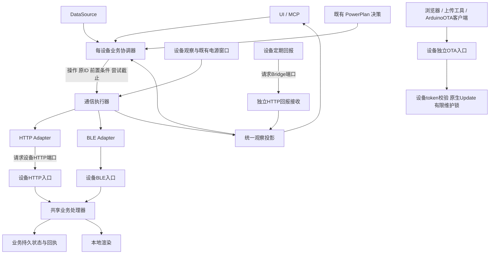
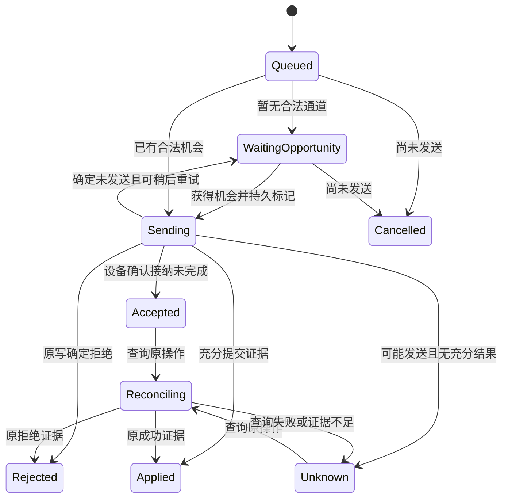
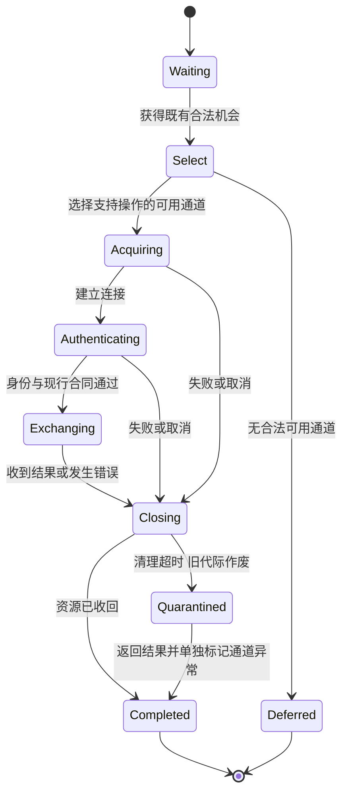

# 业务协议与通信执行器重设计

日期：2026-10-12。状态：设计完成；2026-10-12已开始P0/P1，T01查询失败保护通过宿主回归，其余目标按阶段继续，未部署。见[执行状态](protocol-redesign-status.md)。关联唯一待办 B6/C8；实施入口为 [分阶段计划](protocol-redesign-plan.md)，源码发现见 [架构复核](architecture-review-redesign-20261012.md)。本设计明确用户最新约束，细化拟议实现，不把目标状态写成现有能力。

## 1 固定原则

1. 不改电源策略：深睡BLE会合、定期开HTTP做一次信息同步；浅睡直接HTTP。正式PowerPlan、物理BOOT、临时同步、USB及RF的既有优先级与截止保持。
2. 设备定期回报请求Bridge HTTP端口；Bridge操作请求设备HTTP端口。回报不是工作拉取，不把业务操作塞进回报响应。
3. 上层只表达业务操作和结果，通信执行器选择合法、可用且支持操作的通道。设备HTTP已可用时不加BLE前置；没有合法机会就等待，不自行续电源窗口。
4. 最终产品只支持一套现行协议。删除旧协议执行、翻译、协商、降级和重试分支；不保留长期双栈或兼容开关。不匹配明确拒绝并提示更新，不能因超时尝试旧报文。
5. 独立OTA保留：`GET /update`、`POST /doUpdate`及ArduinoOTA不依赖Bridge、owner、业务会话或上层协议。保持设备token鉴权、原生上传和有限维护锁，不加48 B业务帧、事务ID、回执账本或通信执行器前置。
6. 原身份、事务围栏、完整Bundle、单active context、CompiledTemplate、原生OTA双槽、显式发布与数据投递许可不变。

“单一现行协议”不等于去掉格式校验，也不等于所有常量都改成相同数字。当前48 B frame、`wifi_management=3`及各自现行marker属于不同格式域；按唯一合同严格校验，不按数字大小或`v2`文件名决定删除。硬件容量/操作支持是能力，不是历史协议协商。

## 2 目标结构与调用方向



独立OTA不是另一版业务协议，是保留的原生维护入口。Bridge可作为普通OTA客户端调用同一上传接口；Bridge自己的排队、镜像预检和重启核验不会变成设备OTA入口的要求。

## 3 三层职责与所有权

| 层 | 负责 | 持有 | 禁止承担 |
|---|---|---|---|
| 上层业务协议/协调器 | 业务顺序、冻结控制意图、数据合并、原事务结果、确认义务、用户反馈 | 持久任务、TransactionKey、请求内容摘要、设备context/合同、确认进度 | 选择GATT/HTTP、取得裸外设、手工close、依据底层错误字符串猜是否发送 |
| 通信执行器 | 通道选择、机会准入、每次完整截止、有限切换、连接生命周期、按设备调度 | 本次Attempt、通道证据、有限资源许可、连接代际 | 改写业务ID/内容、重算PowerPlan、把连接成功当业务成功、无限恢复 |
| HTTP/BLE Adapter | 现行编码、身份/会话绑定、分页/分片、请求关联、收发证据、取消及有限close | socket或peripheral、当前session/request_no、接收缓存 | 自动换载体、业务重试、创建claim/Plan、更新业务确认指纹 |

设备入口只做载体认证/解码和请求上下文构造；共享处理器负责owner、revision/context、原子提交与回执。不要把同一权限/业务状态机分别写在HTTP和BLE handler。

实现继续使用现有core/ble/app/render/mcp crates。先形成接口和唯一调用路径，不机械按概念新建crate、数据库或通用消息总线。

### 3.1 调度与锁

- 每设备一个有界业务执行队列，同一设备的冲突写串行。每设备最多一个活动尝试；未知业务事务不持锁等待，阻止哪些后续写由业务冲突关系决定。
- 不同设备独立运行；既有全局串行HTTP轮询也要拆成有上限的独立设备调度，避免一台慢设备推迟所有设备。到期事件合并，不无限排队。
- BLE适配器需要独占许可，范围仅为扫描/连接/收发/有界清理。不得持有全局BLE许可等待HTTP回报、HTTP证明或诊断同步。
- 执行顺序固定：先得到本设备执行权，再等待BLE许可；发现扫描独立时只发布候选，不在持BLE许可时反向等待设备锁。所有等待消耗本次截止。
- 适配器在旧链路未清理时不可冒充空闲。清理超时则作废旧代际、标记适配器健康异常，进行一次有界恢复；不证明可恢复就明确暂停BLE并保留HTTP服务，禁止无限创建挂起worker。
- 回报接收只验证并发布观察，不等待设备业务执行权；因此设备回报不会与正在等待回报的操作形成死锁。
- 同步HTTP代码若暂保留spawn_blocking，必须有限worker、底层socket总截止及在途标记；外层future取消不能释放仍在写入的同设备执行权。最终只有已退出worker或已关闭且不可再写的socket才可释放传输在途状态。

## 4 上层业务协议

### 4.1 操作与成功判据

| 操作 | 成功证据 | 未知时的确认方式 |
|---|---|---|
| ReadStatus / ReadWifiSnapshot | 认证MAC/会话及完整一致快照；分页绑定同一快照 | 重新进行有界只读请求；不发布部分页 |
| Claim / Renew | 设备明确确认当前principal及有限lease | 认证读取owner及期限；不能由普通业务隐式claim |
| SetData | 当前context、原seq、内容一致的applied证据 | 原context/seq及操作定义的应用证据；不单凭“序号更大”确认原内容 |
| SetPowerPlan | 原plan_id/参数已保存，返回真实剩余期限 | 查询原计划；不换ID延长窗口 |
| PublishBundle | 原冻结job完成完整校验和提交、新context | 查询原安装状态/完整内容身份；网络传完不算发布成功 |
| ActivateTemplate | 原请求完成且返回新context | 原请求回执或合同允许的充分状态证明 |
| ApplyWifiConfig | 原TransactionKey对应的持久committed回执及revision | query原事务；不能只凭配置看起来相同猜测成功 |
| TrialWifi / ActivateWifi | 接纳与最终连接结果分开；终态可持久查询 | 原事务结果；进程/设备重启不得把pending变成功 |
| SyncDiagnostics | 本机内容落盘校验、原批次ACK/complete | 原批次及游标；未采集和已确认gap区分 |
| Bridge管理的固件更新 | 独立OTA上传结果，再认证验证重启后的运行镜像 | 只读核验运行镜像；丢上传响应不自动再次上传 |

最后一项是Bridge客户端用例，不把独立OTA升级成事务协议。`/api/ota/image`仅是可选的只读运行镜像证明，不是上传接口，也不是手动OTA前置。

### 4.2 概念接口与身份

以下为内部设计接口，不新增wire包装：

```text
Operation = {device_mac, kind, business_identity, frozen_payload, preconditions}
AttemptLimit = {absolute_deadline, cancellation}
execute(Operation, AttemptLimit) -> AttemptResult
query_original(OperationIdentity, AttemptLimit) -> AttemptResult
```

- HTTP/BLE选择参数不出现在业务请求中；支持哪些载体由当前操作表定义。
- `TransactionKey = principal + namespace + request_id` 在Wi-Fi去重、查询、存储和ACK中使用同一定义。Data的context/seq、Plan的plan_id仍保留其必要语义，不强行换成一个万能ID。
- request_no/session用于一次载体交互，不能替代跨连接持久业务身份。重连重新认证不会创建新业务操作。
- 控制命令入队冻结意图；数据只在未发送时可合并，发送前冻结seq与内容。持久标记成功后才允许发送；无法保存标记则NotSent。
- 正式PowerPlan由既有决策生成业务意图；通信执行器只执行。SyncOpen/network_start属于下层会合机制，只能消费已授权的窗口和计划，不能自己生成正式计划。

### 4.3 业务状态机



该图描述业务结果，不是长期占用worker的运行循环。Reconciling的一次查询结束后立即释放本次资源，下次自然机会才继续。

作业另有独立 `execution_intent=active/cancelled/expired`。取消/过期停止新的副作用，但不抹去 `outcome=unknown/accepted`；独立确认义务仍可query-only。界面可以显示“已取消继续执行，原操作结果待确认”。确定拒绝/冲突/缺输入不是无限自动等待；只有明确可恢复原因进入WaitingOpportunity。

### 4.4 回执生命周期与重启

- Bridge收到终态先持久保存，再发送result_ack；设备退役回执但保留对应principal/namespace高水位。ACK丢失可重复确认原回执，不能重新提交原写。
- Wi-Fi保存等持久变更与回执在同一原子提交中形成，查询错误不能改变原写结果。
- 对新实现的trial，开始前持久记录原ID、不可复用的boot代际与“无持久配置副作用”的执行类型；重启能证明旧代际执行已终止且不会恢复时，保存明确interrupted终态。它只证明该次临时尝试已结束，不证明断电前从未成功联网，也不能报告试连成功。
- 对activate，保持现行“联网成功后才提交新active，失败恢复旧active”的顺序；不改成先持久切换再试连。成功后的active变更必须与该阶段回执原子绑定；重启后当前连接状态是另一次观察。pending恢复时有原ID的提交证据则准确报告持久激活已完成、当前网络重新核验；有原子存储证据证明未切换才能记未应用的中断。存储损坏或证据不足仍Unknown。
- 旧数据中的pending不能追认成上述有证据终态。不得因为“不兼容旧协议”而清空这些回执或围栏；保留为未解决记录，明确占用容量和恢复所需证据。
- 结果容量用尽时拒绝新控制写并报告capacity；查询与安全只读仍可进行。不能自动丢未知记录来让测试通过。

## 5 通信执行器

### 5.1 机会与期限

一次Attempt只使用现有观察及现行策略授权。电源模式不是单独的“在线”布尔：正式light期限、临时HTTP窗口、BOOT人工窗口与RF上限均需保留其来源。有效尝试截止为调用者截止、当前操作准入截止、当前RF/会话截止的最早值；连续USB仍受本次尝试截止限制。

排队、发现、连接、认证、分页、收发、收尾都计入同一个绝对截止。子阶段只可收紧，不能重新起算。必须为close留出有限额度；如果剩余预算不足以安全发送则NotSent。合法Plan/SyncOpen确实改变了设备RF阶段时，以同MAC/同醒次认证观察更新对应RF证据，不能沿用旧INFO，也不能因此重置上层尝试截止。

周期HTTP信息同步由既有调度触发。业务队列可提供待办需求给现有PowerPlan决策，但“通道不可用”不直接生成新的Light计划。深睡等待期间没有合法BLE/HTTP机会时明确等待，不通过不停扫描/建链补偿。

### 5.2 状态机



结果在所有出口保留发送证据。Closing失败不覆盖已经得到的Applied；附加cleanup_error并报告通道健康异常。反之close成功不能把Unknown变失败或成功。

通道切换由执行器统一决策，不能由Adapter递归调用另一Adapter：

| 当前事实 | 允许的下一动作 |
|---|---|
| 确定NotSent，尚有预算且另一通道支持 | 释放原资源后在同一尝试截止内切换一次；无机会则Deferred |
| 部分写/写入不确定 | 作废不安全链路；本次不再发送业务写，后续可用通道只查询原结果 |
| 整帧已发但ACK丢失 | 同样保留Unknown；若协议与链路状态允许，有限只读确认原ID |
| 明确原业务拒绝 | 返回拒绝，不换通道绕过 |
| 软件/现行合同不匹配、MAC不符、凭据拒绝 | 明确错误，停止自动换接；发现其他地址不等于绕过身份失败 |
| 只有设备→Bridge回报成功 | 记录该方向观察；不能直接标记Bridge→设备HTTP可用 |

一次机会不无限HTTP→BLE→HTTP循环。下一周期是新的通信尝试，但原业务身份及结果不确定性不变。常规HTTP直达和深睡BLE会合走相同执行接口，不保留两套业务状态机。

## 6 HTTP 与 BLE Adapter

### 6.1 共同契约

```text
open(peer, deadline) -> authenticated_link | Failure
exchange(link, encoded_operation, original_identity, deadline) -> TransportEvidence
close(link, deadline) -> Closed | Abandoned
```

这是内部Seam，生产和故障Adapter跨同一接口。每次构造失败、身份失败、取消、成功都进入同一有限收尾逻辑。裸socket/peripheral不得交给UI、MCP或业务协调器。

`TransportEvidence`包含原请求关联、通道/连接代际、阶段、发送证据、认证业务响应（若有）和清理状态。Adapter可以完成当前格式的解码/字段规范化，但不能决定“下次重试哪个业务”。敏感原文不进入持久错误或日志。

### 6.2 HTTP

状态：Idle → Connecting → SessionReady → Sending → Reading → Closed；任意发送前失败NotSent，发送开始后失败保守Unknown，关联充分的业务响应才能缩小不确定性。

- 总截止覆盖session锁、TCP连接、完整写、完整读、分页；每次socket读写使用剩余预算，不能按chunk恢复完整timeout。
- 记录真实写入进度；“send函数被调用”不是全帧已发，“HTTP200”不是业务成功。401/403若来自查询，只说明查询权限失败，不证明原写拒绝。
- HTTP业务保留现行48 B frame及路由；错误状态、MAC/session/context和请求关联必须校验。缺页/截断/超限明拒，不给业务层半份snapshot。
- 成功取得新session不会自动重放前一未知写；恢复工作由业务协调器决定query-original。
- Bridge回报接收为独立入口，认证后更新有时间/boot来源的观察；回报ACK只确认回报接收，不授权其他设备业务。

### 6.3 BLE

状态：Idle → Scanning → Connecting → Discovering → Verifying → Ready → Writing → AwaitingAck → Ready/Closing → Closed或Abandoned。

- start_scan、events、properties、stop_scan、connect、discover、INFO、绑定验证均在整体截止内；不能只限制events.next。
- 显式配对是有用户动作的独立准入，普通自动会合不能偷偷进入较长配对等待。
- 分片开始前标记链路不可复用；完整写结束后才允许按协议读ACK。取消/不确定写后保持poisoned，不能用同链路发下一条命令。
- 业务ACK须关联同请求/会话/代际；迟到ACK或原生回调不污染新连接。
- 正常和构造失败只暴露一个有限close；取消Rust future不等于取消CoreBluetooth请求。隔离旧代际、有限恢复和停止堆积native工作必须可测。
- 保留已有平台必要行为（MTU分片、停扫描再连接、GATT重发现）；平台特例限制在Adapter，不传播到业务状态机。

## 7 错误模型与对外反馈

内部使用枚举/结构，最后一层才转换有限错误码及中文反馈，不再跨层解析字符串。结果分四个正交维度：

```text
stage: queue / discover / connect / authenticate / write / ack / query / cleanup
sent: not_sent / write_unknown / frame_sent
outcome: none / rejected / accepted / applied / unknown
action: none / wait_opportunity / query_original / refresh_snapshot /
        user_action / update_software / repair_channel
```

`sent`描述本次尝试；原事务outcome不能因一次只读查询的NotSent而回退。Adapter提供事实，业务状态转移根据“此次是原写还是结果查询”计算action。显示错误与原业务结果可同时存在。

| 情况 | 原业务结果 | 对外处理 |
|---|---|---|
| 排队/扫描预算耗尽，未发 | 未开始 | 本次结束，等待合法机会，给next_attempt/阶段 |
| 原写被owner/权限/revision拒绝 | Rejected或Conflict | 明确被占用/认证/重新读取；不循环待确认 |
| 写中断、丢ACK | Unknown | 原ID只读确认；不自动换ID重发 |
| 查询返回storage、401、会话过期 | 保留原Unknown/Accepted | 报此次查询原因；停止或有界恢复权限/session后再查 |
| snapshot过期 | 读失败 | 重新读取完整snapshot，保留Bridge编辑 |
| close超时但已有applied | Applied | 保留成功；另报通道清理异常，不重做业务 |
| 软件不匹配/未知op | 不执行 | update_required/unsupported_operation；无降级 |
| 用户取消已发操作 | 结果不被改写 | 停新副作用，保留确认义务 |
| 长期无法确认且账本满 | Unknown保留 | 明确未解决记录及capacity，停止新冲突写 |

观察投影统一输出 LastObservation、LastAttempt、SchedulerHealth及PowerExpectation。各自带时间/来源/boot；旧connected不等于当前可达，预计休眠不证明自动调度仍在运行。

## 8 独立 OTA 的明确边界

### 8.1 保留接口与状态机

`/update`是简单上传页面；`/doUpdate`接收普通multipart固件；ArduinoOTA维持原生协议。已取得正确设备token的客户端无需运行Bridge，不需先取得owner或打开业务session。token仍只经受控绑定BLE链路取得/轮换，不降低鉴权。

状态：Idle → Authenticating → Receiving → Finalizing → RebootPending；错误/取消/停滞 → Aborting → Idle。有限OTA维护锁只保证更新安全，不改正式PowerPlan，不因重启重新授Light。原生固件双槽保留，上传不可绕过设备更新内核的尺寸/镜像/写入检查。

禁止为OTA增加：48 B业务头、claim前置、session协商、PowerPlan前置、job_id、result/query/ACK账本、BLE换接、Bridge回报地址、工作拉取、自动分片重试协议。已有普通HTTP multipart传输与原生Update分块写入不是新增业务分片协议。

### 8.2 必要的窄修正

源码 `transport.cpp:1059–1073` 的完成handler依赖全局otaUploadDenied，token检查只在文件开始；无文件POST静态上可能返回UPDATE OK/FAILED而非401。target不符与写失败还共用拒绝标记，可能统一报401。尚未运行验证，不能称未授权刷写已发生。

在现有路由内完成小修正即可：每个请求检查token；只有收到文件且Update.end成功才能UPDATE OK；用局部上传状态区分未上传、target不符、busy、写入/结束失败。HTTP可用普通状态码401/400/409/500和短文本反馈，成功保留简单200结果；不引入新通信协议。ArduinoOTA按原生认证错误返回，不套HTTP状态码。

保留20秒无数据停滞清理（`application.cpp:342–346`）及中止后释放Update/维护锁；所有中断路径能够再次尝试上传。并发上传明确busy，不允许第二次请求破坏第一次上传状态。保留可选target检查，提供target但不符必须拒绝；不新增只有Bridge才能生成的凭据或字段。

`UPDATE OK`只表示镜像接收/结束成功并安排重启，不承诺新ROM已运行。Bridge自动化可额外使用 `/api/ota/image`读取运行分区指定长度SHA256；独立上传客户端无需使用该业务证明端点。丢上传响应由客户端明确报告结果未知，不给设备增加去重账本，也不让Bridge自动重复整包上传。

## 9 旧逻辑删除清单

路径和行号来自本次静态核对；删除必须按调用图确认最终引用，而非按名称批量替换。最终交付不残留旧协议执行路径。

| 删除项 | 当前位置 | 替代责任/删除验收 |
|---|---|---|
| wifi_management=2及缺字段降级 | app/wifi.rs:262,482–486,495,596,676 | 唯一现行合同校验；旧输入明确拒绝 |
| Permit/PERMITS、wifi_authorize、legacy_writable | app/wifi.rs:16–19,594–615,682–686；transport.cpp:806–809；wifi_management.inc:8–10,33–59 | 现行认证context和既有机会准入；无旧permit网络入口 |
| 旧直接wifi_activate及独立恢复状态机 | app/wifi.rs:560–580,781–846 | 同一个业务执行/确认驱动；原ID规则覆盖HTTP/BLE |
| 无context的旧Wi-Fi权限处理 | wifi_management.inc:269–271及WithContext双分支 | 共享处理器必需已验证context；首次配网仍由当前受控入口完成 |
| 旧UDP触发Pusher.cycle_once后备循环 | app/main.rs:3500以后 | 注册设备调度与现行绑定入口；UDP仍作当前发现提示 |
| 缺ble_wire放行、旧Wi-Fi大小分叉、缺ble_claim跳过及弱化醒次校验 | ble/lib.rs:905,1336,1424；app/rendezvous.rs:26,473,609 | 一次验证当前固定合同；移除旧版宽容，保留完整身份/醒次/ACK关联 |
| 五处构造失败裸disconnect和无界close API | ble/lib.rs:1067,1104,1110,1122,1137,1589 | Adapter统一有限收尾；真实建链故障注入验证 |
| 上层手工drop/close与恢复旗标拼装 | app/rendezvous.rs:339–468附近 | Attempt上下文及执行器唯一出口；设备原始JSON只读 |
| 同步事务核到异步BLE的双通道往返 | app/wifi.rs:744–767 | 纯业务状态转移＋异步执行驱动；无需每操作新线程 |
| 重复错误字符串解析/状态文案推断 | core/rendezvous.rs、app/platform.rs、app/wifi.rs、UI | 结构化结果＋共享投影；保留有限公开错误码 |
| 旧命令别名/旧payload成功路径与对应正向fixture | transport分派、BLE编解码、Fake及工具 | 唯一操作表；旧输入仅拒绝，不翻译；负向拒绝测试保留 |

固件只保留一个通用unknown/retired拒绝出口，无需为每个旧命令保留执行handler。`wifi_migrate`旧存储迁移命令不进入最终在线协议：现有数据如确需迁移，在发布前选定并验证一次性转换方式（独立工具或受控数据迁移步骤），不假定工具已经存在，最终ROM/Bridge不提供旧协议入口。未决记录的完整TransactionKey、内容指纹、未知状态及高水位必须进入最终软件能识别的保留表示；仅备份旧blob不等于仍能阻止冲突写。无法建立可执行围栏时阻止该设备新业务写并保留原数据，不能清空凭据/围栏后继续。

**不删除**：当前48 B frame、现行sync/Data/Plan、owner与会话校验、MTU协商、设备token流程、固件分区与原生OTA、完整snapshot分页、独立HTTP回报、UDP发现、当前持久数据和原事务证据。`device_client::wifi_request`仍被现行snapshot调用，不按函数名删除；先收敛调用再决定是否移除多余包装。

旧协议不支持与旧磁盘记录处理是两件事。升级前冻结写入、保存私有备份和未确认清单；只保留经过校验的现行持久格式，必要的一次性数据转换不成为在线协议双栈。未知格式明确拒绝并保留原文件，不静默初始化空库。

## 10 验收判据

最终验收必须同时证明：上层同一操作能在合法HTTP/BLE机会执行且结果一致；一次失败不会停止下一轮调度；未知结果永不被查询失败/取消抹掉；没有旧协议成功执行或降级；独立OTA在Bridge关闭且无业务owner/session的情况下仍可正常鉴权上传；所有电源截止与当前策略不变。

单次命令超时、Fake业务测试、UI合成IPC或编译通过都不能单独证明上述性质。具体阶段、任务和故障矩阵见实施计划。
